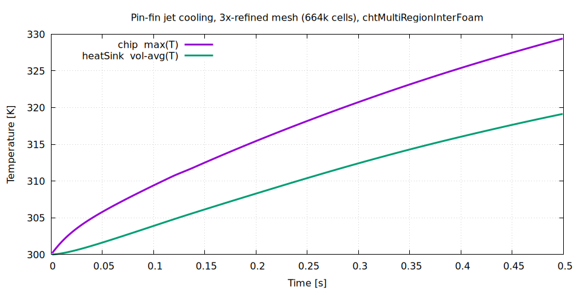
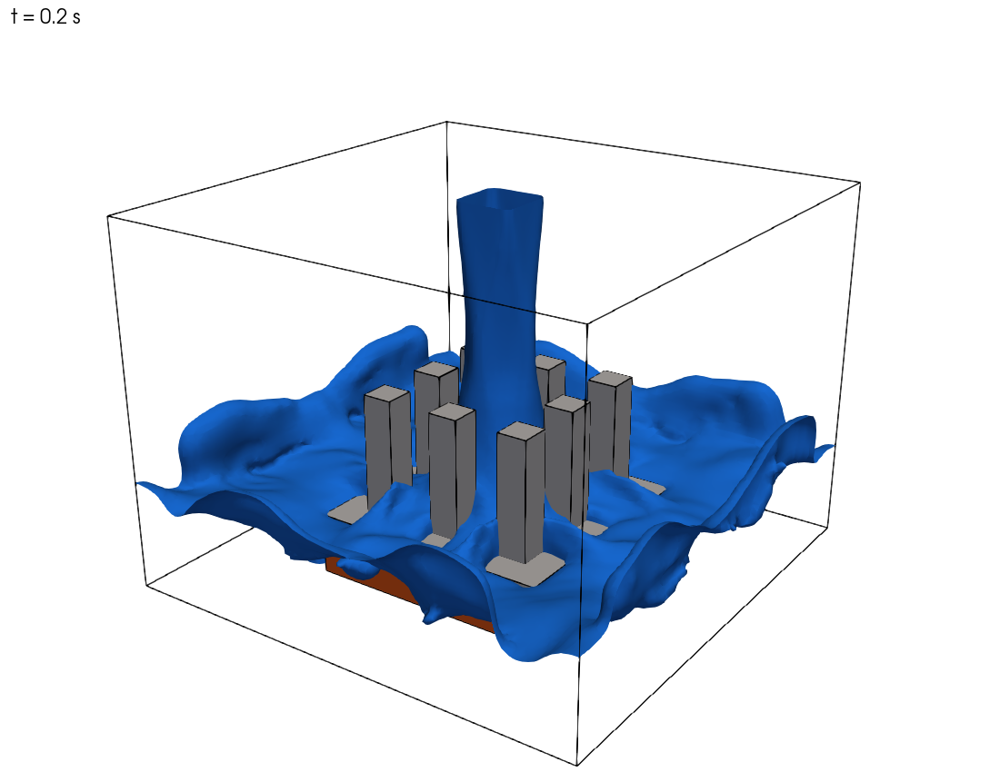
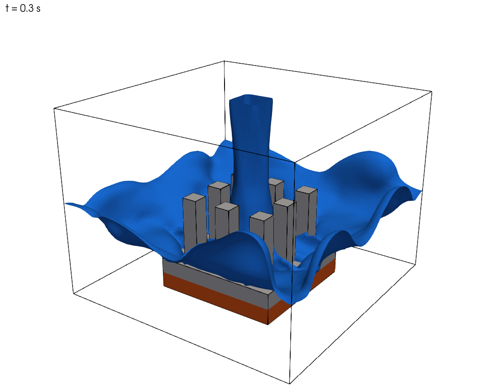
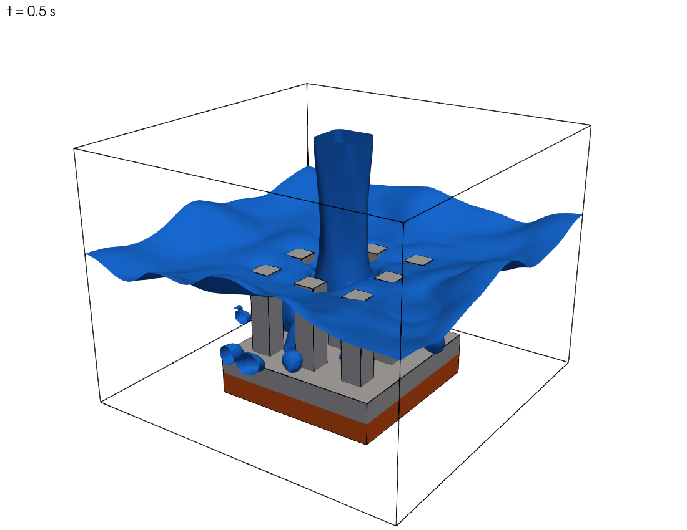

# 예제 19. 다상 유동 + 복합 열전달 (VOF + CHT) : 핀-휜 히트싱크의 액체 제트 충돌 냉각

**참고**:

- 이 예제는 C. Schubert의 [OpenFOAM--MHD--VoF-Solver-Collection](https://github.com/c-schubert/OpenFOAM--MHD--VoF-Solver-Collection)(GPL-3)에서 추출하여 OpenFOAM v2412로 포팅한 외부 솔버 `chtMultiRegionInterFoam`을 이용해, 다상 유동(VOF)과 다중 영역 복합 열전달(CHT)이 결합된 액체 제트 충돌 냉각을 해석하는 예제이다.
- [https://github.com/swtbkim/chtMultiRegionInterFoam](https://github.com/swtbkim/chtMultiRegionInterFoam) : 솔버 소스, 예제 케이스(`examples/pinFinJetCooling`), 검증 보고서, 튜닝 스터디 보고서
- 이 예제는 OpenFOAM 튜토리얼(한국어판)에 새로 추가된 내용으로, [CC BY-NC-SA 3.0](https://creativecommons.org/licenses/by-nc-sa/3.0/) 라이선스 하에 배포된다.
- 이 자료는 ESI Group, ESI-OpenCFD 또는 OpenFOAM Foundation에 의해 승인된 자료가 아니다.

**호환성**:

- 이 예제에 수록된 명령어 및 케이스 파일은 OpenFOAM v2412를 기반으로 작성되었다.
- `chtMultiRegionInterFoam`은 OpenFOAM에 내장된 기본 솔버가 아니라 외부 솔버이다. 따라서 소스 코드를 받아서 직접 빌드해야 한다([7.3절](#73-빌드)).

**선행 학습**:

- [예제 8. 다상 유동 (Volume of fluid, VOF)](08_다상-유동-Volume-of-fluid-VOF.md) : `interFoam`을 이용한 VOF 계면 포착
- [예제 9. 병렬 계산 기법](09_병렬-계산-기법.md) : `compressibleInterFoam`을 이용한 압축성 2상 유동과 병렬 계산
- [예제 13. 격자 생성 도구 (`snappyHexMesh` - 다중 영역)](13_격자-생성-도구-snappyHexMesh-다중-영역.md) : `chtMultiRegionFoam`을 이용한 다중 영역 복합 열전달

---

## 목차

1. 배경
   - 1.1 문제 정의
   - 1.2 왜 새 솔버가 필요한가
   - 1.3 지배 방정식
2. 전처리
   - 2.1 케이스 디렉터리 구조
   - 2.2 격자 생성
   - 2.3 영역 정의 — `constant/regionProperties`
   - 2.4 유체 영역 물성
   - 2.5 고체 영역 물성과 발열원
   - 2.6 경계 및 초기 조건
   - 2.7 수치 기법과 솔버 설정
3. 솔버 실행
4. 후처리
   - 4.1 칩·히트싱크 온도 이력 (검증)
   - 4.2 물 계면(제트) 거동 — `alpha.water = 0.5` 등가면
   - 4.3 ParaView 에서 직접 보기
   - 4.4 물리적 해석
5. 확장 및 주의사항
6. 고급 옵션과 성능 튜닝 스터디
   - 6.1 스터디 목적과 방법
   - 6.2 비용 구조 — 시간은 어디에 쓰이는가
   - 6.3 항목별 결과 요약
   - 6.4 압력 선형 솔버 — QW2, QW1, M5
   - 6.5 PISO 보정 횟수 — M2
   - 6.6 VOF 부분 순환과 계면 Courant 수 — nAlphaSubCycles, M3
   - 6.7 대류 스킴 — QW5a, QW5b
   - 6.8 에너지 결합 부분 루프 조기 종료 — QW3
   - 6.9 적응형 외부 보정 감소 (M1)
   - 6.10 병렬 분할 — M6
   - 6.11 기각·보류된 아이디어
   - 6.12 누적 결과와 튜닝 프리셋
   - 6.13 교훈
7. 부록: 솔버 추출 및 빌드
   - 7.1 출처
   - 7.2 v2412 포팅 패치
   - 7.3 빌드

---

## 1. 배경

### 1.1 문제 정의

이 예제에서는 칩에서 발생하는 열을 **핀-휜 히트싱크(pin-fin heat sink)** 와 **액체 제트 충돌(liquid jet impingement)** 로 냉각하는 과정을 해석한다. 물리적으로 서로 다른 세 개의 영역이 동시에 등장한다.

- **chip** : 발열체. 일정 열량 `150 W` 를 균일하게 발생시킨다.
- **heatSink** : 칩 위에 부착된 알루미늄 히트싱크. 바닥판(base)과 3 x 3 사각 핀으로 구성된다.
- **fluid** : 히트싱크 주위의 유체 영역. 초기에는 공기로 가득 차 있고, 상단 노즐에서 **액체 제트**가 아래로 분사되어 핀에 충돌·냉각한다.

즉 이 예제는 두 가지 물리 현상이 결합된 문제를 다룬다.

1. **다상 유동 (VOF)** — 물과 공기가 뚜렷한 계면을 사이에 두고 분리되어 흐른다. [예제 8](./08_다상-유동-Volume-of-fluid-VOF.md)의 `interFoam` 댐 붕괴와 동일한 계면 포착(interface capturing) 기법을 사용한다.
2. **복합 열전달 (Conjugate Heat Transfer, CHT)** — 고체(칩, 히트싱크)의 열전도와 유체의 대류 열전달이 고체-유체 계면에서 연속적으로 연결된다. [예제 13](./13_격자-생성-도구-snappyHexMesh-다중-영역.md)의 `chtMultiRegionFoam` 와 동일한 다중 영역 결합을 사용한다.

```text
                    │  │   물 제트 (1.5 m/s, 300 K)
                    ▼  ▼
        ┌────────────────────────────────────────┐  ← outlet (상단, 공기/물 배출)
        │      nozzle (4 x 4 mm)                 │
        │   ┌──┐  ┌──┐  ┌──┐                     │
        │   │  │  │  │  │  │  pin (Al, 8 mm)     │   fluid (공기 + 물, VOF)
        │   │  │  │  │  │  │                     │
        │ ══╧══╧══╧══╧══╧══╧══  base (Al)        │
        │ ▓▓▓▓▓▓▓▓▓▓▓▓▓▓▓▓▓▓▓▓  chip (Si, 150 W) │
        └────────────────────────────────────────┘  ← bottom (단열)
              32 x 24 x 32 mm

* 상단 노즐에서 분사된 물 제트가 칩 위 알루미늄 핀-휜 히트싱크(3 x 3 핀)에 충돌하여 냉각
```

### 1.2 왜 새 솔버가 필요한가

표준 OpenFOAM 솔버만으로는 이 문제를 한 번에 풀 수 없다.

| 솔버 | 다상(VOF) | 에너지 방정식 | 다중 영역 CHT |
| :--- | :---: | :---: | :---: |
| `interFoam` | O | X (등온) | X |
| `compressibleInterFoam` | O | O | X (단일 영역) |
| `chtMultiRegionFoam` | X (단상) | O | O |
| **`chtMultiRegionInterFoam`** | **O** | **O** | **O** |

`chtMultiRegionInterFoam` 은 **유체 영역에서는 `compressibleInterFoam`(압축성 2상 VOF + 에너지)** 을, **고체 영역에서는 `chtMultiRegionFoam`(열전도)** 를 사용하고, 두 영역을 온도 결합 경계조건으로 묶은 솔버이다. 즉 `interFoam` 과 `chtMultiRegionFoam` 을 합친 형태이다.

> **Note:** 이 솔버는 OpenFOAM 기본 배포본에 포함되어 있지 않다. c-schubert 의 [OpenFOAM--MHD--VoF-Solver-Collection](https://github.com/c-schubert/OpenFOAM--MHD--VoF-Solver-Collection) 에서 추출하여 v2412 로 포팅하였다. 솔버 추출·빌드 방법은 [부록](#7-부록-솔버-추출-및-빌드)에 정리한다.

### 1.3 지배 방정식

**유체 영역 (압축성 2상 VOF).** 물의 체적 분율 $\alpha_1$ 에 대한 이류(advection) 방정식을 MULES 로 푼다.

$$\frac{\partial \alpha_1}{\partial t} + \nabla\cdot(\alpha_1 \mathbf{U}) + \nabla\cdot\big(\alpha_1(1-\alpha_1)\,\mathbf{U}_r\big) = 0$$

혼합물 밀도·점성은 $\rho = \alpha_1\rho_1 + \alpha_2\rho_2$, $\mu = \alpha_1\mu_1 + \alpha_2\mu_2$ 로 정의된다. 운동량 방정식에는 중력과 표면장력(연속 표면력, CSF)이 포함된다.

$$\frac{\partial(\rho\mathbf{U})}{\partial t} + \nabla\cdot(\rho\mathbf{U}\mathbf{U}) = -\nabla p_{rgh} - (\mathbf{g}\cdot\mathbf{x})\nabla\rho + \nabla\cdot\boldsymbol{\tau} + \sigma\kappa\nabla\alpha_1$$

에너지 방정식은 온도 $T$ 형태로 풀린다.

**고체 영역 (열전도).** 엔탈피 $h$ 에 대한 전도 방정식을 풀고, 칩 영역에는 발열원 $\dot{q}$ 가 더해진다.

$$\frac{\partial(\rho h)}{\partial t} - \nabla\cdot(\alpha_h \nabla h) = \dot{q}$$

**계면 결합.** 고체-유체, 고체-고체 계면에서 온도와 열유속이 연속이 되도록 `compressible::turbulentTemperatureRadCoupledMixed` 경계조건이 양쪽 영역의 $T$ 를 결합한다.

$$T_s = T_f, \qquad k_s \frac{\partial T_s}{\partial n} = k_f \frac{\partial T_f}{\partial n}$$

---

## 2. 전처리

### 2.1 케이스 디렉터리 구조

다중 영역 케이스는 `constant/`, `system/`, `0/` 아래에 **영역별 하위 폴더**를 둔다.

```bash
pinFinJetCooling
├── Allrun                      # 전체 실행 스크립트
├── Allclean
├── constant
│   ├── g                       # 중력 (전역)
│   ├── regionProperties        # 영역 목록 (fluid / solid)
│   ├── fluid
│   │   ├── thermophysicalProperties        # phases (water air)
│   │   ├── thermophysicalProperties.water  # 물 (perfectFluid)
│   │   ├── thermophysicalProperties.air    # 공기 (perfectGas)
│   │   ├── turbulenceProperties            # laminar
│   │   └── radiationProperties             # none
│   ├── heatSink
│   │   └── thermophysicalProperties        # 알루미늄 (heSolidThermo)
│   └── chip
│       └── thermophysicalProperties        # 실리콘 (heSolidThermo)
├── system
│   ├── blockMeshDict           # 배경 격자
│   ├── topoSetDict             # chip/heatSink/fluid 셀존 + 노즐 면집합
│   ├── createPatchDict         # nozzle 패치 생성
│   ├── controlDict
│   ├── fvSchemes / fvSolution  # 전역(상위) 설정
│   ├── fluid    {fvSchemes, fvSolution}
│   ├── heatSink {fvSchemes, fvSolution}
│   └── chip     {fvSchemes, fvSolution, fvOptions(발열원)}
└── 0.orig                      # 초기/경계장 (Allrun 이 0/ 로 복사)
    ├── fluid    {alpha.water, U, T, p, p_rgh}
    ├── heatSink {T, p}
    └── chip     {T, p}
```

### 2.2 격자 생성

핀-휜 형상은 다음 네 단계로 생성한다. 모든 핀이 격자선에 정확히 정렬되는 정육면체(Cartesian) 격자를 쓰므로 격자 품질이 완벽하다(비직교도 0). 본 예제는 셀 크기를 1/3 mm 로 3배 조밀화하여 96 x 72 x 96 = 663,552 셀을 사용한다. `topoSetDict` 는 절대 좌표(m)로 영역을 정의하므로 격자를 조밀화해도 그대로 동작한다.

```bash
blockMesh                                   # 32 x 24 x 32 mm, 1/3 mm 셀 (96 x 72 x 96, 단일 블록)
topoSet                                     # chip/heatSink/fluid 셀존 + nozzle 면집합
createPatch -overwrite                      # 상단 outlet 에서 nozzle 패치 분리
splitMeshRegions -cellZones -overwrite      # 영역별 격자 분할 + 결합 패치 자동 생성
```

`system/blockMeshDict` — mm 단위로 좌표를 적고 `scale 0.001` 로 m 로 변환한다.

```cpp
scale   0.001;

vertices
(
    (  0  0  0 ) (  32  0  0 ) (  32 24  0 ) (  0 24  0 )
    (  0  0 32 ) (  32  0 32 ) (  32 24 32 ) (  0 24 32 )
);

blocks
(
    hex (0 1 2 3 4 5 6 7) (96 72 96) simpleGrading (1 1 1)   // 1/3 mm 셀 (3배 조밀화)
);
```

`system/topoSetDict` — `boxToCell` 로 칩·히트싱크(바닥판 + 9개 핀)·유체 셀존을 정의한다. 핀은 2 mm 사각, 높이 8 mm, 5 mm 피치의 3 x 3 배열이다.

```cpp
actions
(
    // 칩 (실리콘 다이) : x,z [8,24] mm, y [0,2] mm
    { name chipCells; type cellSet; action new; source boxToCell;
      box (0.008 0.000 0.008) (0.024 0.002 0.024); }
    { name chip; type cellZoneSet; action new; source setToCellZone; set chipCells; }

    // 히트싱크 = 바닥판 + 핀 (모두 같은 셀존에 add)
    { name heatSinkCells; type cellSet; action new; source boxToCell;
      box (0.008 0.002 0.008) (0.024 0.004 0.024); }              // 바닥판
    { name heatSinkCells; type cellSet; action add; source boxToCell;
      box (0.010 0.004 0.010) (0.012 0.012 0.012); }              // 핀 1 (이하 9개)
    // ... (핀 2~9) ...
    { name heatSink; type cellZoneSet; action new; source setToCellZone; set heatSinkCells; }

    // 유체 = 전체 - 칩 - 히트싱크
    { name fluidCells; type cellSet; action new; source boxToCell; box (-1 -1 -1) (1 1 1); }
    { name fluidCells; type cellSet; action delete; source cellToCell; set chipCells; }
    { name fluidCells; type cellSet; action delete; source cellToCell; set heatSinkCells; }
    { name fluid; type cellZoneSet; action new; source setToCellZone; set fluidCells; }

    // 노즐 면집합 = 상단 outlet 패치 ∩ 중앙 4 x 4 mm
    { name nozzleFaces; type faceSet; action new;    source patchToFace; patch outlet; }
    { name nozzleFaces; type faceSet; action subset; source boxToFace;
      box (0.014 0.020 0.014) (0.018 0.026 0.018); }
);
```

`splitMeshRegions` 는 각 셀존을 독립 영역 격자로 나누고, 영역이 맞닿는 면에 `<영역>_to_<이웃영역>` 형태의 **결합(mapped) 패치**를 자동 생성한다. 분할 결과는 다음과 같다.

| 영역 | 셀 수 | 패치 |
| :--- | :---: | :--- |
| fluid | 628,128 | `nozzle`, `outlet`, `walls`, `bottom`, `fluid_to_chip`, `fluid_to_heatSink` |
| heatSink | 21,600 | `heatSink_to_chip`, `heatSink_to_fluid` |
| chip | 13,824 | `bottom`, `chip_to_fluid`, `chip_to_heatSink` |

> **Note:** 칩의 옆면은 유체와 직접 닿으므로 `chip_to_fluid` 패치가 생성된다. 즉 칩은 윗면(히트싱크)과 옆면(유체) 양쪽으로 냉각된다.

### 2.3 영역 정의 — `constant/regionProperties`

```cpp
regions
(
    fluid       (fluid)
    solid       (heatSink chip)
);
```

### 2.4 유체 영역 물성

압축성 2상 혼합물을 정의한다(`twoPhaseMixtureThermo`). 상(phase) 목록·표면장력·최소압력은 `constant/fluid/thermophysicalProperties` 에 둔다.

```cpp
phases          (water air);
pMin            10000;
sigma { type constant; sigma 0.07; }     // 물-공기 표면장력 [N/m]
```

각 상은 별도 파일로 정의한다. 물은 `perfectFluid`(약압축성), 공기는 `perfectGas` 이다.

```cpp
// constant/fluid/thermophysicalProperties.water
thermoType
{
    type            heRhoThermo;     mixture  pureMixture;
    transport       const;           thermo   hConst;
    equationOfState perfectFluid;    specie   specie;
    energy          sensibleInternalEnergy;
}
mixture
{
    specie          { molWeight 18.0; }
    equationOfState { R 3000; rho0 1027; }    // rho ~ 1027 kg/m^3
    thermodynamics  { Cp 4195; Hf 0; }
    transport       { mu 3.645e-4; Pr 2.289; }
}
```

중력은 전역 파일 `constant/g` 에 정의한다(-y 방향).

```cpp
dimensions  [0 1 -2 0 0 0 0];
value       (0 -9.81 0);
```

### 2.5 고체 영역 물성과 발열원

고체는 `heSolidThermo` + `constIso`(등방 열전도 `kappa`) 를 사용한다.

```cpp
// constant/heatSink/thermophysicalProperties  (알루미늄)
mixture
{
    transport       { kappa 205; }       // W/m/K
    thermodynamics  { Hf 0; Cp 900; }
    equationOfState { rho 2700; }
}
// constant/chip/thermophysicalProperties     (실리콘): kappa 149, Cp 705, rho 2329
```

GPU 발열은 칩 영역의 에너지 방정식에 `scalarSemiImplicitSource` 로 `150 W` 를 주입한다(`system/chip/fvOptions`).

```cpp
gpuHeatSource
{
    type            scalarSemiImplicitSource;
    selectionMode   all;            // chip 영역 전체
    volumeMode      absolute;       // [W]
    sources         { h (150 0); }  // (Su Sp): 150 W 발열, 음함수항 0
}
```

### 2.6 경계 및 초기 조건

초기에 영역은 공기로 가득 차 있고(`alpha.water = 0`), 모든 온도는 `300 K` 이다. 주요 경계조건은 다음과 같다.

| 필드 | nozzle (제트 입구) | outlet (상단) | walls / bottom | 고체-유체 계면 |
| :--- | :--- | :--- | :--- | :--- |
| `alpha.water` | `fixedValue 1` | `inletOutlet 0` | `zeroGradient` | `zeroGradient` |
| `U` | `fixedValue (0 -1.5 0)` | `pressureInletOutletVelocity` | `noSlip` | `noSlip` |
| `T` | `fixedValue 300` | `inletOutlet 300` | `zeroGradient` | **결합 BC** |
| `p_rgh` | `fixedFluxPressure` | `totalPressure 1e5` | `fixedFluxPressure` | `fixedFluxPressure` |

고체-유체, 고체-고체 계면의 온도 결합은 다음과 같이 지정한다(유체쪽은 `kappaMethod fluidThermo`, 고체쪽은 `solidThermo`).

```cpp
// 예) 0.orig/chip/T 의 chip_to_heatSink, chip_to_fluid 패치
type            compressible::turbulentTemperatureRadCoupledMixed;
Tnbr            T;
kappaMethod     solidThermo;
qrNbr           none;   qr   none;
value           uniform 300;
```

> **Note:** 칩 바닥면(`bottom`)은 `zeroGradient`(단열)로 두었다. 따라서 발생한 열은 전부 히트싱크와 유체를 통해서만 빠져나가며, 이는 냉각 성능을 보수적으로 평가하는 설정이다.

### 2.7 수치 기법과 솔버 설정

상위(전역) `system/fvSolution` 은 다중 영역 드라이버가 읽는 외부 보정 횟수와 에너지 결합 부분 루프를 지정한다. `nOuterCorrectors 2` 와 `energyCoupling` 부분 루프를 쓰면, 매 시간 간격 안에서 첫 외부 보정 뒤에 유동을 고정한 채 유체 온도와 고체 전도를 추가로 다시 풀어 영역 간(복합) 열전달 결합을 **암시적으로(implicit)** 강화한다. 가장 단순하고 견고한 설정을 원하면 `nOuterCorrectors 1` 로 두면 되며, 이 경우 매 간격마다 유체→고체를 한 번씩만 순차로 푸는 완전 명시적(explicit) 결합이 된다.

```cpp
// system/fvSolution (상위)
PIMPLE
{
    nOuterCorrectors 2;

    adaptiveOuterTol    0;          // 적응형 외부 보정 감소(M1): 0 = 끔
    adaptiveOuterSteps  5;          // M1 히스테리시스(연속 준정상 간격 수)

    energyCoupling
    {
        iterations  2;
        // convergence { "T" 1e-3; }   // 부분 루프 조기 종료(QW3): 기본은 끔
    }
}
```

`adaptiveOuterTol`, `adaptiveOuterSteps`, `convergence` 는 기본값에서 꺼져 있으며(기본 동작과 비트 단위로 동일), 그 원리와 사용법은 [6장](#6-고급-옵션과-성능-튜닝-스터디)에서 튜닝 스터디 근거와 함께 다룬다.

유체 영역(`system/fluid/fvSolution`)은 `alpha.water`(MULES), `p_rgh`, `U`, `T` 선형 솔버와 PIMPLE 보정을 둔다.

```cpp
"alpha.water.*"
{
    nAlphaCorr 1; nAlphaSubCycles 2; cAlpha 1;
    MULESCorr no; nLimiterIter 5;
    solver smoothSolver; smoother symGaussSeidel; tolerance 1e-8; relTol 0;
}
PIMPLE { momentumPredictor no; transonic no; nCorrectors 2; nNonOrthogonalCorrectors 0; }
```

`system/controlDict` 은 적응 시간 간격(adjustable time step)을 사용한다. 정육면체 격자라 이산화는 모두 `uncorrected`(비직교 보정 불필요)로 단순화한다. 시간 간격은 유동 Courant 수(`maxCo`)와 **VOF 계면 Courant 수(`maxAlphaCo`)** 의 더 엄격한 쪽, 그리고 고체 확산수로 동시에 제한된다. `maxAlphaCo` 를 `maxCo` 보다 작게 두면 계면을 더 선명하게 유지하면서 시간 간격을 조절할 수 있다.

```cpp
application     chtMultiRegionInterFoam;
endTime         0.5;
deltaT          1e-5;
writeControl    adjustable;   writeInterval 0.02;   writeFormat binary;
adjustTimeStep  yes;
maxCo           0.5;   maxAlphaCo 0.5;   maxDeltaT 1e-3;
```

---

## 3. 솔버 실행

먼저 솔버가 빌드되어 있어야 한다([부록](#7-부록-솔버-추출-및-빌드) 참고). 빌드 후 케이스 실행은 `Allrun` 한 줄로 끝난다.

```bash
cd chtMultiRegionInterFoam/examples/pinFinJetCooling   # 7.3절에서 받은 솔버 저장소의 예제 케이스
./Allclean       # (선택) 이전 결과 정리
./Allrun         # 격자 → 분할 → 4코어 병렬 풀이 → 재구성(reconstruct)
```

`Allrun` 내부는 다음과 같다.

```bash
runApplication blockMesh
runApplication topoSet
runApplication createPatch -overwrite
runApplication splitMeshRegions -cellZones -overwrite
restore0Dir                                       # 0.orig → 0 (영역별)
runApplication decomposePar -allRegions -force    # 영역별 4분할
# export OMPI_MCA_rmaps_base_oversubscribe=1        # 물리 코어보다 많은 랭크 허용
runParallel $(getApplication)                     # mpirun -np 4 chtMultiRegionInterFoam -parallel
runApplication reconstructPar -allRegions -newTimes
```

> **Note:** `decomposePar -allRegions` 는 상위 `system/decomposeParDict` 가 아니라 **영역별** `system/<region>/decomposeParDict` 를 읽는다. 따라서 `fluid`, `heatSink`, `chip` 각각에 동일한 분할 설정(`numberOfSubdomains 4; method scotch;`)을 두어야 한다.

> **Note:** 물리 코어 수가 랭크 수보다 적은 (하이퍼스레딩 등) 환경에서는 `OMPI_MCA_rmaps_base_oversubscribe` 를 켜거나 `mpirun --use-hwthread-cpus` 를 사용한다.

실행 로그(`log.chtMultiRegionInterFoam`)에서 다음 줄들을 확인한다.

```bash
Solving for fluid region fluid
MULES: Solving for alpha.water
Phase-1 volume fraction = 0.516 ...  Min(alpha.water) = 0  Max(alpha.water) = 1   # VOF
...
Solving for solid region chip
DICPCG:  Solving for h, Initial residual = ...                                     # 고체 전도
Min/max T:323.8 329.4                                                              # 칩 온도
```

- `Max(alpha.water) = 1` 은 순수한 물 영역(제트·고인 물)이 존재함을 뜻한다.
- `Phase-1 volume fraction` 은 영역 내 물의 총 체적 비율로, 시간이 지나며 증가한다(약 0.5 s 에 ~52 %).
- 각 영역의 `Min/max T` 로 칩·히트싱크 온도 상승을 추적할 수 있다.

이 케이스는 약 664,000 셀이므로 16코어 병렬로 `t = 0.5 s` 까지 약 40~50분 소요된다(약 7,800 시간 간격). 학습 목적으로는 `blockMeshDict` 의 분할 수를 `(32 24 32)` 로 되돌려 단일 코어로 수 분 내에 실행할 수도 있다.

---

## 4. 후처리

### 4.1 칩·히트싱크 온도 이력 (검증)

`controlDict` 의 함수 객체가 칩 최고온도와 히트싱크 평균온도를 매 시간 간격마다 기록한다.

```bash
postProcessing/chip/chipTemperature/0/volFieldValue.dat        # max(T)
postProcessing/heatSink/heatSinkTemperature/0/volFieldValue.dat # volAverage(T)
```

이를 그리면 칩 온도가 `300 K` 에서 상승하다가, 제트 냉각이 발달하면서 상승 기울기가 점차 완만해지는 것을 볼 수 있다.



| 시간 [s] | 칩 max(T) [K] | 히트싱크 평균 T [K] |
| :---: | :---: | :---: |
| 0.04 | 304.7 | 301.1 |
| 0.15 | 312.8 | 306.3 |
| 0.28 | 320.0 | 311.8 |
| 0.49 | 329.1 | 318.9 |

`t = 0.5 s` 시점의 영역별 온도 분포는 다음과 같다.

| 영역 | 온도 범위 [K] | 해석 |
| :--- | :---: | :--- |
| chip | 323.8 ~ 329.4 | 발열원, 가장 뜨거움 |
| heatSink | 304.7 ~ 326.5 | 바닥판 ~326 K → 핀 끝 ~305 K |

핀 끝(`~305 K`)이 냉각수 온도(`300 K`)에 근접한다는 점이 제트 충돌 냉각이 실제로 작동함을 보여준다. 칩(329 K) → 히트싱크 바닥판(326 K) → 핀 끝(305 K) 으로 이어지는 온도 구배는 **고체 내부 전도 + 계면 복합 열전달 + 유체 대류**가 일관되게 결합되어 있음을 의미한다. 약 `0.5 s` 동안 칩 온도는 `300 K → 329 K` 로 상승하며, 상승 기울기가 점차 완만해지는 것은 제트 냉각이 발열과 균형을 향해 발달하고 있음을 뜻한다.

### 4.2 물 계면(제트) 거동 — `alpha.water = 0.5` 등가면

VOF 계면(물-공기 경계)은 `alpha.water = 0.5` 등가면으로 가장 잘 드러난다. 아래 그림은 `t = 0, 0.1, 0.2, 0.3, 0.4, 0.5 s` 에서의 **계면(파란색)**, **히트싱크·칩 벽면(고체색: 회색·주황색)**, **도메인 외곽선(특징 에지, feature edge)** 을 함께 보여준다.

| | |
| :---: | :---: |
|  |  |
|  |  |
|  |  |

- `t = 0.0 s` : 도메인은 공기로 차 있어 계면이 없다. 알루미늄 핀-휜 히트싱크(회색)와 실리콘 칩(주황색)만 보인다.
- `t = 0.1 s` : 노즐에서 분사된 물 기둥이 핀 배열 상단에 도달한다.
- `t = 0.2 ~ 0.3 s` : 제트가 핀에 충돌(impingement)한 뒤 방사상으로 퍼지며 물결치는 액막을 형성한다. 중앙의 수직 물기둥(제트)이 뚜렷하다.
- `t = 0.4 ~ 0.5 s` : 물이 바닥에 고이며 수위가 핀 높이까지 올라가 핀을 적신다(약 0.5 s 에 유체 체적의 ~52 %).

> **Note:** 위 그림은 `foamToVTK` 로 VTK 를 추출한 뒤 `pvbatch`(ParaView 배치 모드)로 오프스크린 렌더링하여 생성하였다. 렌더 스크립트는 케이스 내 `render_interface.py` 에 있다.
>
> ```bash
> foamToVTK -allRegions -time '0,0.1,0.2,0.3,0.4,0.5' -fields '(alpha.water T)'
> pvbatch --force-offscreen-rendering render_interface.py
> ```

### 4.3 ParaView 에서 직접 보기

```bash
paraFoam -touch-all      # 영역별 .OpenFOAM 파일 생성
paraFoam
```

- **물 계면** : `fluid` 영역에서 `alpha.water` 의 등가면(Contour, value = 0.5) → 제트와 고인 물의 형상.
- **온도장** : 모든 영역에 `T` 컬러맵을 적용하고 중앙 평면(Slice, z = 16 mm)으로 자르면 칩→핀→물로 이어지는 냉각을 볼 수 있다.
- **속도** : `fluid` 영역의 `U` 벡터/유선으로 제트 충돌 후 퍼지는 흐름 확인.

### 4.4 물리적 해석

투입 전력 `150 W` 와 고체 열용량(칩 + 히트싱크 ≈ 2.8 J/K)으로 추정한 무냉각 단열 상승률은 약 `54 K/s` 이다. `0.5 s` 동안 칩 최고온도는 약 `+29 K` 상승했고, 그 기울기는 시간이 지날수록 완만해진다. 핀 끝이 냉각수 온도 부근(`~305 K`)에 머무는 점에서 제트가 발생열의 상당 부분을 제거하고 있음을 알 수 있으며, 계산을 더 길게 수행하면 발열과 냉각이 균형을 이루는 준정상(quasi-steady) 상태에 접근한다.

---

## 5. 확장 및 주의사항

- **난류** : 본 예제는 층류이다. 실제 제트(Re ~ 3 x 10^4)는 난류이므로 `constant/fluid/turbulenceProperties` 를 `RAS`(예: `kOmegaSST`)로 바꾸고 `0/fluid` 에 `k`, `omega`, `nut`, `alphat` 장을 추가하면 된다.
- **결합 강도** : 본 예제는 `nOuterCorrectors 2` 로 영역 간 결합을 암시적으로 푼다. 칩 온도 변화가 매우 빠르거나 진동하면 `nOuterCorrectors` 를 3 이상으로 더 올리고, 반대로 최대 견고성이 필요하면 `nOuterCorrectors 1`(완전 명시적 결합)로 낮춘다. 유동·열장이 정착한 준정상 구간에서만 자동으로 외부 보정을 1 회로 줄이는 방법은 [6.9절 적응형 외부 보정 감소(M1)](#69-적응형-외부-보정-감소-m1)를 참고한다.
- **접촉각** : 핀 표면의 젖음(wetting)을 모사하려면 `alpha.water` 벽면 경계조건을 `constantAlphaContactAngle` 등으로 바꾼다.
- **isoAdvector** : 더 날카로운 계면이 필요하면 isoAdvector 기반 `chtMultiRegionInterIsoFoam` 을 쓸 수 있으나, 이는 별도 `VoFLibrary` 의 v2412 포팅이 필요하다(본 예제에서는 다루지 않음).

---

## 6. 고급 옵션과 성능 튜닝 스터디

1~5장의 예제는 **보수적인 기본 설정**(`nCorrectors 2`, `nAlphaSubCycles 2`, 중간 압력 `relTol 0.01`, 에너지 대류 `upwind`, `scotch` 분할, 적응형 외부 보정 끔)으로 구성되어 있다. 처음 케이스를 돌리거나 결과를 검증할 때는 이 설정이 가장 안전하다. 이 장은 그 위에서 **어떤 옵션을 바꾸면 얼마나 빨라지고, 그 대가로 무엇을 잃는지**를 튜닝 테스트로 하나씩 확인한 튜닝 스터디이다. 항목마다 물리·수치적 이유, 사전(dictionary) 설정 방법, 측정 효과, 주의사항을 정리하고, 마지막에 채택된 항목을 묶은 **튜닝 프리셋**을 제시한다.

> **Note:** 이 장의 변경은 모두 선택 사항이다. 예제 케이스(솔버 저장소의 `examples/pinFinJetCooling`)의 사전 파일은 기본 설정 그대로이며, 튜닝 프리셋을 쓰려면 [6.12절](#612-누적-결과와-튜닝-프리셋)의 스니펫을 복사해 적용한다. 원 측정 보고서(영문)는 솔버 저장소의 [`docs/tuning_study.md`](https://github.com/swtbkim/chtMultiRegionInterFoam/blob/main/docs/tuning_study.md) 에 있다.

### 6.1 스터디 목적과 방법

**목적.** 공학적 관심량(QoI: 칩 최고온도, 히트싱크 온도)과 계면 건전성을 해치지 않는 범위에서 실행 시간을 줄이는 옵션을 찾는다. 후보는 압력 솔버(QW1, QW2, M5), 보정 횟수(M2, M1), VOF 부분 순환과 계면 Courant 수(`nAlphaSubCycles`, M3), 대류 스킴(QW5a, QW5b), 에너지 결합(QW3), 코드 정리(QW4, M4), 병렬 분할(M6)이며, 각각을 비교 기준과 1:1 로 비교했다.

**채택 관문(gate).** 다음 세 조건을 **모두** 만족할 때만 채택한다.

1. 실행 시간(wall-clock)이 줄거나, 비용 증가를 감수할 만큼 정확도가 좋아진다.
2. QoI 가 허용 범위 안에 머문다.
3. `alpha.water` 가 [0, 1] 범위에서 유계(bounded)를 유지한다.

**시험 조건.**

| 항목 | 값 |
| :--- | :--- |
| 격자 | `blockMeshDict` 분할 `(48 36 48)` → 약 83k 셀(fluid 가 약 95 %). 모든 변형이 같은 격자를 사용 |
| 실행 | 직렬(serial), `endTime 0.02 s` 고정 (기본 설정에서 181 시간 간격) |
| I/O | `writeControl timeStep; writeInterval 1000000;` (결과 쓰기 최소화) |
| 지표 | `ExecutionTime`, 방정식별 선형 솔버 반복 합계, `p_rgh` GAMG 사이클/풀이, 칩 max T, 히트싱크 max T, `alpha.water` 최소/최대 |
| 잡음 | 같은 세션 안의 기본 설정 재실행 61.44 s vs 61.10 s → 약 0.5 %. 세션 사이 잡음은 훨씬 크다(같은 기본 설정이 61.1 s, 58.68 s, 54.12 s). 반복 수는 결정론적으로 매번 동일 |

- 반복 수는 매번 똑같으므로 비용의 **대리 지표**로 쓰기 좋지만, 채택 판정은 반드시 실행 시간으로 한다([6.4절](#64-압력-선형-솔버--qw2-qw1-m5)의 QW1 참고).
- 실행 시간은 **같은 세션에서 연달아 돌린 실행끼리만** 비교한다. 세션이 다르면 같은 설정도 10 % 넘게 달라질 수 있다. 그래서 6.9절과 6.12절의 수정 후 측정(`FIX_*`)은 기준 실행(`FIX_base02`)을 같은 세션에서 함께 돌려 비교한다.
- 적응 시간 간격 때문에 변형마다 간격 수가 다르다(165~195). 따라서 간격당 비용이 아니라 **같은 `endTime` 까지의 총 실행 시간**을 비교한다.
- `writeControl adjustable` 은 쓰기 시각에 맞추려고 dt 를 잘라내므로, 튜닝 테스트에서는 `timeStep` 기반의 매우 큰 `writeInterval` 로 바꿔 이 간섭을 없앤다.

> **Note (규모 한계):** 이 튜닝 테스트는 83k 셀 직렬 실행이고, 0.02 s 창은 거의 전부 기동(start-up) 과도 구간이다. 압력 솔버·보정 횟수·부분 순환처럼 **간격당 비용**을 바꾸는 지렛대는 깨끗하게 측정되지만, (a) 663k 셀 / 16 랭크 실운전에서의 병렬 확장성(M5, M6)과 (b) 적응형 결합(QW3, M1)의 준정상 효과는 이 창으로 측정되지 않는다. 보수적 기준(tol 0.1)의 M1 은 이 창에서 휴면이었고, 6.9절·6.12절의 M1 이득(기본 설정 위 -46 %, 튜닝 프리셋 위 -40 %)은 느슨한 기준(tol 0.5)이 기동 과도 중에도 발동한 결과이다. 병렬 지렛대는 별도 근거(분할 분석)로 따로 평가했다.

**직접 튜닝 테스트 해 보기.** 격자 생성부터 `restore0Dir` 까지 마친 케이스(`blockMeshDict` 를 `(48 36 48)` 로 바꾼 것)를 두 벌 복사하고, `system/` 만 다르게 한 뒤 실행 제어를 통일한다.

```bash
# 1) 기준 / 변형 케이스 준비: 격자와 0/ 은 공유하고 system/ 만 수정
cp -r pinFinJetCooling caseBase
cp -r pinFinJetCooling caseTuned
foamDictionary -entry "PIMPLE/nCorrectors" -set 1 caseTuned/system/fluid/fvSolution   # 시험할 변경

# 2) 실행 제어 통일: 고정 endTime, 쓰기 최소화(쓰기 시각 dt 잘림 방지)
for c in caseBase caseTuned; do
    foamDictionary -entry endTime       -set 0.02     $c/system/controlDict
    foamDictionary -entry writeControl  -set timeStep $c/system/controlDict
    foamDictionary -entry writeInterval -set 1000000  $c/system/controlDict
    (cd $c && chtMultiRegionInterFoam > log.run 2>&1)
done
```

로그에서 지표를 뽑는 최소 레시피는 다음과 같다.

```bash
awk '/^Time = /{n++}
     /ExecutionTime = /{et=$3}
     /Solving for p_rgh,/{p++; match($0,/No Iterations [0-9]+/); pi+=substr($0,RSTART+14)}
     /Solving for solid region/{reg=$NF}
     /Min\/max T:/{if(reg=="chip"){sub(/.*Min\/max T:/,""); chip=$0}}
     /OUTER-EXIT/{ox++}
     END{printf "steps=%d exec=%ss p_rgh=%d solves/%d iters (%.2f per solve) outerExits=%d chipT=%s\n",
                n, et, p, pi, (p ? pi/p : 0), ox, chip}' log.run
grep -oE "(Min|Max)\(alpha.water\) = [-0-9.eE+]+" log.run | tail -2    # 계면 유계성
grep -cE "FOAM FATAL|nan" log.run                                     # 0 이어야 한다
```

판정 순서는 (1) FATAL/nan 없음 → (2) `alpha.water` 범위 → (3) QoI 차이 → (4) 실행 시간 차이가 잡음(0.5 %)보다 충분히 큰지 이다.

### 6.2 비용 구조 — 시간은 어디에 쓰이는가

기본 설정(`nOuterCorrectors 2`, `energyCoupling` 2 회, `nCorrectors 2`)에서 한 시간 간격 동안 드라이버가 푸는 선형 시스템은 다음과 같다(181 간격 합계로 확인).

| 방정식 | 간격당 풀이 | 구성 | 181 간격 합계 (풀이 / 반복) |
| :--- | :---: | :--- | :---: |
| `p_rgh` (GAMG) | 4 | `nOuterCorrectors 2` x `nCorrectors 2` | 724 / 2776 (평균 3.83 사이클) |
| 유체 `T` | 4 | 외부 보정 1 + `energyCoupling` 2 + 외부 보정 2 | 724 / 1230 |
| 고체 `h` | 8 | 4 회 x 2 영역(chip, heatSink) | 1448 / 898 |
| `U` | 0 | `momentumPredictor no` → 운동량 행렬은 조립만 하고 풀지 않음 | 0 / 0 |
| `alpha.water` | — | 명시적 MULES (`MULESCorr no`) → 선형 솔버 반복 없음 | — |

- 간격당 4 회의 `p_rgh` 풀이 중 **마지막 한 번만** `p_rghFinal`(`relTol 0`, 절대 허용치 `1e-7`)로 풀리고, 앞의 3 회는 `p_rgh`(`relTol 0.01`)로 풀린다.
- GAMG 한 사이클은 여러 격자 레벨의 평활·제한·보간을 포함하므로 `T`/`h` 의 한 번 반복보다 훨씬 무겁다. 따라서 **압력 풀이가 비용을 지배**하며, 최적화의 주 표적이다.

이 구조를 알면 각 옵션의 효과를 미리 짐작할 수 있다. 실행 시간은 대략 (압력 풀이 횟수 = `nOuterCorrectors` x `nCorrectors`) x (풀이당 사이클: `relTol`, 평활기, 초기 추정의 질) + (MULES 횟수: `nAlphaSubCycles`) + (결합 루프 횟수: `energyCoupling`, M1)에 의해 정해진다.

### 6.3 항목별 결과 요약

측정은 누적 경로로 진행했다. 기본 설정(`BASE_ref`) → +QW2 → +`nAlphaSubCycles 1` → +QW5a → +QW3 (= **중간 상태**, 54.28 s) → +M2 (= **튜닝 프리셋**, 43.99 s; 재실행 TUNED_final 44.11 s, 반복 수 동일; 통합 드라이버로 다시 돌린 `FIX_preset` 도 반복 수·QoI 가 TUNED_final 과 똑같다, 6.12절). 채택되지 않은 항목은 해당 시점의 상태에서 가지(branch)로 시험했다. 변화율은 각 행의 "비교 기준" 대비이다.

| 항목 | 변경 | 비교 기준 | 간격 | 실행 시간 | 변화 | 칩 max T [K] | `alpha.water` 범위 | 판정 |
| --- | --- | --- | :---: | :---: | :---: | :---: | :---: | --- |
| 기본 | 기본 설정 (`BASE_ref`) | — | 181 | 61.10 s | — | 302.9849 | -2.8e-11 ~ 1 | 기준 |
| QW1 | `p_rgh` 평활기 DIC → DICGaussSeidel | 기본 | 181 | 64.23 s | +5.1 % | 302.9849 | -2.8e-11 ~ 1 | 원복 (실운전 후보) |
| QW2 | 중간 `p_rgh` `relTol` 0.01 → 0.05 | 기본 | 181 | 58.58 s | -4.1 % | 302.9851 | -4.5e-11 ~ 1 | **채택** |
| QW4 | 효과 없는 `p_rgh.storePrevIter()` 제거 (코드) | 기본 | — | 비트 동일 | 0 | 동일 | 동일 | **채택** (코드 정리) |
| sub | `nAlphaSubCycles` 2 → 1 | QW2 | 183 | 52.44 s | -10.5 % | 302.9784 | -2.3e-10 ~ 1 | **채택** |
| QW5a | `div(rhoPhi,T)` upwind → limitedLinear 1 | sub | 183 | 54.22 s | +3.4 % | 302.9833 | -9.6e-10 ~ 1 | **채택** (정확도) |
| QW3 | `energyCoupling` `convergence { "T" 1e-3; }` | QW5a | 183 | 54.28 s | 중립 | 302.9833 | -9.6e-10 ~ 1 | **채택** (조건 충족 시 부분 루프 생략) |
| M2 | `nCorrectors` 2 → 1 | QW3 | 185 | 43.99 s | -19.0 % | 302.9807 | -1.4e-11 ~ 1 | **채택** (주의사항 있음) |
| M5 | GAMG `nCellsInCoarsestLevel` 10 → 200 | QW3 | 183 | 55.26 s | +1.8 % | 302.9777 | -1.2e-10 ~ 1 | 실운전 관문 (문서화) |
| M3 | `maxAlphaCo` 0.5 → 1.0 | QW3 | 165 | 51.57 s | -5.0 % | 302.9753 | -4.1e-7 ~ 1.0000003 | 기각 |
| QW5b | `div(rhoPhi,U)` upwind → limitedLinearV 1 | QW3 | 195 | 61.00 s | +12.4 % | 302.9801 | -1.6e-6 ~ 1.0000017 | 기각 |
| M1 (수정 전) | 적응형 외부 보정 감소 (코드, tol 0.5), 6월 측정 | QW3 | 180 | 28.83 s | -46.9 % | 302.9795 | -1.5e-9 ~ 1.0000001 | 이력 (`pEqn.H` 수정 전, 6.9절) |
| M1 | 같은 옵션 (tol 0.5), `pEqn.H` 수정 후 | 기본 (같은 세션 `FIX_base02`, 54.12 s) | 177 | 29.38 s | -45.7 % | 302.9700 | -7.3e-18 ~ 1 | 기본 끔으로 탑재, 검증됨 |
| M2 + M1 | 튜닝 프리셋 + M1 (tol 0.5) | 프리셋 (같은 세션 `FIX_preset`, 38.83 s) | 185 | 23.27 s | -40.1 % | 302.9813 | -4.3e-8 ~ 1 | 측정됨, 주의사항 있음 (6.12절) |
| M4 | 동결 분기의 contErr/divUp 캐시 (코드) | — | — | ~0 | — | 측정 안 함 | — | 기각 |
| M6 | fluid 분할 scotch → hierarchical (4 2 2) | 16 분할 분석 | — | 프로세서 면 -3.5 % | — | — | — | **채택** (실운전 분할) |

이후 절에서는 항목을 성격별로 묶어 "왜 그렇게 되는가"를 설명한다.

### 6.4 압력 선형 솔버 — QW2, QW1, M5

**QW2: 중간 압력 풀이만 완화한다.** PIMPLE 의 중간 압력 풀이는 다음 보정에서 다시 고쳐질 "중간 답"이다. 이를 초기 잔차의 1 % 까지 깎는 것은 낭비이며, 간격의 최종 상태(연속식 만족)는 마지막 `p_rghFinal` 만 엄격하면 보장된다. 따라서 `p_rgh` 의 `relTol` 만 키우고 `p_rghFinal` 은 `relTol 0` 으로 둔다.

```cpp
// system/fluid/fvSolution
p_rgh
{
    solver          GAMG;
    tolerance       1e-07;
    relTol          0.05;              // QW2: 중간 p_rgh 풀이(간격당 3 회)만 완화
    smoother        DIC;
    cacheAgglomeration true;           // 정적 격자: 응집(agglomeration) 계층을 모든 p_rgh 풀이에서 재사용
}

p_rghFinal
{
    $p_rgh;
    relTol          0;                 // 최종 풀이는 그대로 엄격
}
```

결과는 `p_rgh` 반복 2776 → 2251 (-19 %), 사이클/풀이 3.83 → 3.11, 실행 시간 -4.1 %, 칩 max T +0.0002 K 이다. `cacheAgglomeration true` 는 v2412 GAMG 의 기본 동작과 같으며, 격자가 움직이지 않으니 응집 계층을 재사용한다는 의도를 명시한 것이다.

**QW1: 반복 수가 아니라 실행 시간으로 판정한다.** 평활기를 `DIC` → `DICGaussSeidel` 로 바꾸면 GAMG 사이클이 3.83 → 3.62 (-5.5 %)로 줄었지만, 실행 시간은 61.10 → 64.23 s (+5.1 %)로 오히려 늘었다. 더 무거운 Gauss-Seidel sweep 의 비용이 사이클 절감보다 컸기 때문이다. "반복이 줄었으니 빨라졌다"는 판단은 틀릴 수 있다는 것이 이 스터디의 첫 번째 교훈이다. 다만 병렬 실운전에서는 거친 격자 레벨의 전역 통신(all-reduce)이 비용을 지배하므로 사이클을 줄이는 쪽이 이길 수 있다. 그래서 QW1 은 663k / 16 랭크에서 실행 시간으로 다시 재 볼 **실운전 후보**로 남긴다.

```cpp
    smoother        DICGaussSeidel;    // QW1: 직렬 83k 에서 +5 % 느림. 실운전 분할에서 재측정 후 판단
```

**M5: GAMG 최하위 레벨 (실운전 관문).** 병렬 GAMG 에서 가장 거친 레벨은 계산보다 통신 지연(latency)이 지배한다. 최하위 레벨을 키우고 한 프로세서로 모으면 전역 통신 횟수가 줄어든다. 직렬 83k 에서는 공략할 all-reduce 가 없으므로, `nCellsInCoarsestLevel` 10 → 200 시험은 54.28 → 55.26 s (+1.8 %)로 중립~악화였다(시험 사전에 함께 적은 `nFinestSweeps 2; nPostSweeps 2;` 는 v2412 GAMG 의 기본값이라 실제로 바뀐 것은 최하위 레벨 크기뿐이다). 실운전용으로 권장하는 블록은 다음과 같으며, 반드시 실제 분할(663k / 16 랭크)에서 **실행 시간**으로 튜닝 테스트한 뒤 채택한다. `processorAgglomerator` 는 v2412 에서 프로세서가 2 개 이상일 때만 생성되므로 직렬에서는 효과가 없다.

```cpp
    // M5: 663k/16 랭크 실운전 전용 (직렬에서는 끈다)
    nCellsInCoarsestLevel  500;
    processorAgglomerator  masterCoarsest;
```

### 6.5 PISO 보정 횟수 — M2

`nCorrectors` 는 한 외부 보정 안에서 압력 방정식을 몇 번 풀어 속도-압력을 맞출지 정한다. 시간 간격이 Courant 수 0.5 로 묶여 있으면 한 번의 보정으로도 간격 끝의 연속식은 `p_rghFinal` 로 엄격히 맞춰진다.

```cpp
// system/fluid/fvSolution
PIMPLE
{
    momentumPredictor   no;
    transonic           no;
    nCorrectors         1;     // M2: 2 → 1
    nNonOrthogonalCorrectors 0;
}
```

결과는 압력 풀이 732 → 370 (절반), 실행 시간 54.28 → 43.99 s (-19.0 %), 칩 max T 302.9833 → 302.9807 K, `alpha.water` 유계이다.

**왜 -50 % 가 아니라 -19 % 인가.** 풀이 횟수는 절반이 되었지만 풀이당 사이클이 3.19 → 5.14 로 늘었다. 단일 보정은 더 나쁜 초기 추정에서 출발하고, 간격당 압력 풀이 2 회 중 1 회가 `p_rghFinal`(`relTol 0`)이 되어 엄격한 풀이의 비중이 1/4 에서 1/2 로 커지기 때문이다. 실제로 `p_rgh` 반복 합계는 2336 → 1902 (-19 %)로, 실행 시간 감소율과 거의 같다. MULES, `T`, `h` 비용은 그대로 남는다.

> **주의:** 두 번째 보정은 명시적으로 처리되는 표면장력 항(CSF)도 안정화한다. 0.02 s 시험 창에서는 문제가 없었지만, 전체 길이 실행에서 계면 주변 기생 전류(parasitic current)나 `alpha.water` 넘침이 보이면 `nCorrectors 2` 로 되돌린다. 표면장력이 지배적인 문제(작은 액적, 미세 유로)에서는 기본값 2 를 유지하는 편이 안전하다.

### 6.6 VOF 부분 순환과 계면 Courant 수 — nAlphaSubCycles, M3

**`nAlphaSubCycles` 2 → 1.** 부분 순환 2 회는 한 간격 동안 MULES 를 dt/2 로 두 번 돌려 순환당 계면 Courant 수를 절반으로 낮춘다. 그러나 이 솔버는 [2.7절](#27-수치-기법과-솔버-설정)에서 설명한 대로 시간 간격 자체가 `maxAlphaCo 0.5`(계면 Courant 수)로 제한되므로, 전체 dt 에 대해서도 계면 Co 가 이미 0.5 이하로 묶인다. 부분 순환은 안정성 여유를 거의 더하지 않고 MULES 비용만 두 배로 만든다.

```cpp
// system/fluid/fvSolution
"alpha.water.*"
{
    nAlphaCorr      1;
    nAlphaSubCycles 1;       // maxAlphaCo 0.5 가 이미 전체 dt 의 계면 Co 를 제한
    cAlpha          1;
    // (나머지 항목은 기본 설정과 동일)
}
```

결과는 58.58 → 52.44 s (-10.5 %), 칩 max T 302.9851 → 302.9784 K (약 -0.007 K), `alpha.water` -2.3e-10 ~ 1 로 유계이다.

**M3: `maxAlphaCo` 를 1.0 으로 올리면?** 2.7절의 계면 Courant 수 제한이 실제로 dt 를 묶는 제한자가 되었다(계면 Co 최대 0.499 vs 유동 Co 0.417). 따라서 `maxAlphaCo 1.0` 으로 올리면 dt 가 커져 간격 수가 183 → 165 로 줄었다. 그러나 간격당 비용이 늘어 순 이득은 -5.0 % 에 그쳤고, 부분 순환 1 회에 계면 Co 가 1.0 에 가까워지자 `alpha.water` 가 1.0000003 (최소 -4.1e-7)으로 넘쳤다. 유계성 손실에 비해 이득이 작아 **기각**했다.

> **교훈:** `nAlphaSubCycles` 와 `maxAlphaCo` 는 한 쌍으로 다룬다. 순환당 계면 Courant 수(대략 `maxAlphaCo / nAlphaSubCycles`)가 MULES 유계성을 결정한다. 부분 순환을 1 로 줄였다면 `maxAlphaCo` 는 0.5 이하로 둔다.

### 6.7 대류 스킴 — QW5a, QW5b

**QW5a: `div(rhoPhi,T)` upwind → limitedLinear 1 (채택, 정확도).** `T` 는 직접 풀리는 변수이다. 1차 `upwind` 는 수치 확산이 커서 벽 근처 열 경계층을 뭉개고, `limitedLinear 1` 은 TVD 제한자로 유계성을 지키면서 2차 정확도를 준다. 비용은 `T` 반복 1264 → 1951, 실행 시간 +3.4 % 이다. 칩 max T 는 302.9784 → 302.9833 K 로 바뀌었다.

```cpp
// system/fluid/fvSchemes
divSchemes
{
    div(rhoPhi,T)       Gauss limitedLinear 1;   // QW5a
}
```

**QW5b: `div(rhoPhi,U)` upwind → limitedLinearV 1 (기각).** "`momentumPredictor no` 이니 운동량 방정식은 풀지 않고, 그러니 이 스킴은 공짜다"라는 직관은 틀렸다. 운동량 행렬 `UEqn` 은 풀지 않아도 매 보정마다 조립되며, 그 대각 계수와 비대각 부분이 압력 방정식의 계수와 소스를 만든다.

```text
div(rhoPhi,U) → UEqn 조립 → UEqn.A(), UEqn.H() → rAU, HbyA → phiHbyA → p_rgh 방정식
```

즉 대류 스킴을 바꾸면 **압력 시스템 자체가 바뀐다**. 측정 결과 간격 수가 183 → 195 로 늘고 실행 시간 +12.4 %, `alpha.water` 넘침이 1.0000017 (최소 -1.6e-6)로 커졌다. 그래서 기각했다.

### 6.8 에너지 결합 부분 루프 조기 종료 — QW3

`energyCoupling` 부분 루프는 OpenFOAM 의 `loopControl` 이다. `iterations` 는 통과 횟수이고, `convergence` 하위 사전에 필드별 초기 잔차 기준을 줄 수 있다. 단, v2412 의 `loopControl::loop()` 는 **매 통과 전(첫 통과 포함)** 에 이 기준을 검사하며, 비교 대상은 `solutionControl::maxResidual(...).first()`, 곧 **그 시간 간격의 첫 번째 유체 `T` 풀이**(부분 루프가 시작되기 전, 외부 보정 1 에서 푼 것)의 초기 잔차이다. 이 값은 통과 사이에 바뀌지 않으므로, 기준을 만족하면 부분 루프 전체를 **건너뛰고**(0 회 통과, 간격당 `T` 4 → 2, `h` 8 → 4 풀이), 만족하지 않으면 `iterations` 회를 모두 돈다. `iterations 2` 에서 "1 회 통과 후 종료"는 일어날 수 없다.

```cpp
// system/fvSolution (상위)
PIMPLE
{
    nOuterCorrectors 2;
    energyCoupling
    {
        iterations  2;                 // 통과 횟수
        convergence { "T" 1e-3; }      // QW3: 간격의 첫 유체 T 초기 잔차 < 1e-3 이면 부분 루프 생략
    }
}
```

0.02 s 기동 창에서는 간격 첫 유체 `T` 풀이의 초기 잔차가 1e-3 아래로 내려가지 않아 한 번도 작동하지 않았다(부분 루프 통과 366 회 = 간격당 2 회, 반복 수 동일, 실행 시간 중립). 40 간격 진단 실행(`S3_diag`)은 간격당 1 회 통과(`T` 풀이 간격당 3 회)였지만, 그 설정이 기록되지 않았고 이 수치는 `iterations 1`(또는 0 회·2 회 통과 간격이 반씩 섞인 경우)과 일치하므로 조기 종료가 동작한다는 증거로 볼 수 없다. 위 동작 방식에 따르면 이득은 간격 첫 `T` 잔차가 이미 기준 아래인 **준정상 구간에서만** 생기며(부분 루프 전체 생략), 기동 구간에서는 비용이 없으므로 켜 두어도 손해가 없다.

### 6.9 적응형 외부 보정 감소 (M1)

드라이버 `chtMultiRegionInterFoam.C` 에는 이 스터디에서 나온 코드 변경 두 가지가 들어 있다. **QW4** 는 아무 효과가 없던 `p_rgh.storePrevIter()` 루프를 지운 코드 정리이다(압력은 외부 보정 사이에서 완화(under-relaxation)되지 않으므로 저장된 이전 반복값을 쓰는 곳이 없다). 결과는 비트 단위로 같다. **M1** 은 이 절의 주제인 적응형 외부 보정 감소이며 기본값은 꺼짐이다. M1 에는 `fluid/pEqn.H` 의 한 줄 수정(`p_rghFinal` 선택을 `finalIter` 기준으로 변경)이 함께 들어 있는데, 그 경위는 아래 결과 1 뒤의 **스터디 교훈**에서 다룬다. 통합 후 M1 을 끈 현재 드라이버를 이전 드라이버와 같은 조건(35 간격)으로 돌려, 시간·헤더 줄을 제외한 솔버 로그(2520 줄)와 반복 수·온도·`alpha.water` 범위가 모두 동일함을 확인했다(M1 이 꺼져 있으면 코드 경로가 동일하다). 0.02 s 전체 창(181 간격)을 통합 드라이버로 다시 돌린 `MERGE_base02` 와, `pEqn.H` 수정 뒤에 다시 돌린 `FIX_base02` 도 기본 설정(`BASE_ref`)의 반복 수·온도·`alpha.water` 범위를 그대로 재현했다.

**아이디어.** `nOuterCorrectors 2` + `energyCoupling` 은 영역 간 결합을 강하게 묶어 주지만, 유동과 열장이 거의 변하지 않는 간격에서는 두 번째 외부 보정과 에너지 부분 루프가 거의 같은 답을 다시 계산할 뿐이다. M1 은 그런 간격을 감지해 **외부 보정을 1 회로 줄인다**.

**알고리즘.** 매 간격이 끝나면 간격 시작값(`oldTime`, 위첨자 0)에 대한 상대 변화율을 계산한다. 추가 필드 저장은 없다.

$$\text{flowChange} = \max_{\text{fluid}} \frac{\max|\mathbf{U}-\mathbf{U}^0|}{\max|\mathbf{U}^0|}, \qquad \text{thermChange} = \max_{\text{solid}} \frac{\max|h-h^0|}{\max|h^0|}$$

1. `flowChange` 와 `thermChange` 가 **둘 다** `adaptiveOuterTol` 미만이면 `steadyCount` 를 1 늘리고, 하나라도 넘으면 0 으로 되돌린다.
2. `steadyCount >= adaptiveOuterSteps` 이면 **다음 간격**은 외부 보정 1 회로 푼다(로그에 `OUTER-EXIT`). 이 1 회가 그 간격의 `finalIter` 이므로 최종 솔버 설정(`p_rghFinal`, `TFinal`, `hFinal`)이 모두 적용된다. 즉 단축 간격도 완전 결합 간격과 같은 최종 허용치로 끝난다. `energyCoupling` 부분 루프는 외부 보정이 2 회 이상일 때만 돌므로 함께 건너뛴다.
3. 단축된 간격에서도 측정은 계속된다. 한 번이라도 기준을 넘으면 다음 간격부터 즉시 완전 결합(`nOuterCorrectors` 회)으로 돌아간다.

`nCorrectors 2` 기준으로 단축 간격의 풀이 수는 `p_rgh` 4 → 2, 유체 `T` 4 → 1, 고체 `h` 8 → 2 로 줄어든다.

**사전 키** (상위 `system/fvSolution` 의 `PIMPLE`):

| 키 | 기본값 | 의미 |
| :--- | :---: | :--- |
| `adaptiveOuterTol` | `0` | 상대 변화율 기준. `0`(이하)이면 M1 꺼짐, 기본 드라이버와 비트 단위 동일 |
| `adaptiveOuterSteps` | `5` | 단축을 시작하기 전에 필요한 연속 준정상 간격 수(히스테리시스) |

```cpp
// system/fvSolution (상위)
PIMPLE
{
    nOuterCorrectors    2;
    adaptiveOuterTol    0.5;    // 예: 출렁이는 자유 수면에서 발동시키려면 느슨한 유동 기준이 필요
    adaptiveOuterSteps  5;
    energyCoupling { iterations 2; }
}
```

**로그 읽기.** M1 을 켜면 매 간격 끝에 `adaptiveOuter:` 줄이, 단축 간격 시작에 `OUTER-EXIT` 줄이 찍힌다. 아래는 기본 설정에 `adaptiveOuterTol 0.5` 만 켠 실행(`FIX_m1base`, `pEqn.H` 수정 후)의 실제 로그 발췌이다.

```text
adaptiveOuter: flowChange=1.3774048e+15 thermChange=0.00115737 steadyCount=0 nextCorrectors=2    # 1번째 간격: U0 = 0 (정지) → 분모가 ~0
adaptiveOuter: flowChange=0.29690156 thermChange=0.0013872383 steadyCount=1 nextCorrectors=2
...
adaptiveOuter: flowChange=0.10066554 thermChange=0.0028553028 steadyCount=5 nextCorrectors=1    # 5 연속 → 다음 간격 단축
...
Time = 0.000154991

OUTER-EXIT: quasi-steady, using 1 outer corrector (tight)
...
GAMG:  Solving for p_rgh, Initial residual = 0.080716596, Final residual = 0.00043477869, No Iterations 3    # 1번째 보정: p_rgh (relTol 0.01)
GAMG:  Solving for p_rgh, Initial residual = 0.0022751278, Final residual = 9.6445253e-08, No Iterations 10  # 마지막 보정: p_rghFinal (< 1e-7)
...
adaptiveOuter: flowChange=0.5239237 thermChange=0.0060400915 steadyCount=0 nextCorrectors=2    # 기준 초과 → 즉시 완전 결합 복귀
```

- 첫 간격은 정지 유동(`U0 = 0`)이라 분모가 0 에 가까워 `flowChange` 가 매우 크게 나온다. 그래서 실행은 항상 완전 결합으로 시작한다.
- `nextCorrectors` 는 다음 간격의 외부 보정 횟수이다. 발동 횟수는 `grep -c OUTER-EXIT log.*` 로 센다.
- 단축 간격(외부 보정 1 회, `nCorrectors 2`)에는 `p_rgh` 줄이 두 개 찍힌다. 마지막 줄의 최종 잔차가 `p_rghFinal` 의 절대 허용치 `1e-7` 아래이면 그 간격은 실제로 엄격하게(`tight`) 끝난 것이다. 이 확인이 왜 필요한지는 아래 스터디 교훈에서 다룬다.

**결과 1 — 이 튜토리얼의 기본 설정에 M1 만 켠 경우** (통합 드라이버, 0.02 s 창. 위 두 행은 `pEqn.H` 수정 후 같은 세션에서 연달아 측정):

| 설정 | 실행 | 간격 | 단축 간격 | 실행 시간 | `p_rgh` 풀이 / 반복 / 사이클 | 칩 max T [K] | 히트싱크 max T [K] | `alpha.water` |
| :--- | :--- | :---: | :---: | :---: | :---: | :---: |: ---: | :---: |
| 기본 (M1 끔) | `FIX_base02` | 181 | 0 | 54.12 s | 724 / 2776 / 3.83 | 302.9849 | 301.4706 | -2.8e-11 ~ 1 |
| 기본 + `adaptiveOuterTol 0.5`, `adaptiveOuterSteps 5` | `FIX_m1base` | 177 | 156 | **29.38 s (-45.7 %)** | 396 / 1910 / 4.82 | 302.9700 | 301.4451 | -7.3e-18 ~ 1 |
| (수정 전 이력) 기본 (M1 끔) | `MERGE_base02` | 181 | 0 | 58.68 s | 724 / 2776 / 3.83 | 302.9849 | 301.4706 | -2.8e-11 ~ 1 |
| (수정 전 이력) 기본 + `adaptiveOuterTol 0.5` | `MERGE_m1` | 177 | 156 | 28.03 s (-52 %) | 396 / 1272 / 3.21 | 302.9700 | 301.4451 | -4.3e-18 ~ 1 |

M1 은 177 간격 중 156 간격을 단축해 `p_rgh` 풀이를 724 → 396, 유체 `T` 풀이를 724 → 240, 고체 `h` 풀이를 1448 → 480 으로 줄였다(`energyCoupling` 통과 362 → 42). 대가는 칩 max T -0.015 K, 히트싱크 max T -0.026 K 의 드리프트이다. 표의 아래 두 행은 `pEqn.H` 수정 전의 같은 실험으로, 이력으로만 남긴다(다른 세션이라 실행 시간을 위 두 행과 직접 비교하지 않는다).

**스터디 교훈 — 단축 간격은 정말 엄격했는가 (`pEqn.H` 수정).**

통합 직후의 M1 은 단축 간격 시작에 `(tight)` 라고 찍었고, 코드 주석도 "단일 보정이 `finalIter` 이므로 최종 솔버 설정이 적용된다"고 적고 있었다. 그런데 실제로는 그렇지 않았다.

**무엇이 잘못되었나.** 고체 `h` 와 유체 `T` 는 드라이버의 `finalIter`(= `oCorr == nOuterThis-1`)로 최종 설정을 고르므로 단축 간격에서도 `hFinal`, `TFinal` 이 적용되었다. 그러나 유체 압력은 `fluid/pEqn.H` 에서 `oCorr == nOuterCorr-1` 조건으로 `p_rghFinal` 을 골랐고, 여기서 `nOuterCorr` 는 **설정값**(2)이다. M1 이 간격을 외부 보정 1 회(`oCorr = 0`)로 줄이면 이 조건은 결코 참이 되지 않으므로, 단축 간격의 `p_rgh` 풀이는 모두 중간 허용치(`p_rgh` 의 `relTol`)로 끝났다. M1 이 새로 도입한 "이번 간격의 보정 횟수"(`nOuterThis`)를 압력 방정식만 모르고 있었던 것이다.

**어떻게 찾았나 — 잔차 감사.** 로그 문구를 믿지 않고, 단축 간격마다 마지막 `p_rgh` 풀이의 최종 잔차를 뽑아 `p_rghFinal` 의 절대 허용치 `1e-7` 과 비교했다.

```bash
# 단축 간격(OUTER-EXIT ~ 다음 adaptiveOuter: 줄)마다 마지막 p_rgh 최종 잔차 → 최소 / 중앙 / 최대
awk '/^OUTER-EXIT/{red=1}
     /Solving for p_rgh/{match($0,/Final residual = [-0-9.eE+]+/); last=substr($0,RSTART+17,RLENGTH-17)}
     /^adaptiveOuter:/{if(red) print last; red=0}' log.run |
  sort -g | awk '{a[NR]=$1} END{print "n="NR, "min="a[1], "med="a[int((NR+1)/2)], "max="a[NR]}'
```

수정 전 실행(`MERGE_m1`)에서 최종 잔차가 `1e-7` 아래로 내려간 `p_rgh` 풀이는 396 회 중 21 회, 곧 완전 결합 간격 21 개의 마지막 풀이뿐이었고, 단축 간격 156 개의 마지막 풀이는 1.2e-6 ~ 7.5e-5 (중앙값 4.0e-6)에서 멈춰 있었다.

**한 줄 수정.** `pEqn.H` 가 설정값 대신 드라이버의 `finalIter` 를 쓰도록 바꾸었다.

```cpp
// fluid/pEqn.H : p_rgh.select(...) 조건
-   oCorr == nOuterCorr-1
+   finalIter    // == (oCorr == nOuterCorr-1) unless M1 reduces the step
    && corr == nCorr-1
    && nonOrth == nNonOrthCorr
```

M1 이 간격을 줄이지 않으면 `nOuterThis = nOuterCorr` 이므로 새 조건은 옛 조건과 똑같다. 실제로 M1 을 끈 `FIX_base02` 는 기본 설정(`BASE_ref`)과 반복 수·온도·`alpha.water` 범위가 모두 같았다. 단축 간격에서는 이제 `p_rgh`, `T`, `h` 가 모두 최종 설정으로 풀리므로 로그의 `(tight)` 문구가 사실이 되었다.

**효과 — 수정 전/후** (기본 설정 + `adaptiveOuterTol 0.5`, `adaptiveOuterSteps 5`):

| | 수정 전 (`MERGE_m1`) | 수정 후 (`FIX_m1base`) |
| :--- | :---: | :---: |
| 간격 / 단축 간격 | 177 / 156 | 177 / 156 |
| `p_rgh` 풀이 / 반복 / 사이클 | 396 / 1272 / 3.21 | 396 / 1910 / 4.82 |
| 단축 간격 마지막 `p_rgh` 최종 잔차 (최소 / 중앙 / 최대) | 1.2e-6 / 4.0e-6 / 7.5e-5 | 3.3e-8 / 6.5e-8 / 9.99e-8 |
| 최종 잔차 `< 1e-7` 인 `p_rgh` 풀이 | 21 / 396 | 177 / 396 (모든 간격의 마지막 풀이) |
| 유체 `T` / 고체 `h` 반복 | 534 / 802 | 534 / 802 (원래 최종 설정이라 불변) |
| 실행 시간 | 28.03 s (같은 세션 기본 58.68 s 대비 -52 %) | 29.38 s (같은 세션 기본 54.12 s 대비 -46 %) |
| 칩 max T / 히트싱크 max T [K] | 302.97001 / 301.44507 | 302.97001 / 301.44507 |
| `alpha.water` | -4.3e-18 ~ 1 | -7.3e-18 ~ 1 |

- **비용.** 결정론적 비용은 `p_rgh` 반복 +638 회(+50 %)이다. 실행 시간은 세션이 달라 절대값(28.03 → 29.38 s)을 직접 비교할 수 없다. 같은 세션 기본 대비로 정규화하면 M1 실행 시간이 기본의 0.48 배 → 0.54 배, 즉 약 +14 % 늘었고, M1 의 이득은 -52 % → -46 % 로 줄었다. 그래도 `p_rgh` 반복 합계(1910)는 M1 을 끈 기본(2776)보다 여전히 적다.
- **이득.** 이 창의 QoI 는 소수 다섯째 자리까지 같았다. 즉 느슨한 압력이 결과를 눈에 띄게 바꾸지는 않았다. 수정의 가치는 정확도 숫자가 아니라 **보장**에 있다. 이제 단축 간격도 완전 결합 간격과 같은 최종 연속식 허용치로 끝나므로, QW2(`relTol 0.05`)나 M2(`nCorrectors 1`)와 함께 써도 숨은 느슨한 허용치가 끼어들지 않는다(6.12절의 프리셋 + M1 측정).
- **교훈.** 기능이 "의도대로 동작한다"는 것은 로그 문구나 주석이 아니라 잔차로 확인한다. 특히 외부 보정 횟수처럼 여러 헤더가 공유하는 제어 변수를 간격마다 바꾸는 기능을 넣을 때는, 그 변수를 따로 계산하던 곳(여기서는 `pEqn.H`)을 모두 찾아 같은 판정(`finalIter`)을 쓰게 한다.

**결과 2 — 스터디 본 측정 (6월, `pEqn.H` 수정 전 이력)** (6.3절의 중간 상태 = QW2 + `nAlphaSubCycles 1` + QW5a + QW3, `nCorrectors 2`):

| 설정 | 간격 | 단축 간격 | 실행 시간 | 칩 max T [K] | 히트싱크 max T [K] | `alpha.water` | 비고 |
| :--- | :---: | :---: | :---: | :---: | :---: | :---: | :--- |
| M1 끔 | 183 | 0 | 54.28 s | 302.9833 | 301.4696 | -9.6e-10 ~ 1 | 비교 기준 |
| 강제 발동 (워밍업 없음) | 176 | 174 | 21.53 s (-60 %) | 302.9692 | 301.4436 | -1.0e-17 ~ 1 | 상한 확인용 |
| tol 0.5 + 히스테리시스 5 | 180 | 142 | 28.83 s (-47 %) | 302.9795 | 301.4514 | -1.5e-9 ~ 1.0000001 | 사실상 유계 |
| tol 0.1, 히스테리시스 **없음** | 28 에서 중단 | 3 | — | — | — | -3.3e-4 ~ 1.000096 | **발산 (FATAL)** |

> **Note:** 결과 2 는 `pEqn.H` 수정 전 바이너리로 측정했으므로, 단축 간격의 `p_rgh` 가 중간 허용치(여기서는 QW2 의 `relTol 0.05`)로 끝나던 옛 동작의 수치이다. 이력으로 남기며, 현재 동작의 수치는 결과 1 과 6.12절을 쓴다. 결과 2 의 M1 행은 모두 기본 설정(61.1 s)이나 튜닝 프리셋(44.1 s)이 아니라 이 **중간 상태**(M1 끔, 54.28 s)와 비교한 것이다. 이 중간 상태를 M1 이 발동하지 않은 채 반복 측정한 값은 54.28~54.82 s(`S3_QW3`, `S4_off`, `S4_demo`, 휴면 상태의 tol 0.1 + 히스테리시스 실행)이며 반복 수는 모두 같다. 칩 max T 302.983 K 도 이 상태의 값과 일치한다.

**히스테리시스의 교훈 (수정 전 측정).** 처음 구현에는 연속 간격 조건이 없었다. tol 0.1 에서는 활발한 과도 구간 중 우연히 변화가 작았던 간격이 단축을 일으켰고, 단축이 3 회 일어난 뒤 `alpha.water` 가 -3.3e-4 ~ 1.000096 으로 무너지며 28 번째 간격에서 발산했다. `adaptiveOuterSteps`(연속 준정상 간격 수) 히스테리시스를 넣자 같은 tol 0.1 설정은 과도 구간 내내 휴면 상태로 남아 정상 완주했다. 고립된 한 번의 "조용한 간격"은 준정상의 증거가 아니다. 이 발산 사례는 단축 간격의 압력이 느슨하던 수정 전 바이너리의 결과이며 수정 후에는 다시 재현하지 않았다. 다만 히스테리시스는 단축을 언제 발동할지 정하는 논리이므로, 그 필요성은 압력 허용치 수정과 무관하게 유지된다.

**자유 수면에서는 유동 기준이 발동을 제한한다.** 위 로그에서 보듯 열 변화율(`thermChange`)은 1e-3~1e-2 수준으로 기준보다 훨씬 작게 머물지만, 노즐 제트가 자유 수면을 계속 출렁이게 하므로 `flowChange` 는 0.1~0.3 에 머물고 순간적으로 0.5 를 넘기도 한다(결과 1 의 tol 0.5 실행에서 첫 간격을 뺀 범위 0.067~0.71). 그래서 tol 0.1 같은 보수적 기준으로는 이 예제에서 발동하지 않으며, 발동시키려면 0.5 같은 느슨한 유동 기준을 받아들여야 한다. 그 대가가 QoI 드리프트이다(수정 후 기본 설정 위 칩 max T -0.015 K / 히트싱크 max T -0.026 K, 튜닝 프리셋 위 +0.0006 K / -0.015 K; 수정 전 결과 2 에서는 칩 0.004~0.014 K, 히트싱크 0.018~0.026 K). M1 은 계면이 정착한 경우나 단상 CHT 에서 가장 효과적이다.

**언제, 어떻게 켜는가.**

1. **관찰 모드로 시작한다.** `adaptiveOuterTol` 을 아주 작은 양수(예: `1e-9`)로 두면 단축은 절대 일어나지 않고 `adaptiveOuter:` 진단 줄만 찍힌다. 준정상 구간의 `flowChange`/`thermChange` 수준을 먼저 확인한다.
2. **기준을 고른다.** 정착 구간의 `flowChange` 보다 약간 큰 값을 `adaptiveOuterTol` 로 둔다. 이 예제처럼 출렁이는 자유 수면에서는 0.5 에서 검증되었다(위 결과).
3. **히스테리시스는 끄지 않는다.** `adaptiveOuterSteps` 는 기본 5 이상으로 둔다. `1` 은 히스테리시스가 없는 것과 같고(발산 사례), `0` 이면 `steadyCount >= 0` 이 항상 참이 되어 기준과 무관하게 두 번째 간격부터 매번 단축된다.
4. **`nOuterCorrectors 2` 이상에서만 의미가 있다.** `nOuterCorrectors 1` 이면 줄일 외부 보정이 없으므로 M1 은 아무 일도 하지 않는다.
5. **QoI 로 검증한다.** 같은 시간 창(또는 같은 재시작 시점에서 짧은 구간)을 M1 끔/켬으로 돌려 칩 max T, 히트싱크 온도(`postProcessing/chip/chipTemperature`, `postProcessing/heatSink/heatSinkTemperature`), `alpha.water` 범위, `OUTER-EXIT` 횟수를 비교한다. 드리프트가 설계 허용치 안에 들 때만 장시간 실행에 쓴다.

권장 용도는 칩의 준정상 온도를 구하려는 **장시간 열 설계 실행**이다. 기동 과도의 상세한 온도 이력이 목적이라면 끈다.

### 6.10 병렬 분할 — M6

`fluid` 영역은 전체 셀의 약 95 % 이므로 압력 풀이의 프로세서 경계(halo) 통신을 지배한다. 정육면체 구조 격자에서는 축에 정렬된 `hierarchical` 분할이 `scotch` 보다 경계 면을 적게 만든다. 16 분할에서 프로세서 면은 `scotch` 9261 → `hierarchical (4 2 2)` 8933 (-3.5 %)이었고, 랭크 수가 늘수록 이득이 커진다. `n` 은 후보 벡터(예: `(4 2 2)`, `(2 2 4)`, `(4 1 4)`)를 `decomposePar -region fluid` 로그의 `Number of processor faces` 로 비교해 고른다.

```cpp
// system/fluid/decomposeParDict
numberOfSubdomains  16;
method              hierarchical;
coeffs { n ( 4 2 2 ); }   // 4*2*2 = 16
```

- 고체 영역(`system/chip`, `system/heatSink`)은 `scotch` 를 그대로 두되 **같은 `numberOfSubdomains`** 를 유지한다. 고체를 더 적게 분할하면 기동 시 FATAL 로 멈춘다.
- 랭크 수를 바꾸면 `n` 을 다시 정한다. 후보 분할은 `decomposePar -region fluid -force` 로그의 `Number of processor faces` 로 비교한다.
- 실운전 압력 솔버 튜닝(M5, QW1)은 [6.4절](#64-압력-선형-솔버--qw2-qw1-m5)의 블록을 이 분할 위에서 실행 시간으로 튜닝 테스트한다.

### 6.11 기각·보류된 아이디어

- **M4 — 동결 분기 캐시 (기각).** 에너지 부분 루프(`frozenFlow`)는 유동을 고정하므로 `contErr` 와 `divUp` 를 한 번만 계산해 재사용하면 될 것처럼 보인다. 실제로 `divUp` 은 에너지 통과가 바꾸지 않는 `phi`, `U`, `p` 만 쓰고, `contErr` 는 혼합 밀도 `rho`(알파 부분 순환과 `pEqn.H` 에서만 다시 계산됨), `rhoPhi`, `rho1`/`rho2` 에 의존하는 fvOptions 항을 쓴다. `TEqn` 의 `mixture.correctThermo()` 는 `rho1`/`rho2` 는 갱신하지만 `rho` 는 건드리지 않으므로, 유체 fvOptions 가 없는 한(이 예제) 두 값은 통과 사이에 불변이다. 그래도 둘 다 값싼 명시적 `fvc` 연산이고 간격당 통과가 2 회뿐이라 절감이 ~0 이어서, 코드를 늘릴 가치가 없어 기각했다(실행 측정은 하지 않았다).
- **LTS 국소 시간 간격 (기각, 근거 있음).** LTS 는 정상 상태로 빨리 수렴시키는 기법이다. 그러나 M1 계측에서 보듯 이 예제의 `flowChange` 는 0.1~0.3 에서 결코 가라앉지 않는다. 충돌 제트가 자유 수면을 계속 출렁이게 하므로 이 케이스에는 LTS 가 수렴할 **진짜 정상 상태가 없다**. 계면이 정착한 구성이나 단상 CHT 에서만 고려할 만하다.
- **고체 열 예조건화 / warm start (정상 설계 실행에 권장).** 목표가 기동 과도가 아니라 칩의 준정상 온도라면, 고체 초기 온도를 운전점 근처로 주어 느린 전도 워밍업을 건너뛸 수 있다. 칩 322 K / 히트싱크 312 K 초기값에서 안정적으로 실행되고 `alpha.water` 가 유계임을 확인했다. 수렴 상태는 초기조건과 무관하므로 수치적 위험 없이 정상까지의 간격 수를 줄인다. 단, 4.1절과 같은 온도 상승 이력은 더 이상 의미가 없다.

```cpp
// 0.orig/chip/T, 0.orig/heatSink/T 의 internalField (예)
internalField   uniform 322;    // chip
internalField   uniform 312;    // heatSink
```

### 6.12 누적 결과와 튜닝 프리셋

채택된 항목(QW2 + `nAlphaSubCycles 1` + QW5a + QW3 + M2, M1 은 끔)을 모두 적용한 결과를 기본 설정과 비교하면 다음과 같다(같은 0.02 s 직렬 창, 6월 측정).

| | 기본 설정 (`BASE_ref`) | 튜닝 프리셋 (`TUNED_final`) | 변화 |
| :--- | :---: | :---: | :---: |
| 간격 수 | 181 | 185 | — |
| 실행 시간 | 61.10 s | **44.11 s** | **-27.8 %** (약 1.39 배 빠름) |
| `p_rgh` 풀이 | 724 | 370 | -49 % |
| `p_rgh` 반복 | 2776 | 1902 | -31 % |
| `p_rgh` 사이클/풀이 | 3.83 | 5.14 | M2 영향 (6.5절) |
| 유체 `T` 반복 | 1230 | 1953 | QW5a 의 2차 스킴 비용 |
| 칩 max T | 302.9849 K | 302.9807 K | -0.004 K (중립) |
| 히트싱크 max T | 301.4706 K | 301.4680 K | -0.003 K (중립) |
| `alpha.water` | -2.8e-11 ~ 1 | -1.4e-11 ~ 1 | 유계 |

이득은 거의 전부 압력 풀이 작업의 절반 감소(QW2 + M2)와 더 싼 alpha 부분 순환에서 나오며, 에너지 대류는 오히려 2차 정확도로 좋아졌다.

**통합 드라이버 재측정과 프리셋 + M1.** 위 표는 6월에 옛 분기 바이너리로 잰 값이다. `pEqn.H` 수정 후의 통합 드라이버로 기본 설정, 튜닝 프리셋, 프리셋 + M1(`adaptiveOuterTol 0.5`, `adaptiveOuterSteps 5`)을 같은 세션에서 연달아 다시 측정했다.

| | 기본 (`FIX_base02`) | 튜닝 프리셋 (`FIX_preset`) | 프리셋 + M1 (`FIX_preset_m1`) |
| :--- | :---: | :---: | :---: |
| 간격 수 / 단축 간격 | 181 / 0 | 185 / 0 | 185 / 150 |
| 실행 시간 | 54.12 s | 38.83 s (-28.3 %) | **23.27 s (-57.0 %; 프리셋 대비 -40.1 %)** |
| `p_rgh` 풀이 / 반복 / 사이클 | 724 / 2776 / 3.83 | 370 / 1902 / 5.14 | 220 / 1775 / 8.07 |
| 유체 `T` 풀이 / 반복 | 724 / 1230 | 740 / 1953 | 290 / 891 |
| 고체 `h` 풀이 / 반복 | 1448 / 898 | 1480 / 1006 | 580 / 859 |
| `energyCoupling` 통과 | 362 | 370 | 70 |
| 칩 max T | 302.9849 K | 302.9807 K | 302.9813 K |
| 히트싱크 max T | 301.4706 K | 301.4680 K | 301.4533 K |
| `alpha.water` | -2.8e-11 ~ 1 | -1.4e-11 ~ 1 | **-4.3e-8** ~ 1 |

- **통합 드라이버는 튜닝 분기를 그대로 재현한다.** `FIX_preset` 의 간격 수, 모든 반복 수, 칩·히트싱크 온도, `alpha.water` 범위가 옛 분기 바이너리의 TUNED_final(44.11 s)과 정확히 같다. 실행 시간 차이(44.11 → 38.83 s)는 세션 차이이며, 같은 세션 기본 대비 -28.3 % 는 6월의 -27.8 % 와 일치한다.
- **프리셋 + M1 은 측정된 조합이다.** 185 간격 중 150 간격이 단축되어 프리셋 대비 -40.1 %, 기본 대비 -57.0 % 이다. 프리셋 대비 드리프트는 칩 max T +0.0006 K, 히트싱크 max T -0.015 K 이다. 단축 간격 150 개의 마지막 `p_rgh` 최종 잔차는 모두 `1e-7` 아래(최대 9.98e-8)로, `pEqn.H` 수정 덕분에 `relTol 0.05` 가 단축 간격에 끼어들지 않는다(6.9절 스터디 교훈).
- **주의 (`alpha.water` 하한).** 프리셋 + M1 의 `alpha.water` 최소값 -4.3e-8 은 M1 을 끈 실행(~1e-11, 기본 + M1 은 ~1e-17)보다 세 자릿수 이상 크다. `nCorrectors 1` 에 M1 이 겹치면 단축 간격의 압력 풀이가 **한 번뿐**이고, 그 한 번이 더 나쁜 초기 추정에서 `p_rghFinal` 까지 가야 하므로 풀이당 사이클이 8.07 로 늘어난다. 유계 위반은 작지만, 장시간 실행이나 표면장력 지배 문제에서는 `alpha.water` 범위를 감시하고, 넘침이 자라면 M1 을 끄거나 `nCorrectors 2` 로 되돌린다.

663k / 16 랭크 실운전에서는 M5·QW1·M6 의 여지가 남아 있다.

아래 스니펫은 프리셋 그대로 복사해 쓸 수 있는 형태이다(주석은 ASCII 로 두었다). 기본 설정 파일과 다른 줄만 바뀐다.

**`system/fvSolution` (상위)** — QW3 를 켜고, M1 은 끈 상태로 자리만 둔다.

```cpp
PIMPLE
{
    nOuterCorrectors 2;

    adaptiveOuterTol  0;       // M1 off (see 6.9 before enabling)
    adaptiveOuterSteps 5;

    energyCoupling
    {
        iterations  2;                 // hard cap
        convergence { "T" 1e-3; }      // QW3: skip the energy sub-loop when the step's first fluid-T initial residual < 1e-3
    }
}
```

**`system/fluid/fvSolution`** — QW2, `nAlphaSubCycles 1`, M2.

```cpp
solvers
{
    "alpha.water.*"
    {
        nAlphaCorr      1;
        nAlphaSubCycles 1;       // maxAlphaCo 0.5 already bounds Co over the full dt
        cAlpha          1;

        MULESCorr       no;
        nLimiterIter    5;

        solver          smoothSolver;
        smoother        symGaussSeidel;
        tolerance       1e-8;
        relTol          0;
    }

    ".*(rho|rhoFinal)"
    {
        solver          diagonal;
    }

    "pcorr.*"
    {
        solver          PCG;
        preconditioner
        {
            preconditioner  GAMG;
            tolerance       1e-05;
            relTol          0;
            smoother        DICGaussSeidel;
        }
        tolerance       1e-05;
        relTol          0;
        maxIter         50;
    }

    p_rgh
    {
        solver          GAMG;
        tolerance       1e-07;
        relTol          0.05;              // QW2: loosen the intermediate p_rgh solves only
        smoother        DIC;               // QW1 (DICGaussSeidel): production candidate only
        cacheAgglomeration true;           // reuse hierarchy across all p_rgh solves (static mesh)
        // M5 (production 663k/16-rank only; benchmark on wall-clock):
        //   nCellsInCoarsestLevel  500;
        //   processorAgglomerator  masterCoarsest;   // parallel only (no effect in serial)
    }

    p_rghFinal
    {
        $p_rgh;
        relTol          0;
    }

    "(U|T).*"
    {
        solver          smoothSolver;
        smoother        symGaussSeidel;
        tolerance       1e-07;
        relTol          0;
        nSweeps         1;
    }
}

PIMPLE
{
    momentumPredictor   no;
    transonic           no;
    nCorrectors         1;     // M2: restore 2 if parasitic currents / alpha overshoot appear
    nNonOrthogonalCorrectors 0;
}
```

**`system/fluid/fvSchemes`** — QW5a (나머지 `divSchemes` 항목은 그대로, 특히 `div(rhoPhi,U)` 는 `upwind` 유지).

```cpp
divSchemes
{
    div(phi,alpha)      Gauss vanLeer;
    div(phirb,alpha)    Gauss linear;

    div(rhoPhi,U)       Gauss upwind;            // keep upwind (QW5b rejected)
    div(rhoPhi,T)       Gauss limitedLinear 1;   // QW5a
    div(rhoPhi,K)       Gauss upwind;
    div(phi,p)          Gauss upwind;

    div(((rho*nuEff)*dev2(T(grad(U))))) Gauss linear;
}
```

**`system/fluid/decomposeParDict`** — M6 (고체는 `scotch`, 같은 `numberOfSubdomains`).

```cpp
numberOfSubdomains  16;
method              hierarchical;
coeffs { n ( 4 2 2 ); }   // 4*2*2 = 16; re-tune n for other rank counts
```

**쓰지 말아야 할 때.**

| 프리셋 항목 | 피해야 하는 경우 |
| :--- | :--- |
| `nCorrectors 1` (M2) | 표면장력 지배 문제, 기생 전류나 `alpha.water` 넘침이 보일 때 |
| `nCorrectors 1` (M2) + M1 | 측정됨(프리셋 대비 -40 %, QoI 드리프트 0.015 K 이내). 단축 간격의 압력 풀이가 `p_rghFinal` 1 회뿐이라 `alpha.water` 하한이 -4.3e-8 로 커진다. 표면장력 지배 문제나 장시간 실행에서 `alpha.water` 범위가 자라면 M1 을 끄거나 `nCorrectors 2` 로 (위 표) |
| `nAlphaSubCycles 1` | `maxAlphaCo` 를 0.5 보다 크게 둘 때 (6.6절) |
| `relTol 0.05` (QW2) | 확인된 제약 없음. 이전 판의 "M1 과 함께 쓸 때" 주의는 `pEqn.H` 수정으로 해소되었다(단축 간격도 `p_rghFinal` 로 끝남, 6.9절) |
| `limitedLinear` (QW5a) | 비용 +3 % 도 아까운 대량 매개변수 스윕의 초기 선별(upwind 로 충분할 때) |
| `hierarchical (4 2 2)` (M6) | 16 이 아닌 랭크 수, 또는 비정렬·비직육면체 격자 |

**사용 시나리오.**

| 목적 | 권장 설정 |
| :--- | :--- |
| 처음 실행, 학습, 결과 검증 | 기본 설정 (예제 그대로) |
| 반복 열 설계 (형상·유량·전력 매개변수 연구) | 튜닝 프리셋 + 고체 warm start, 장시간이면 M1 관찰 모드 → QoI 검증 후 켬 |
| 계면 거동 자체가 관심사 (액막, 액적, 젖음) | 기본 설정의 `nCorrectors 2`, `nAlphaSubCycles 2` 유지 |
| 663k / 16 랭크 실운전 | 튜닝 프리셋 + M6, 그 위에서 M5·QW1 을 실행 시간으로 튜닝 테스트 |

### 6.13 교훈

- **비용 구조를 먼저 본다.** 간격당 어떤 방정식을 몇 번 푸는지 세면(6.2절) 어디를 줄여야 할지 바로 보인다. 이 예제에서는 압력이다.
- **반복 수가 아니라 실행 시간으로 판정한다.** QW1 은 사이클을 5.5 % 줄이고도 5 % 느렸다.
- **중간 풀이는 느슨하게, 최종 풀이는 엄격하게.** `p_rgh` / `p_rghFinal` 분리가 정확도 손실 없는 가장 싼 이득이다.
- **"절반으로 줄이면 절반"은 아니다.** M2 는 풀이 횟수를 절반으로 줄였지만 풀이당 사이클이 늘어 -19 % 였다.
- **"풀지 않는 방정식"도 계수로 남는다.** `momentumPredictor no` 에서도 `div(rhoPhi,U)` 는 압력 시스템을 바꾼다.
- **제한자를 아는 만큼만 완화한다.** `maxAlphaCo` 가 dt 를 묶고 있으니 부분 순환은 줄일 수 있었지만, `maxAlphaCo` 자체를 키우는 것은 유계성을 깼다.
- **적응형 기법에는 히스테리시스가 필수이다.** 한 번의 조용한 간격으로 결합을 줄인 M1 은 발산했다(수정 전 측정).
- **로그 문구가 아니라 잔차로 확인한다.** M1 의 단축 간격은 `(tight)` 라고 찍혔지만, 잔차 감사로 보니 압력은 중간 허용치로 끝나고 있었다. `pEqn.H` 를 `finalIter` 로 고친 한 줄 뒤에야 문구가 사실이 되었고, 그 비용은 압력 반복 +50 %, 같은 세션 기본 대비 실행 시간 약 +14 %(기본의 0.48 배 → 0.54 배) 였다(6.9절).
- **측정 창이 답할 수 있는 질문만 묻는다.** 기동 과도 창은 QW3·M1 의 준정상 효과와 병렬 지렛대(M5, M6)를 재지 못한다(이 창의 M1 수치는 느슨한 기준 tol 0.5 가 기동 과도 중에도 발동한 결과이다). 이들은 맞는 조건에서 따로 검증한다.
- **기본은 보수적으로, 튜닝은 근거와 함께.** 예제의 기본 설정은 그대로 두고, 각 옵션은 이 장의 튜닝 테스트 방법으로 자기 케이스에서 다시 확인한 뒤 쓴다.

---

## 7. 부록: 솔버 추출 및 빌드

### 7.1 출처

`chtMultiRegionInterFoam` 은 [c-schubert/OpenFOAM--MHD--VoF-Solver-Collection](https://github.com/c-schubert/OpenFOAM--MHD--VoF-Solver-Collection) (GPL-3, commit `7e0915d`) 의 `solver/chtMultiRegionFoam/chtMultiRegionInterFoam` 에서 추출하였다. 의존 헤더(공유 `solid/`·`include/` + 솔버 자체 `fluid/`)와 헤더 전용 VoF 헤더가 함께 필요하며, 형제 솔버(`dacFoam`·`adsorptionFoam`·`electrostaticSimpleFoam`)와 동일하게 단일 솔버 디렉터리 `src/chtMultiRegionInterFoam/` 아래에 모아 배치하였다.

```bash
chtMultiRegionInterFoam/                      # 배포 저장소 (github.com/swtbkim/chtMultiRegionInterFoam)
├── src/chtMultiRegionInterFoam/              # 솔버 소스 (Allwmake 가 빌드)
│   ├── fluid/  solid/  include/              # 다중 영역 헤더
│   └── VoF/                                  # 헤더 전용 (MULES alphaEqn)
├── examples/pinFinJetCooling/                # 이 예제의 케이스
└── docs/porting/                             # 업스트림 출처 + v2412 포팅 패치
```

### 7.2 v2412 포팅 패치

이 솔버는 **OpenFOAM v1912** 용이며, v2412 에서는 한 가지 API 변경 때문에 컴파일이 되지 않는다. 알고리즘과 무관한 **기계적 함수명 변경 4줄**만 적용하면 된다([`docs/porting/v2412-portability.patch`](https://github.com/swtbkim/chtMultiRegionInterFoam/blob/main/docs/porting/v2412-portability.patch)).

```cpp
// chtMultiRegionInterFoam/fluid/solveFluid.H, solid/solveSolid.H
- mesh.data::add("finalIteration", true);     // v1912
+ mesh.data().setFinalIteration(true);         // v2412

- mesh.data::remove("finalIteration");         // v1912
+ mesh.data().setFinalIteration(false);         // v2412
```

이는 v2412 기본 `chtMultiRegionFoam` 이 사용하는 관용구와 동일하다.

> **Note:** 위 4줄이 업스트림 대비 **이식성(portability) 패치의 전부**이다. 이와 별도로, 배포 드라이버 `src/chtMultiRegionInterFoam/chtMultiRegionInterFoam.C` 에는 [6장](#6-고급-옵션과-성능-튜닝-스터디)의 성능 스터디에서 나온 두 가지 변경이 추가로 들어 있다. (1) **QW4** — 아무 효과가 없던 `p_rgh.storePrevIter()` 루프와 `fluid/storeOldFluidFields.H` 를 제거한 코드 정리(결과 비트 단위 동일). (2) **M1** — 상위 `PIMPLE` 의 `adaptiveOuterTol`/`adaptiveOuterSteps` 로 켜는 적응형 외부 보정 감소 옵션(기본값 `0` = 꺼짐, 기존 동작과 비트 단위 동일). 단축 간격에서도 `p_rghFinal` 이 쓰이도록 `fluid/pEqn.H` 의 최종 풀이 조건을 `finalIter` 기준으로 바꾼 한 줄 수정이 함께 들어 있다(M1 이 간격을 줄이지 않으면 옛 조건과 같다, 6.9절). 두 변경 모두 알고리즘 포팅과 무관한 선택 기능이며, 측정 근거는 [`docs/tuning_study.md`](https://github.com/swtbkim/chtMultiRegionInterFoam/blob/main/docs/tuning_study.md) 에 있다.

### 7.3 빌드

```bash
source /usr/lib/openfoam/openfoam2412/etc/bashrc   # 설치 경로에 맞게 조정
git clone https://github.com/swtbkim/chtMultiRegionInterFoam.git
cd chtMultiRegionInterFoam
./Allwmake
# 결과: $FOAM_USER_APPBIN/chtMultiRegionInterFoam
```

유체 영역은 v2412 에 내장된 `compressibleInterFoam` 의 라이브러리(`twoPhaseMixtureThermo`, `VoFphaseCompressibleTurbulenceModels`, `surfaceTensionModels`)를 그대로 링크하므로 추가 빌드가 필요 없다.

---

> 본 예제는 예제 8(VOF), 예제 13(다중 영역 CHT), 예제 18(사용자 정의 솔버)의 내용을 종합한다. 함께 학습하면 이해에 도움이 된다.
