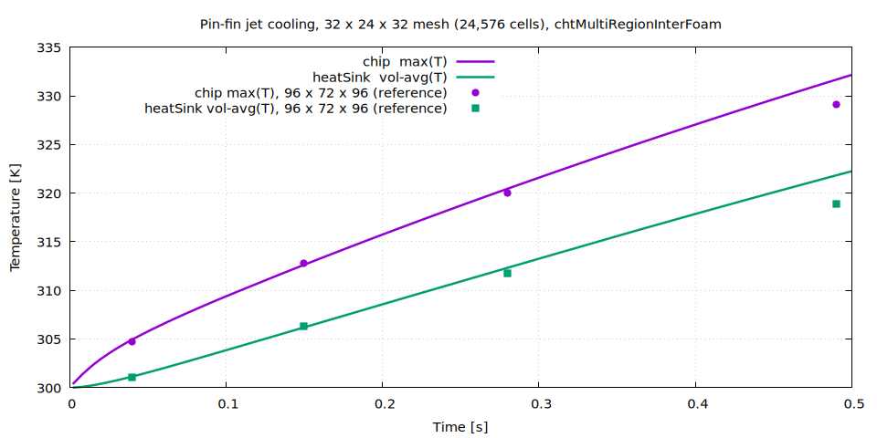
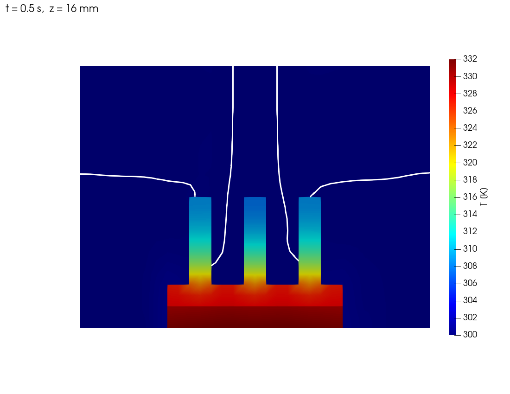
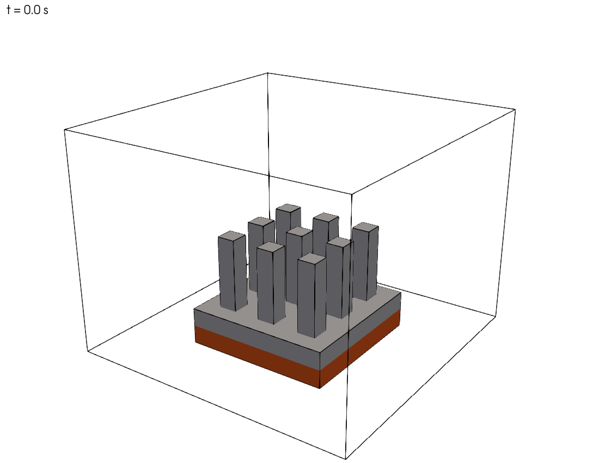
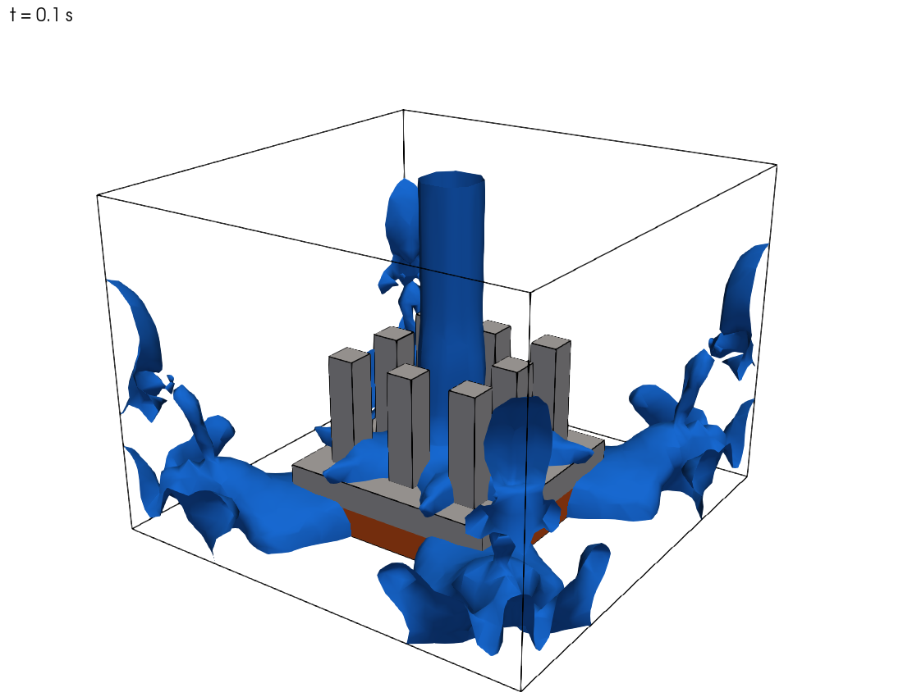
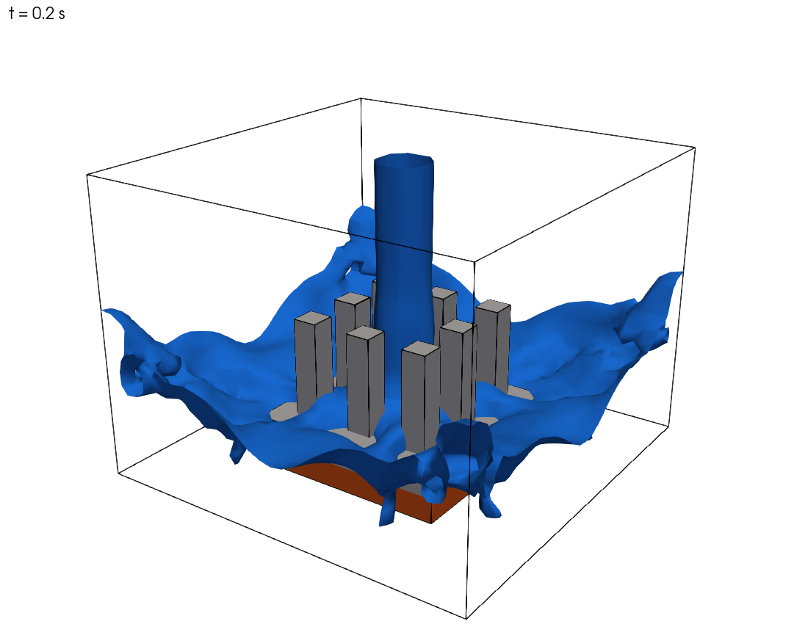
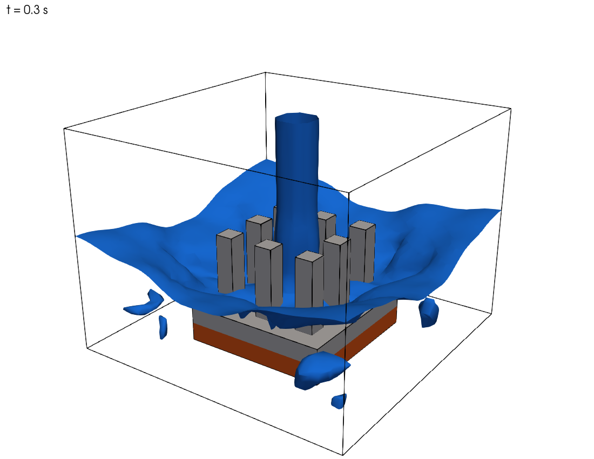
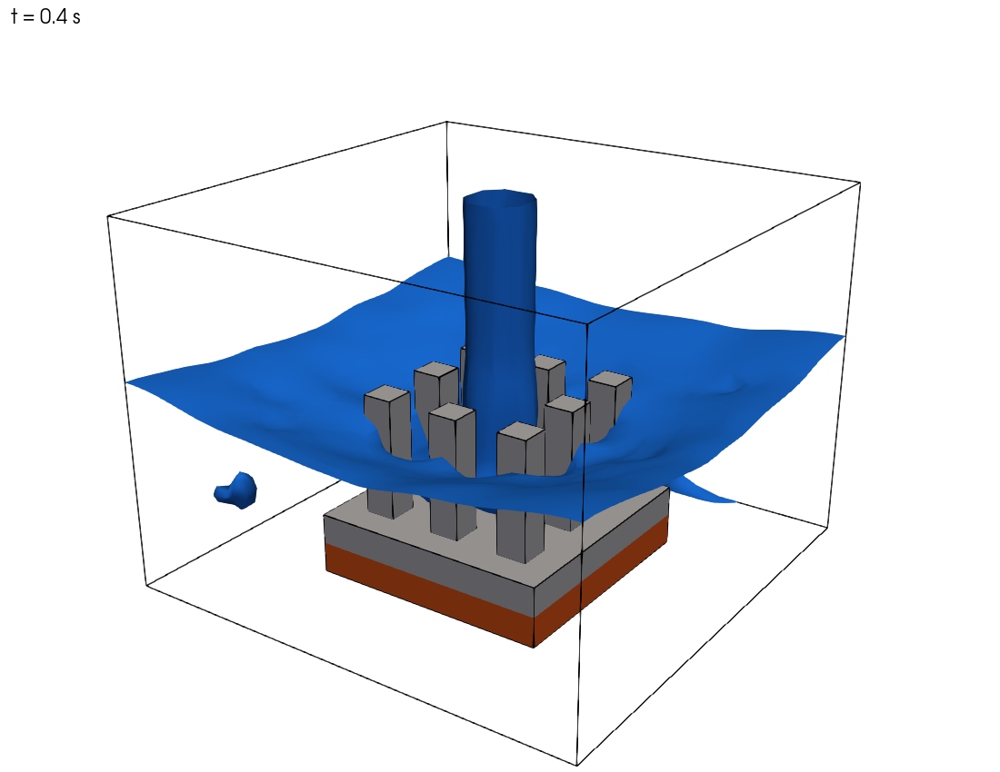
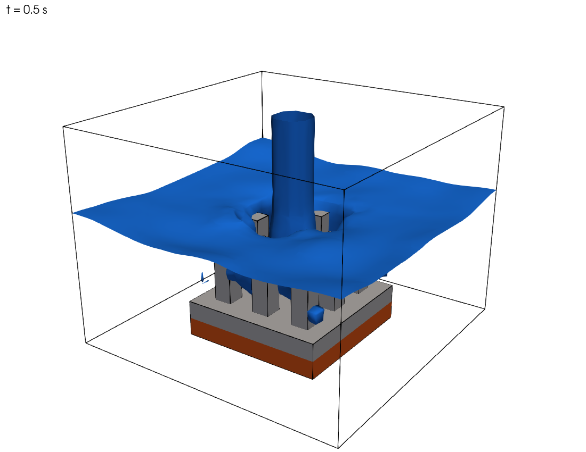

# 예제 19. 다상 유동 + 복합 열전달 (VOF + CHT) : 핀-휜 히트싱크의 액체 제트 충돌 냉각

**참고**:

- 이 예제는 C. Schubert의 [OpenFOAM--MHD--VoF-Solver-Collection](https://github.com/c-schubert/OpenFOAM--MHD--VoF-Solver-Collection)(GPL-3)에서 추출하여 OpenFOAM v2412로 포팅한 외부 솔버 `chtMultiRegionInterFoam`을 이용해, 다상 유동(VOF)과 다중 영역 복합 열전달(CHT)이 결합된 액체 제트 충돌 냉각을 해석하는 예제이다.
- [https://github.com/swtbkim/chtMultiRegionInterFoam](https://github.com/swtbkim/chtMultiRegionInterFoam) : 솔버 소스, 예제 케이스(`examples/pinFinJetCooling`), 검증 보고서
- 이 예제는 OpenFOAM 튜토리얼(한국어판)에 새로 추가된 내용으로, [CC BY-NC-SA 3.0](https://creativecommons.org/licenses/by-nc-sa/3.0/) 라이선스 하에 배포된다.
- 이 자료는 ESI Group, ESI-OpenCFD 또는 OpenFOAM Foundation에 의해 승인된 자료가 아니다.

**호환성**:

- 이 예제에 수록된 명령어 및 케이스 파일은 OpenFOAM v2412를 기반으로 작성되었다.
- `chtMultiRegionInterFoam`은 OpenFOAM에 내장된 기본 솔버가 아니라 외부 솔버이다. 따라서 소스 코드를 받아서 직접 빌드해야 한다([부록 A.3](#a3-빌드)).

**선행 학습**:

- [예제 8. 다상 유동 (Volume of fluid, VOF)](08_다상-유동-Volume-of-fluid-VOF.md) : `interFoam`을 이용한 VOF 계면 포착
- [예제 9. 병렬 계산 기법](09_병렬-계산-기법.md) : `compressibleInterFoam`을 이용한 압축성 2상 유동과 병렬 계산
- [예제 13. 격자 생성 도구 (`snappyHexMesh` - 다중 영역)](13_격자-생성-도구-snappyHexMesh-다중-영역.md) : `chtMultiRegionFoam`을 이용한 다중 영역 복합 열전달

---

## 목차

1. 배경
   - 1.1 문제 정의
   - 1.2 왜 새 솔버가 필요한가
   - 1.3 지배 방정식
   - 1.4 솔버의 계산 순서
2. 전처리
   - 2.1 케이스 디렉터리 구조
   - 2.2 격자 생성
   - 2.3 영역 정의 — `constant/regionProperties`
   - 2.4 유체 영역 물성
   - 2.5 고체 영역 물성과 발열원
   - 2.6 경계 및 초기 조건
   - 2.7 수치 기법과 솔버 설정
3. 솔버 실행
4. 후처리
   - 4.1 로그로 해석 건전성 확인하기
   - 4.2 칩·히트싱크 온도 이력
   - 4.3 온도 분포
   - 4.4 물 계면(제트) 거동 — `alpha.water = 0.5` 등가면
   - 4.5 ParaView 에서 직접 보기
   - 4.6 물리적 해석
5. 확장 및 주의사항
- 부록 A. 솔버 추출 및 빌드

---

## 1. 배경

### 1.1 문제 정의

이 예제에서는 칩에서 발생하는 열을 **핀-휜 히트싱크(pin-fin heat sink)** 와 **액체 제트 충돌(liquid jet impingement)** 로 냉각하는 과정을 해석한다. 물리적으로 서로 다른 세 개의 영역이 동시에 등장한다.

- **chip** : 발열체. 일정 열량 `150 W` 를 균일하게 발생시킨다.
- **heatSink** : 칩 위에 부착된 알루미늄 히트싱크. 바닥판(base)과 3 x 3 사각 핀으로 구성된다.
- **fluid** : 히트싱크 주위의 유체 영역. 초기에는 공기로 가득 차 있고, 상단 노즐에서 **액체 제트**가 아래로 분사되어 핀에 충돌·냉각한다.

즉 이 예제는 두 가지 물리 현상이 결합된 문제를 다룬다.

1. **다상 유동 (VOF)** — 물과 공기가 뚜렷한 계면을 사이에 두고 분리되어 흐른다. [예제 8](./08_다상-유동-Volume-of-fluid-VOF.md)의 `interFoam` 댐 붕괴와 동일한 계면 포착(interface capturing) 기법을 사용한다.
2. **복합 열전달 (Conjugate Heat Transfer, CHT)** — 고체(칩, 히트싱크)의 열전도와 유체의 대류 열전달이 고체-유체 계면에서 연속적으로 연결된다. [예제 13](./13_격자-생성-도구-snappyHexMesh-다중-영역.md)의 `chtMultiRegionFoam` 와 동일한 다중 영역 결합을 사용한다.

```text
                    │  │   물 제트 (1.5 m/s, 300 K)
                    ▼  ▼
        ┌────────────────────────────────────────┐  ← outlet (상단, 공기/물 배출)
        │      nozzle (4 x 4 mm)                 │
        │   ┌──┐  ┌──┐  ┌──┐                     │
        │   │  │  │  │  │  │  pin (Al, 8 mm)     │   fluid (공기 + 물, VOF)
        │   │  │  │  │  │  │                     │
        │ ══╧══╧══╧══╧══╧══╧══  base (Al)        │
        │ ▓▓▓▓▓▓▓▓▓▓▓▓▓▓▓▓▓▓▓▓  chip (Si, 150 W) │
        └────────────────────────────────────────┘  ← bottom (단열)
              32 x 24 x 32 mm

* 상단 노즐에서 분사된 물 제트가 칩 위 알루미늄 핀-휜 히트싱크(3 x 3 핀)에 충돌하여 냉각
```

### 1.2 왜 새 솔버가 필요한가

표준 OpenFOAM 솔버만으로는 이 문제를 한 번에 풀 수 없다.

| 솔버 | 다상(VOF) | 에너지 방정식 | 다중 영역 CHT |
| :--- | :---: | :---: | :---: |
| `interFoam` | O | X (등온) | X |
| `compressibleInterFoam` | O | O | X (단일 영역) |
| `chtMultiRegionFoam` | X (단상) | O | O |
| **`chtMultiRegionInterFoam`** | **O** | **O** | **O** |

`chtMultiRegionInterFoam` 은 **유체 영역에서는 `compressibleInterFoam`(압축성 2상 VOF + 에너지)** 을, **고체 영역에서는 `chtMultiRegionFoam`(열전도)** 를 사용하고, 두 영역을 온도 결합 경계조건으로 묶은 솔버이다. 즉 `compressibleInterFoam` 과 `chtMultiRegionFoam` 을 합친 형태이다.

> **Note:** 이 솔버는 OpenFOAM 기본 배포본에 포함되어 있지 않다. c-schubert 의 [OpenFOAM--MHD--VoF-Solver-Collection](https://github.com/c-schubert/OpenFOAM--MHD--VoF-Solver-Collection) 에서 추출하여 v2412 로 포팅하였다. 솔버 추출·빌드 방법은 [부록 A](#부록-a-솔버-추출-및-빌드)에 정리한다.

### 1.3 지배 방정식

**유체 영역 (압축성 2상 VOF).** 물의 체적 분율 $\alpha_1$ 에 대한 이류(advection) 방정식을 MULES (Multidimensional universal limiter for explicit solution) 알고리즘으로 푼다.

$$\frac{\partial \alpha_1}{\partial t} + \nabla\cdot(\alpha_1 \mathbf{U}) + \nabla\cdot\big(\alpha_1(1-\alpha_1)\,\mathbf{U}_r\big) = 0$$

혼합물 밀도·점성은 $\rho = \alpha_1\rho_1 + \alpha_2\rho_2$, $\mu = \alpha_1\mu_1 + \alpha_2\mu_2$ 로 정의된다. 운동량 방정식에는 중력과 표면장력(연속 표면력, CSF)이 포함된다.

$$\frac{\partial(\rho\mathbf{U})}{\partial t} + \nabla\cdot(\rho\mathbf{U}\mathbf{U}) = -\nabla p_{rgh} - (\mathbf{g}\cdot\mathbf{x})\nabla\rho + \nabla\cdot\boldsymbol{\tau} + \sigma\kappa\nabla\alpha_1$$

에너지 방정식은 온도 $T$ 형태로 풀린다.

**고체 영역 (열전도).** 엔탈피 $h$ 에 대한 전도 방정식을 풀고, 칩 영역에는 발열원 $\dot{q}$ 가 더해진다.

$$\frac{\partial(\rho h)}{\partial t} - \nabla\cdot(\alpha_h \nabla h) = \dot{q}$$

**계면 결합.** 고체-유체, 고체-고체 계면에서 온도와 열유속이 연속이 되도록 `compressible::turbulentTemperatureRadCoupledMixed` 경계조건이 양쪽 영역의 $T$ 를 결합한다.

$$T_s = T_f, \qquad k_s \frac{\partial T_s}{\partial n} = k_f \frac{\partial T_f}{\partial n}$$

### 1.4 솔버의 계산 순서

`chtMultiRegionInterFoam` 은 영역마다 방정식을 따로 풀고, 영역 사이의 열 교환은 결합 경계조건이 주고받는다. 이 예제의 설정(`nOuterCorrectors 1`, [2.7절](#27-수치-기법과-솔버-설정))에서 한 시간 간격(time step)은 다음 순서로 진행된다.

```text
시간 간격 n → n+1
 ├─ fluid 영역 (compressibleInterFoam 과 동일)
 │    ├─ alpha.water  : MULES 로 계면 이동 (부분 순환 nAlphaSubCycles 회)
 │    ├─ U            : 운동량 행렬 조립 (momentumPredictor no → 직접 풀지는 않음)
 │    ├─ T            : 유체 에너지 방정식
 │    └─ p_rgh        : 압력 보정 nCorrectors 회 → U, phi 갱신
 ├─ heatSink 영역 : h 전도 방정식
 └─ chip 영역     : h 전도 방정식 + 150 W 발열원
```

각 영역은 다른 영역의 **가장 최근 온도**를 경계값으로 사용한다. 이처럼 한 간격 안에서 영역을 한 번씩 차례로 푸는 방식을 **명시적(explicit) 결합** 또는 분리(segregated) 결합이라 한다. 한 시간 간격마다 영역 간 온도 분포에 필연적으로 지연 효과가 발생하기 때문에, 이 온도 지연 효과를 무시할 수 있을 만큼 시간 간격을 충분히 작게 설정해야 한다.

---

## 2. 전처리

### 2.1 케이스 디렉터리 구조

다중 영역 케이스는 `constant/`, `system/`, `0/` 아래에 **영역별 하위 폴더**를 둔다.

```bash
pinFinJetCooling
├── Allrun                      # 전체 실행 스크립트
├── Allclean
├── constant
│   ├── g                       # 중력 (전역)
│   ├── regionProperties        # 영역 목록 (fluid / solid)
│   ├── fluid
│   │   ├── thermophysicalProperties        # phases (water air)
│   │   ├── thermophysicalProperties.water  # 물 (perfectFluid)
│   │   ├── thermophysicalProperties.air    # 공기 (perfectGas)
│   │   ├── turbulenceProperties            # laminar
│   │   └── radiationProperties             # none
│   ├── heatSink
│   │   └── thermophysicalProperties        # 알루미늄 (heSolidThermo)
│   └── chip
│       └── thermophysicalProperties        # 실리콘 (heSolidThermo)
├── system
│   ├── blockMeshDict           # 배경 격자
│   ├── topoSetDict             # chip/heatSink/fluid 셀존 + 노즐 면집합
│   ├── createPatchDict         # nozzle 패치 생성
│   ├── controlDict
│   ├── fvSchemes / fvSolution  # 전역(상위) 설정
│   ├── fluid    {fvSchemes, fvSolution}
│   ├── heatSink {fvSchemes, fvSolution}
│   └── chip     {fvSchemes, fvSolution, fvOptions(발열원)}
└── 0.orig                      # 초기/경계장 (Allrun 이 0/ 로 복사)
    ├── fluid    {alpha.water, U, T, p, p_rgh}
    ├── heatSink {T, p}
    └── chip     {T, p}
```

> **Note:** 솔버 저장소에 들어 있는 예제 케이스(`examples/pinFinJetCooling`)의 설정이 이 문서와 다를 수 있다. 실행 전에 `system/blockMeshDict` 의 격자 분할(2.2절)과 상위 `system/fvSolution`(2.7절)을 이 문서의 값과 맞춘다.

### 2.2 격자 생성

핀-휜 형상은 다음 네 단계로 생성한다. 모든 핀이 격자선에 정확히 정렬되는 정육면체(Cartesian) 격자를 쓰므로 격자 품질이 완벽하다(비직교도 0). 이 예제는 셀 크기 1 mm 의 32 x 24 x 32 = 24,576 셀을 사용한다. 이 격자는 학습용이며, 4코어 병렬로 1분 안팎에 끝까지 계산된다.

```bash
blockMesh                                   # 32 x 24 x 32 mm, 1 mm 셀 (단일 블록)
topoSet                                     # chip/heatSink/fluid 셀존 + nozzle 면집합
createPatch -overwrite                      # 상단 outlet 에서 nozzle 패치 분리
splitMeshRegions -cellZones -overwrite      # 영역별 격자 분할 + 결합 패치 자동 생성
```

`system/blockMeshDict` — mm 단위로 좌표를 적고 `scale 0.001` 로 m 로 변환한다.

```cpp
scale   0.001;

vertices
(
    (  0  0  0 ) (  32  0  0 ) (  32 24  0 ) (  0 24  0 )
    (  0  0 32 ) (  32  0 32 ) (  32 24 32 ) (  0 24 32 )
);

blocks
(
    hex (0 1 2 3 4 5 6 7) (32 24 32) simpleGrading (1 1 1)   // 1 mm 셀
);
```

`system/topoSetDict` — `boxToCell` 로 칩·히트싱크(바닥판 + 9개 핀)·유체 셀존을 정의한다. 핀은 2 mm 사각, 높이 8 mm, 5 mm 피치의 3 x 3 배열이다. 모든 좌표가 mm 정수이므로 1 mm 격자에서도 형상이 정확히 맞는다.

```cpp
actions
(
    // 칩 (실리콘 다이) : x,z [8,24] mm, y [0,2] mm
    { name chipCells; type cellSet; action new; source boxToCell;
      box (0.008 0.000 0.008) (0.024 0.002 0.024); }
    { name chip; type cellZoneSet; action new; source setToCellZone; set chipCells; }

    // 히트싱크 = 바닥판 + 핀 (모두 같은 셀존에 add)
    { name heatSinkCells; type cellSet; action new; source boxToCell;
      box (0.008 0.002 0.008) (0.024 0.004 0.024); }              // 바닥판
    { name heatSinkCells; type cellSet; action add; source boxToCell;
      box (0.010 0.004 0.010) (0.012 0.012 0.012); }              // 핀 1 (이하 9개)
    // ... (핀 2~9) ...
    { name heatSink; type cellZoneSet; action new; source setToCellZone; set heatSinkCells; }

    // 유체 = 전체 - 칩 - 히트싱크
    { name fluidCells; type cellSet; action new; source boxToCell; box (-1 -1 -1) (1 1 1); }
    { name fluidCells; type cellSet; action delete; source cellToCell; set chipCells; }
    { name fluidCells; type cellSet; action delete; source cellToCell; set heatSinkCells; }
    { name fluid; type cellZoneSet; action new; source setToCellZone; set fluidCells; }

    // 노즐 면집합 = 상단 outlet 패치 ∩ 중앙 4 x 4 mm
    { name nozzleFaces; type faceSet; action new;    source patchToFace; patch outlet; }
    { name nozzleFaces; type faceSet; action subset; source boxToFace;
      box (0.014 0.020 0.014) (0.018 0.026 0.018); }
);
```

`splitMeshRegions` 는 각 셀존을 독립 영역 격자로 나누고, 영역이 맞닿는 면에 `<영역>_to_<이웃영역>` 형태의 **결합(mapped) 패치**를 자동 생성한다. 분할 결과는 다음과 같다.

| 영역 | 셀 수 | 패치 |
| :--- | :---: | :--- |
| fluid | 23,264 | `nozzle`, `outlet`, `walls`, `bottom`, `fluid_to_chip`, `fluid_to_heatSink` |
| heatSink | 800 | `heatSink_to_chip`, `heatSink_to_fluid` |
| chip | 512 | `bottom`, `chip_to_fluid`, `chip_to_heatSink` |

> **Note:** 칩의 옆면은 유체와 직접 닿으므로 `chip_to_fluid` 패치가 생성된다. 즉 칩은 윗면(히트싱크)과 옆면(유체) 양쪽으로 냉각된다.

### 2.3 영역 정의 — `constant/regionProperties`

```cpp
regions
(
    fluid       (fluid)
    solid       (heatSink chip)
);
```

### 2.4 유체 영역 물성

압축성 2상 혼합물을 정의한다(`twoPhaseMixtureThermo`). 상(phase) 목록·표면장력·최소압력은 `constant/fluid/thermophysicalProperties` 에 둔다.

```cpp
phases          (water air);
pMin            10000;
sigma { type constant; sigma 0.07; }     // 물-공기 표면장력 [N/m]
```

각 상은 별도 파일로 정의한다. 물은 `perfectFluid`(약압축성), 공기는 `perfectGas` 이다.

```cpp
// constant/fluid/thermophysicalProperties.water
thermoType
{
    type            heRhoThermo;     mixture  pureMixture;
    transport       const;           thermo   hConst;
    equationOfState perfectFluid;    specie   specie;
    energy          sensibleInternalEnergy;
}
mixture
{
    specie          { molWeight 18.0; }
    equationOfState { R 3000; rho0 1027; }    // rho ~ 1027 kg/m^3
    thermodynamics  { Cp 4195; Hf 0; }
    transport       { mu 3.645e-4; Pr 2.289; }
}
```

중력은 전역 파일 `constant/g` 에 정의한다(-y 방향).

```cpp
dimensions  [0 1 -2 0 0 0 0];
value       (0 -9.81 0);
```

### 2.5 고체 영역 물성과 발열원

고체는 `heSolidThermo` + `constIso`(등방 열전도 `kappa`) 를 사용한다.

```cpp
// constant/heatSink/thermophysicalProperties  (알루미늄)
mixture
{
    transport       { kappa 205; }       // W/m/K
    thermodynamics  { Hf 0; Cp 900; }
    equationOfState { rho 2700; }
}
// constant/chip/thermophysicalProperties     (실리콘): kappa 149, Cp 705, rho 2329
```

발열량은 칩 영역의 에너지 방정식에 `scalarSemiImplicitSource` 로 `150 W` 를 주입한다(`system/chip/fvOptions`).

```cpp
gpuHeatSource
{
    type            scalarSemiImplicitSource;
    selectionMode   all;            // chip 영역 전체
    volumeMode      absolute;       // [W]
    sources         { h (150 0); }  // (Su Sp): 150 W 발열, 음함수항 0
}
```

### 2.6 경계 및 초기 조건

초기에 영역은 공기로 가득 차 있고(`alpha.water = 0`), 모든 온도는 `300 K` 이다. 주요 경계조건은 다음과 같다.

| 필드 | nozzle (제트 입구) | outlet (상단) | walls / bottom | 고체-유체 계면 |
| :--- | :--- | :--- | :--- | :--- |
| `alpha.water` | `fixedValue 1` | `inletOutlet 0` | `zeroGradient` | `zeroGradient` |
| `U` | `fixedValue (0 -1.5 0)` | `pressureInletOutletVelocity` | `noSlip` | `noSlip` |
| `T` | `fixedValue 300` | `inletOutlet 300` | `zeroGradient` | **결합 BC** |
| `p_rgh` | `fixedFluxPressure` | `totalPressure 1e5` | `fixedFluxPressure` | `fixedFluxPressure` |

고체-유체, 고체-고체 계면의 온도 결합은 다음과 같이 지정한다(유체쪽은 `kappaMethod fluidThermo`, 고체쪽은 `solidThermo`).

```cpp
// 예) 0.orig/chip/T 의 chip_to_heatSink, chip_to_fluid 패치
type            compressible::turbulentTemperatureRadCoupledMixed;
Tnbr            T;
kappaMethod     solidThermo;
qrNbr           none;   qr   none;
value           uniform 300;
```

> **Note:** 칩 바닥면(`bottom`)은 `zeroGradient`(단열)로 두었다. 따라서 발생한 열은 전부 히트싱크와 유체를 통해서만 빠져나가며, 이는 냉각 성능을 보수적으로 평가하는 설정이다.

### 2.7 수치 기법과 솔버 설정

**상위(전역) `system/fvSolution`.** 다중 영역 케이스에는 전역 격자가 없으므로, 상위 `system/fvSolution` 에는 영역 결합을 제어하는 `PIMPLE` 항목만 둔다. 이 예제는 외부 보정을 한 번만 수행한다([1.4절](#14-솔버의-계산-순서)의 명시적 결합).

```cpp
// system/fvSolution (상위)
PIMPLE
{
    nOuterCorrectors 1;
}
```

**유체 영역 `system/fluid/fvSolution`.** `alpha.water`(MULES), `p_rgh`, `U`, `T` 선형 솔버와 PIMPLE 보정을 둔다. 구성은 [예제 9](./09_병렬-계산-기법.md)의 `compressibleInterFoam` 과 같다.

```cpp
"alpha.water.*"
{
    nAlphaCorr 1; nAlphaSubCycles 2; cAlpha 1;
    MULESCorr no; nLimiterIter 5;
    solver smoothSolver; smoother symGaussSeidel; tolerance 1e-8; relTol 0;
}
PIMPLE { momentumPredictor no; transonic no; nCorrectors 2; nNonOrthogonalCorrectors 0; }
```

- `nAlphaSubCycles 2` : 한 시간 간격 동안 계면 이동(MULES)을 dt/2 로 두 번 나누어 푼다.
- `nCorrectors 2` : 한 간격 안에서 압력 방정식을 두 번 풀어 속도-압력을 맞춘다.
- `momentumPredictor no` : 운동량 방정식은 직접 풀지 않고 압력 보정에만 쓴다.

**고체 영역 `system/<solid>/fvSolution`.** 엔탈피 `h` 하나만 푼다. `hFinal` 은 시간 간격의 마지막 풀이에 쓰이는 설정이며, `nOuterCorrectors 1` 에서는 모든 풀이가 마지막 풀이이므로 `hFinal` 이 적용된다.

```cpp
solvers
{
    h      { solver PCG; preconditioner DIC; tolerance 1e-07; relTol 0.1; }
    hFinal { $h; relTol 0; }
}
```

**시간 제어 `system/controlDict`.** 적응 시간 간격(adjustable time step)을 사용한다. 시간 간격은 유동 Courant 수(`maxCo`)와 **VOF 계면 Courant 수(`maxAlphaCo`)** 중 더 엄격한 쪽과 고체 확산수로 동시에 제어한다.

```cpp
application     chtMultiRegionInterFoam;
endTime         0.5;
deltaT          1e-5;
writeControl    adjustable;   writeInterval 0.02;   writeFormat binary;
adjustTimeStep  yes;
maxCo           0.5;   maxAlphaCo 0.5;   maxDeltaT 1e-3;
```

`controlDict` 의 함수 객체 두 개가 칩 최고온도(`chipTemperature`, `max`)와 히트싱크 평균온도(`heatSinkTemperature`, `volAverage`)를 20 간격마다 기록한다. 4.2절에서 이 값을 그린다.

---

## 3. 솔버 실행

먼저 솔버가 빌드되어 있어야 한다([부록 A](#부록-a-솔버-추출-및-빌드) 참고). 빌드 후 케이스 실행은 `Allrun` 한 줄로 끝난다.

```bash
cd chtMultiRegionInterFoam/examples/pinFinJetCooling   # 부록 A.3 에서 받은 솔버 저장소의 예제 케이스
# (2.1절 Note 대로 설정을 맞춘 뒤)
./Allclean       # (선택) 이전 결과 정리
./Allrun         # 격자 → 분할 → 4코어 병렬 풀이 → 재구성(reconstruct)
```

`Allrun` 내부는 다음과 같다.

```bash
runApplication blockMesh
runApplication topoSet
runApplication createPatch -overwrite
runApplication splitMeshRegions -cellZones -overwrite
restore0Dir                                       # 0.orig → 0 (영역별)
runApplication decomposePar -allRegions -force    # 영역별 4분할
runParallel $(getApplication)                     # mpirun -np 4 chtMultiRegionInterFoam -parallel
runApplication reconstructPar -allRegions -newTimes
```

> **Note:** `decomposePar -allRegions` 는 상위 `system/decomposeParDict` 가 아니라 **영역별** `system/<region>/decomposeParDict` 를 읽는다. 따라서 `fluid`, `heatSink`, `chip` 각각에 동일한 분할 설정(`numberOfSubdomains 4; method scotch;`)을 두어야 한다.

> **Note:** 물리 코어 수가 랭크 수보다 적은 (하이퍼스레딩 등) 환경에서는 `OMPI_MCA_rmaps_base_oversubscribe=1` 을 export 하거나 `mpirun --use-hwthread-cpus` 를 사용한다. 병렬 계산 없이 단일 코어로 돌리려면 `Allrun` 의 `decomposePar`, `runParallel`, `reconstructPar` 세 줄을 삭제하고 `runApplication $(getApplication)` 한 줄을 추가한다.

이 격자에서는 4코어 병렬로 `t = 0.5 s` 까지 약 1분이 걸린다(2,041 시간 간격, i7-14700KF 에서 실행 시간 56 s). 실행 로그 `log.chtMultiRegionInterFoam` 의 한 간격은 다음과 같다(마지막 간격 `t = 0.5 s`).

```text
Time = 0.5

Solving for fluid region fluid
MULES: Solving for alpha.water
Phase-1 volume fraction = 0.51521974  Min(alpha.water) = -1.1145885e-18  Max(alpha.water) = 1
MULES: Solving for alpha.water
Phase-1 volume fraction = 0.51536492  Min(alpha.water) = -1.1393506e-18  Max(alpha.water) = 1
smoothSolver:  Solving for T, Initial residual = 0.0020100112, Final residual = 1.2295043e-08, No Iterations 2
GAMG:  Solving for p_rgh, Initial residual = 0.0016417138, Final residual = 1.9144219e-06, No Iterations 2
GAMG:  Solving for p_rgh, Initial residual = 1.6619737e-05, Final residual = 2.1707497e-08, No Iterations 3

Solving for solid region heatSink
DICPCG:  Solving for h, Initial residual = 0.00090937872, Final residual = 6.9373714e-08, No Iterations 2
Min/max T:307.27206 329.4829

Solving for solid region chip
DICPCG:  Solving for h, Initial residual = 0.0096026362, Final residual = 6.2832117e-09, No Iterations 3
Min/max T:328.76739 332.15998
ExecutionTime = 55.85 s  ClockTime = 55 s
```

1.4절의 계산 순서를 그대로 확인할 수 있다.

- `MULES` 두 줄은 `nAlphaSubCycles 2` 의 두 부분 순환이다.
- `T` 다음의 `p_rgh` 두 줄은 `nCorrectors 2` 이다.
- 이어서 `heatSink`, `chip` 순서로 `h` 를 한 번씩 푼다. 각 영역의 `Min/max T` 로 온도 상승을 바로 추적할 수 있다.

---

## 4. 후처리

### 4.1 로그로 해석 건전성 확인하기

결과 그림을 보기 전에, 로그에서 해석이 제대로 진행되었는지 확인한다.

```bash
grep -c "^Time = " log.chtMultiRegionInterFoam                     # number of time steps
grep -cE "FOAM FATAL|nan" log.chtMultiRegionInterFoam               # must be 0
grep "Phase-1 volume fraction" log.chtMultiRegionInterFoam |
  awk '{split($0,a,"Min\\(alpha.water\\) = "); split(a[2],b," "); if(b[1]+0<lo) lo=b[1]+0}
       END{print "min(alpha.water) over run =", lo}'
```

| 점검 항목 | 결과 | 판정 |
| :--- | :--- | :--- |
| 종료 | `End` 까지 도달, `FATAL`/`nan` 0 건 | 정상 |
| `alpha.water` 범위 | 전 구간 최소 -5.8e-17, 최대 1 | 유계 (기계 정밀도 수준) |
| 시간 간격 | 2,041 간격, dt 1e-5 → 최대 3.2e-4 s | 정상 |
| Courant 수 | 유동 최대 0.61, 계면 최대 0.63 | 목표 0.5 부근 (적응 시간 간격의 순간 초과) |

**물의 양으로 질량 보존 확인.** 출구가 상단에 있어 0.5 s 동안 물은 도메인 밖으로 거의 나가지 않는다. 따라서 로그의 `Phase-1 volume fraction`(유체 영역 중 물의 체적 비율)은 노즐에서 들어온 물의 양과 같아야 한다.

$$\frac{V_{water}}{V_{fluid}} = \frac{U_{jet} A_{nozzle}\, t}{V_{fluid}} = \frac{1.5 \times (0.004)^2 \times t}{2.3264\times10^{-5}} \approx 1.032\,t$$

| 시간 [s] | 0.1 | 0.2 | 0.3 | 0.4 | 0.5 |
| :--- | :---: | :---: | :---: | :---: | :---: |
| 이론값 (1.032 t) | 0.103 | 0.206 | 0.310 | 0.413 | 0.516 |
| 로그 `Phase-1 volume fraction` | 0.103 | 0.206 | 0.309 | 0.412 | 0.515 |

두 값의 차이는 모든 시각에서 0.0004 정도로 일정하고 커지지 않는다. 즉 VOF 계산이 물의 양을 올바르게 보존하고 있다. 처음 해석하는 케이스에서는 이처럼 **손으로 계산할 수 있는 양**을 해석 로그와 비교하는 습관을 들이는 것이 좋다.

### 4.2 칩·히트싱크 온도 이력

`controlDict` 의 함수 객체가 기록한 파일은 다음과 같다.

```bash
postProcessing/chip/chipTemperature/0/volFieldValue.dat        # chip  max(T)
postProcessing/heatSink/heatSinkTemperature/0/volFieldValue.dat # heatSink volAverage(T)
```

기록된 값을 이용해 `gnuplot`으로 시간에 따른 칩 최고 온도 및 히트싱크 평균 온도를 플롯한다.

```bash
gnuplot -p -e "set xlabel 'Time [s]'; set ylabel 'T [K]'; set grid; \
  plot 'postProcessing/chip/chipTemperature/0/volFieldValue.dat' u 1:2 w l t 'chip max(T)', \
       'postProcessing/heatSink/heatSinkTemperature/0/volFieldValue.dat' u 1:2 w l t 'heatSink avg(T)'"
```



| 시간 [s] | 칩 max(T) [K] | 히트싱크 평균 T [K] |
| :---: | :---: | :---: |
| 0.1 | 309.4 | 303.9 |
| 0.2 | 315.7 | 308.7 |
| 0.3 | 321.6 | 313.5 |
| 0.4 | 327.0 | 317.9 |
| 0.5 | 332.2 | 322.2 |

칩 온도는 `300 K` 에서 시작해 0.5 s 동안 약 `+32 K` 상승한다. 상승 기울기는 0.1 s 당 6.3 K(0.1~0.2 s)에서 5.2 K(0.4~0.5 s)로 조금씩 완만해진다. 그림의 점은 같은 케이스를 조밀 격자(96 x 72 x 96)로 계산한 참고값이며, 둘의 차이는 [5장](#5-확장-및-주의사항)에서 다룬다.

### 4.3 온도 분포

아래 그림은 `t = 0.5 s` 에서 중앙 평면(z = 16 mm, 가운데 핀 줄을 지나는 면)의 온도이다. 흰 선은 같은 평면에서의 물-공기 계면(`alpha.water = 0.5`)이다.



| 영역 | 온도 범위 [K] | 해석 |
| :--- | :---: | :--- |
| chip | 328.8 ~ 332.2 | 발열원, 가장 뜨거움 |
| heatSink | 307.3 ~ 329.5 | 바닥판 ~328 K → 핀 끝 ~307 K |
| fluid | 300.0 ~ 300.9 | 물이 거의 데워지지 않음 |

고체 두 영역의 범위는 로그 마지막 간격의 `Min/max T` 값이다(3장).

- 열은 칩 → 히트싱크 바닥판 → 핀 뿌리 → 핀 끝으로 전도되며, 핀을 따라 약 20 K 의 온도 구배가 생긴다.
- 알루미늄(`kappa 205`)과 실리콘(`kappa 149`)은 열전도가 좋아서, 칩과 바닥판 내부의 온도 차는 몇 K 에 불과하다.
- 흰 계면선을 보면 제트 기둥이 가운데 핀 위로 떨어지고, 고인 물의 수면은 핀 끝(y = 12 mm)보다 조금 높은 y ≈ 13 mm 부근에 있다. 즉 핀은 모두 물에 잠겨 있다.

### 4.4 물 계면(제트) 거동 — `alpha.water = 0.5` 등가면

VOF 계면(물-공기 경계)은 `alpha.water = 0.5` 등가면으로 가장 잘 드러난다. 아래 그림은 `t = 0, 0.1, 0.2, 0.3, 0.4, 0.5 s` 에서의 **계면(파란색)**, **히트싱크·칩 벽면(회색·주황색)**, **도메인 외곽선**을 함께 보여준다.

| | |
| :---: | :---: |
|  |  |
|  |  |
|  |  |

- `t = 0.0 s` : 도메인은 공기로 차 있어 계면이 없다. 알루미늄 핀-휜 히트싱크(회색)와 실리콘 칩(주황색)만 보인다.
- `t = 0.1 s` : 노즐에서 분사된 물 기둥이 핀 사이로 떨어져 바닥판에 충돌하고, 사방으로 튀어 나가 벽면을 타고 오른다.
- `t = 0.2 ~ 0.3 s` : 튀어 나간 물이 바닥에 고이기 시작하고, 물결치는 수면이 형성된다. 중앙의 수직 물기둥(제트)은 계속 유지된다.
- `t = 0.4 ~ 0.5 s` : 수위가 핀 높이까지 올라가 핀이 물에 잠긴다(0.5 s 에 유체 체적의 약 52 %, 4.1절).

> **Note:** 위 그림은 `foamToVTK` 로 VTK 를 추출한 뒤 `pvbatch`(ParaView 배치 모드)로 오프스크린 렌더링하여 생성하였다. 렌더 스크립트는 케이스 내 `render_interface.py` 에 있다.
>
> ```bash
> foamToVTK -allRegions -time '0,0.1,0.2,0.3,0.4,0.5' -fields '(alpha.water T)'
> pvbatch --force-offscreen-rendering render_interface.py
> ```

**격자를 96 x 72 x 96 으로 늘리면.** 1 mm 격자에서 노즐(4 x 4 mm)은 단면에 셀이 4 x 4 개뿐이고, 계면은 셀 2~3 개 두께로 퍼진다. 그래서 위 그림의 계면은 덩어리지고 튄 물방울이 뭉툭하게 보인다. `blockMeshDict` 의 분할을 `(96 72 96)`(1/3 mm 셀, 663,552 셀)으로 늘려서 해석하면 다음과 같은 그림을 얻는다.

| | |
| :---: | :---: |
|  |  |
|  |  |
|  |  |

제트 기둥의 단면이 노즐 모양(사각)을 유지하고, 충돌 뒤 퍼지는 액막이 매끄러운 물결 모양으로 표현된다. `t = 0.5 s` 에는 핀 끝면이 수면에 드러나는 것까지 구분된다. 대신 셀 수가 27배이고 시간 간격도 약 4배 작아지므로 해석에 필요한 시간이 크게 늘어난다(약 7,800 시간 간격, 16코어 병렬 해석 시 약 40~50분). 학습은 거친 격자로 하고, 정량적인 결과가 필요할 때 격자를 늘리는 것이 좋다(5장).

### 4.5 ParaView 에서 직접 보기

```bash
paraFoam -touch-all      # 영역별 .OpenFOAM 파일 생성
paraFoam
```

- **물 계면** : `fluid` 영역에서 `alpha.water` 의 등가면(Contour, value = 0.5) → 제트와 고인 물의 형상.
- **온도장** : 모든 영역에 `T` 컬러맵을 적용하고 중앙 평면(Slice, z = 16 mm)으로 자르면 4.3절의 그림을 얻는다. 영역마다 컬러맵 범위가 따로 잡히므로, 범위를 `300 ~ 332 K` 로 직접 고정해야 영역 간 온도를 비교할 수 있다.
- **속도** : `fluid` 영역의 `U` 벡터/유선으로 제트 충돌 후 퍼지는 흐름 확인.

### 4.6 물리적 해석

`0.5 s` 동안 칩에 투입된 열은 $150\ \text{W} \times 0.5\ \text{s} = 75\ \text{J}$ 이다. 이 열이 어디로 갔는지 고체의 열용량으로 따져 볼 수 있다.

| 영역 | 열용량 $\rho c_p V$ [J/K] | 평균 온도 상승 (t = 0.5 s) | 저장된 열 [J] |
| :--- | :---: | :---: | :---: |
| chip (16 x 16 x 2 mm) | 2329 x 705 x 5.12e-7 = 0.84 | 331.2 - 300 = 31.2 K | 26.2 |
| heatSink (바닥판 + 핀 9개) | 2700 x 900 x 8.0e-7 = 1.94 | 322.3 - 300 = 22.3 K | 43.3 |
| 합계 | 2.78 | | **69.5 (투입열의 약 93 %)** |

- 투입열의 약 93 % 는 아직 고체를 데우는 데 쓰이고 있고, 물로 빠져나간 열은 약 7 %(5.5 J)에 불과하다. 4.3절에서 물의 온도가 300.9 K 를 넘지 않은 것과 맞는다.
- 냉각이 전혀 없다고 가정한 단열 상승률은 $150 / 2.78 \approx 54\ \text{K/s}$ 이다. 0.4~0.5 s 구간의 칩 온도 상승률(약 51 K/s)이 이 값과 거의 같다. 즉 **0.5 s 는 기동 초기 과도 구간**이며, 발열과 냉각이 균형을 이루는 준정상(quasi-steady) 상태는 훨씬 긴 시간 뒤에 온다.
- 핀 끝이 바닥판보다 약 20 K 낮은 것(4.3절)은 핀 끝이 발열원에서 멀고 차가운 물에 잠겨 있기 때문이다. 이 구배가 바로 히트싱크가 물로 열을 내보내는 경로를 보여 준다.

준정상 온도가 목적이라면 `endTime` 을 수 초 이상으로 늘려야 한다. 이때 고체 초기 온도(`0.orig/chip/T`, `0.orig/heatSink/T` 의 `internalField`)를 예상 운전 온도 근처로 주면 계산 시간을 줄일 수 있다.

---

## 5. 확장 및 주의사항

- **격자 의존성** : 4.2절 그림의 거친 격자(32 x 24 x 32) 결과와 조밀 격자(96 x 72 x 96) 참고값을 비교하면 다음과 같다.

  | 시간 [s] | 칩 max(T) 거친 / 조밀 [K] | 히트싱크 평균 T 거친 / 조밀 [K] |
  | :---: | :---: | :---: |
  | 0.04 | 305.1 / 304.7 | 301.2 / 301.1 |
  | 0.15 | 312.9 / 312.8 | 306.4 / 306.3 |
  | 0.28 | 320.7 / 320.0 | 312.5 / 311.8 |
  | 0.49 | 331.9 / 329.1 | 322.0 / 318.9 |

  0.3 s 까지는 1 K 이내로 일치하지만, 물이 고여 핀을 적시기 시작한 뒤에는 거친 격자가 약 3 K 높게 나온다. 1 mm 셀로는 핀 표면의 얇은 열 경계층과 액막을 충분히 해상하지 못해, 물로 빠져나가는 열을 과소평가하는 것으로 보인다. 학습과 설정 확인은 거친 격자로 충분하지만, 정량적인 냉각 성능은 조밀 격자에서 확인해야 한다.
- **난류** : 본 예제는 층류이다. 실제 제트(Re ~ 3 x 10^4)는 난류이므로 `constant/fluid/turbulenceProperties` 를 `RAS`(예: `kOmegaSST`)로 바꾸고 `0/fluid` 에 `k`, `omega`, `nut`, `alphat` 장을 추가하면 된다.
- **접촉각** : 핀 표면의 젖음(wetting)을 모사하려면 `alpha.water` 벽면 경계조건을 `constantAlphaContactAngle` 등으로 바꾼다.
- **isoAdvector** : 더 날카로운 계면이 필요하면 isoAdvector 기반 `chtMultiRegionInterIsoFoam` 을 쓸 수 있으나, 이는 별도 `VoFLibrary` 의 v2412 포팅이 필요하다(본 예제에서는 다루지 않음).

---

## 부록 A. 솔버 추출 및 빌드

### A.1 출처

`chtMultiRegionInterFoam` 은 [c-schubert/OpenFOAM--MHD--VoF-Solver-Collection](https://github.com/c-schubert/OpenFOAM--MHD--VoF-Solver-Collection) (GPL-3, commit `7e0915d`) 의 `solver/chtMultiRegionFoam/chtMultiRegionInterFoam` 에서 추출하였다. 의존 헤더(공유 `solid/`·`include/` + 솔버 자체 `fluid/`)와 헤더 전용 VoF 헤더가 함께 필요하며, 형제 솔버(`dacFoam`·`adsorptionFoam`·`electrostaticSimpleFoam`)와 동일하게 단일 솔버 디렉터리 `src/chtMultiRegionInterFoam/` 아래에 모아 배치하였다.

```bash
chtMultiRegionInterFoam/                      # 배포 저장소 (github.com/swtbkim/chtMultiRegionInterFoam)
├── src/chtMultiRegionInterFoam/              # 솔버 소스 (Allwmake 가 빌드)
│   ├── fluid/  solid/  include/              # 다중 영역 헤더
│   └── VoF/                                  # 헤더 전용 (MULES alphaEqn)
├── examples/pinFinJetCooling/                # 이 예제의 케이스
└── docs/porting/                             # 업스트림 출처 + v2412 포팅 패치
```

### A.2 v2412 포팅 패치

이 솔버는 **OpenFOAM v1912** 용이며, v2412 에서는 한 가지 API 변경 때문에 컴파일이 되지 않는다. 알고리즘과 무관한 **기계적 함수명 변경 4줄**만 적용하면 된다([`docs/porting/v2412-portability.patch`](https://github.com/swtbkim/chtMultiRegionInterFoam/blob/main/docs/porting/v2412-portability.patch)).

```cpp
// chtMultiRegionInterFoam/fluid/solveFluid.H, solid/solveSolid.H
- mesh.data::add("finalIteration", true);     // v1912
+ mesh.data().setFinalIteration(true);         // v2412

- mesh.data::remove("finalIteration");         // v1912
+ mesh.data().setFinalIteration(false);         // v2412
```

이는 v2412 기본 `chtMultiRegionFoam` 이 사용하는 관용구와 동일하다.

> **Note:** 위 4줄이 업스트림 대비 **이식성(portability) 패치의 전부**이다. 배포 드라이버에는 이와 별도로 기본값에서 꺼져 있는 선택 기능이 일부 추가되어 있으나, 이 예제에서는 사용하지 않는다.

### A.3 빌드

```bash
source /usr/lib/openfoam/openfoam2412/etc/bashrc   # 설치 경로에 맞게 조정
git clone https://github.com/swtbkim/chtMultiRegionInterFoam.git
cd chtMultiRegionInterFoam
./Allwmake
# 결과: $FOAM_USER_APPBIN/chtMultiRegionInterFoam
```

유체 영역은 v2412 에 내장된 `compressibleInterFoam` 의 라이브러리(`twoPhaseMixtureThermo`, `VoFphaseCompressibleTurbulenceModels`, `surfaceTensionModels`)를 그대로 링크하므로 추가 빌드가 필요 없다.
