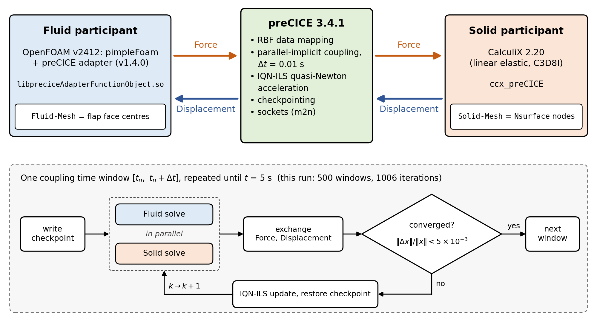
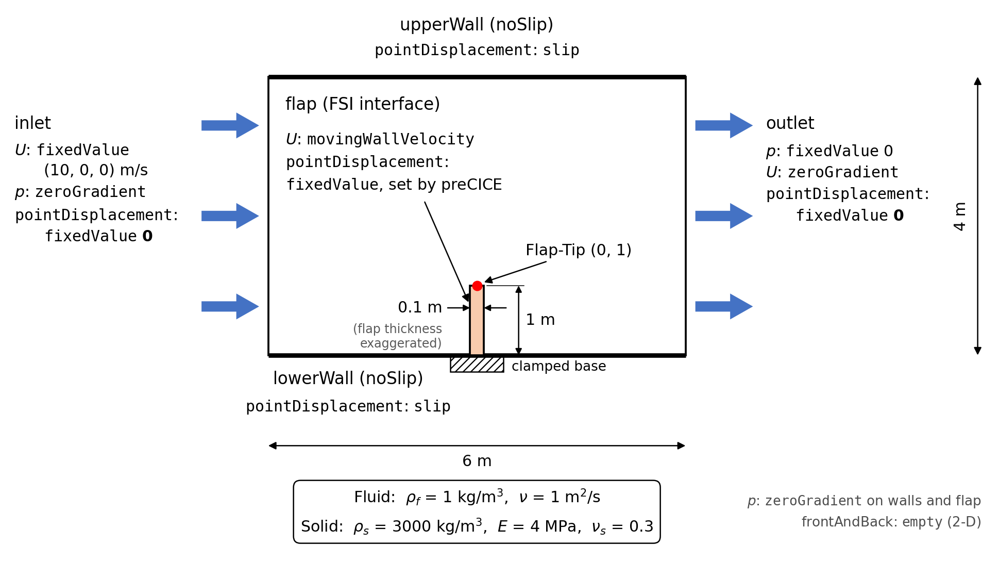
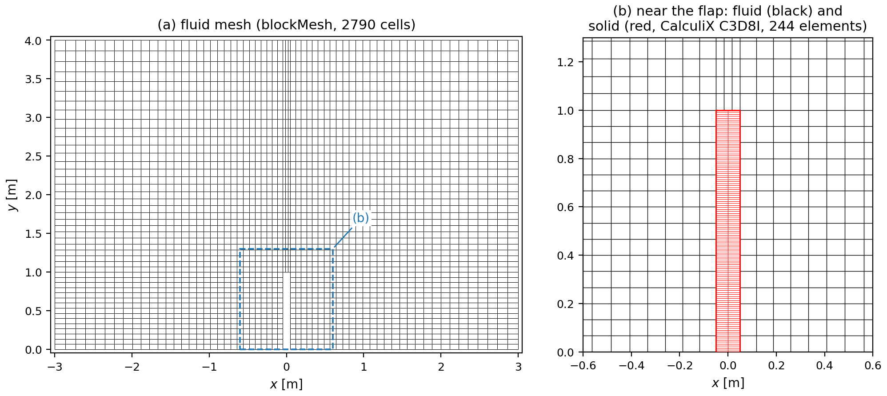
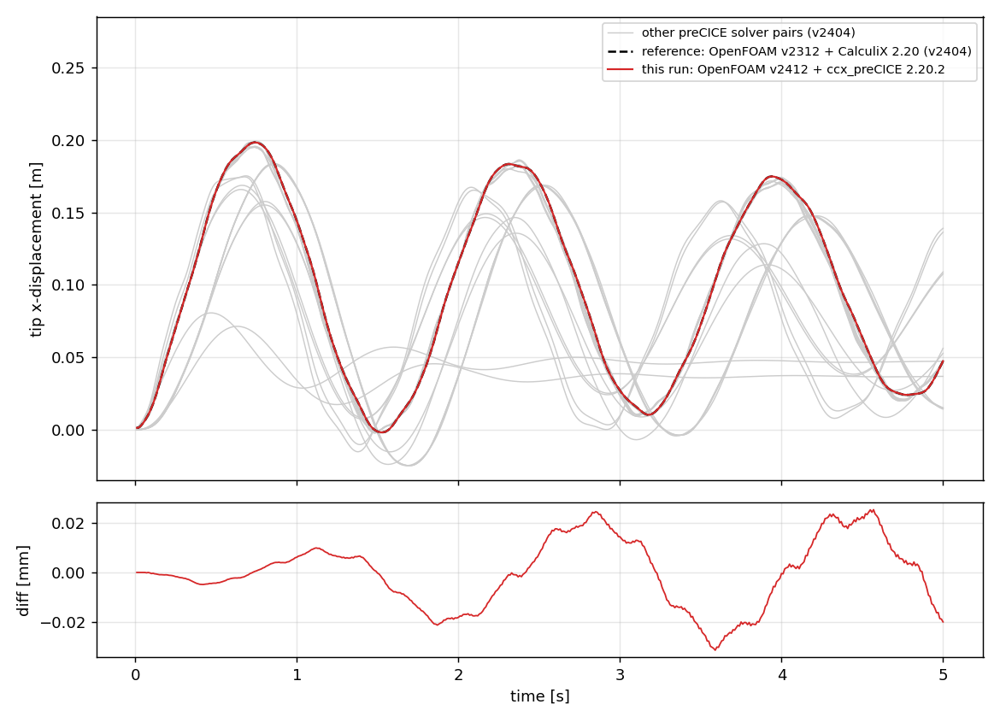
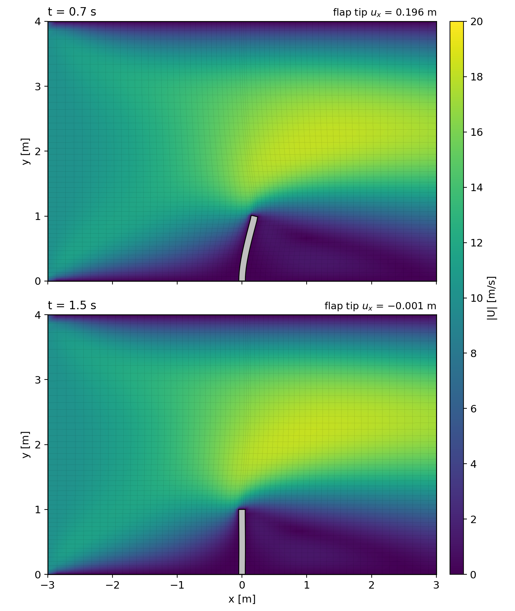

# 예제 21. 유체-구조 연성 해석 (FSI) : OpenFOAM + preCICE + CalculiX

**참고**:

- 이 예제는 연성 라이브러리 [preCICE](https://precice.org)를 이용하여 OpenFOAM(유체)과 CalculiX(구조)를 양방향(two-way)으로 연성하는 유체-구조 연성 해석(Fluid-Structure Interaction, FSI) 예제이다. 해석 케이스는 preCICE 공식 튜토리얼 저장소([https://github.com/precice/tutorials](https://github.com/precice/tutorials), LGPL 3.0)의 perpendicular-flap을 사용한다.
- 사용하는 외부 소프트웨어의 라이선스는 다음과 같다: preCICE (LGPL 3.0), OpenFOAM-preCICE 어댑터 (GPL 3.0), CalculiX-preCICE 어댑터 (GPL 3.0), CalculiX (GPL 2.0).
- 이 예제는 OpenFOAM 튜토리얼(한국어판)에 새로 추가된 내용으로, [CC BY-NC-SA 3.0](https://creativecommons.org/licenses/by-nc-sa/3.0/) 라이선스 하에 배포된다.
- 이 자료는 ESI Group, ESI-OpenCFD 또는 OpenFOAM Foundation에 의해 승인된 자료가 아니다.

**호환성**:

- 이 예제의 명령어와 설정 파일은 [예제 0](00_Ubuntu-24.04-WSL-및-OpenFOAM-v2412-설치-OpenFOAM-솔버-목록.md)의 방법으로 설치한 OpenFOAM v2412 (WSL2, Ubuntu 24.04, /opt/OpenFOAM-v2412 소스 빌드) 환경을 기준으로 작성되었다.
- [예제 20](20_preCICE-연성-해석-환경-구성.md)에서 구성한 환경(preCICE v3.4.1, OpenFOAM-preCICE 어댑터 v1.4.0, CalculiX-preCICE 어댑터 v2.20.2 (CalculiX 2.20))을 그대로 사용하며, 새로 설치할 것은 없다. 해석 케이스는 preCICE 튜토리얼 저장소의 커밋 `e3188113`을 사용한다.
- 해석은 약 40초 걸린다.

**선행 학습**:

- [예제 20. preCICE 연성 해석 환경 구성](20_preCICE-연성-해석-환경-구성.md) : **필수**. preCICE와 CalculiX 어댑터 설치, 환경 스크립트(`~/precice/precice-of-env.sh`), OpenFOAM-preCICE 어댑터 빌드
- [예제 7. 난류 - 비정상 상태](07_난류-비정상-상태.md) : 비정상 비압축성 유동 해석
- [예제 9. 병렬 계산 기법](09_병렬-계산-기법.md) : `decomposePar`, `mpirun`을 이용한 병렬 계산
- [예제 18. 사용자 정의 솔버 만들기](18_사용자-정의-솔버-만들기-전기수력학.md) : 운동학적 압력

---

## 목차

1. 배경
   - 1.1 유체-구조 연성 해석 (FSI)
   - 1.2 연성 방식의 분류
   - 1.3 preCICE
   - 1.4 이동 격자
   - 1.5 이 예제의 도구 선택
2. 예제 개요
3. 해석 환경 확인
4. 해석
   - 4.1 예제 파일 다운로드
   - 4.2 케이스 구조
   - 4.3 preCICE 설정 : precice-config.xml
   - 4.4 유체 participant : fluid-openfoam/
   - 4.5 구조 participant : solid-calculix/
   - 4.6 해석 실행
   - 4.7 해석 출력 확인
   - 4.8 병렬 실행
5. 후처리 및 검증
   - 5.1 연성 수렴 확인
   - 5.2 플랩 끝단 변위
   - 5.3 공식 참조 결과와 비교
   - 5.4 물리적 타당성 확인
   - 5.5 ParaView 가시화
6. 실행 순서 요약
7. 문제 해결
8. 마무리
9. 참고 문헌

## 1. 배경

### 1.1 유체-구조 연성 해석 (FSI)

유체 속의 구조물은 유체로부터 압력과 전단력을 받아 변형된다. 구조물이 변형되면 유체가 흐르는 영역의 형상이 바뀌고, 그 결과 유동장과 구조물에 작용하는 힘도 다시 바뀐다. 이처럼 유체와 구조가 서로 영향을 주고받는 현상을 **유체-구조 연성**(Fluid-Structure Interaction, FSI)이라 한다. 바람에 흔들리는 깃발, 혈관 벽의 박동, 열교환기 튜브의 유체 유발 진동(flow-induced vibration), 항공기 날개의 플러터(flutter), 심장 판막 등이 대표적인 예이다.

FSI 해석은 두 종류의 물리를 함께 풀어야 한다.

- **유체** : 비압축성 Navier-Stokes 방정식 → OpenFOAM의 `pimpleFoam`
- **구조** : 탄성체의 운동 방정식 → 유한요소 해석 프로그램 CalculiX

두 영역은 경계면(interface) $\Gamma$에서 다음 두 조건으로 연결된다.

- **운동학적 조건**(kinematic condition) : 경계면에서 유체의 속도는 구조물의 속도와 같다 (점착(no-slip) 조건).

$$\vec{u}_f = \frac{\partial \vec{d}_s}{\partial t} \qquad \text{on } \Gamma$$

- **동역학적 조건**(dynamic condition) : 경계면에서 유체가 구조물에 가하는 힘과 구조물이 유체에 가하는 힘은 크기가 같고 방향이 반대이다 (작용-반작용).

$$\pmb{\sigma}_f \cdot \vec{n} = \pmb{\sigma}_s \cdot \vec{n} \qquad \text{on } \Gamma$$

여기서 $\vec{u}_f$는 유체 속도, $\vec{d}_s$는 구조물의 변위, $\pmb{\sigma}_f$와 $\pmb{\sigma}_s$는 각각 유체와 구조의 응력 텐서, $\vec{n}$은 경계면의 법선 벡터이다. 이 예제의 연성 해석에서 유체는 경계면에 작용하는 **힘**(Force)을 구조에 넘겨주고, 구조는 경계면의 **변위**(Displacement)를 유체에 넘겨준다.

### 1.2 연성 방식의 분류

FSI 해석 방법은 다음과 같은 기준으로 분류할 수 있다.

#### 단방향(one-way) 연성과 양방향(two-way) 연성

| 방식 | 데이터 전달 | 적용 대상 |
| --- | --- | --- |
| 단방향 | 유체 → 구조 (하중만 전달) | 구조물의 변형이 작아서 유동에 영향을 주지 않는 경우. 예: 바람 하중을 받는 건물의 응력 |
| 양방향 | 유체 ↔ 구조 (하중과 변위를 주고받음) | 구조물의 변형이 유동을 바꾸는 경우. 예: 유연한 막, 판, 혈관, 플러터 |

단방향 연성은 유체 해석을 먼저 끝낸 뒤 그 결과(압력 분포)를 구조 해석의 하중으로 넣으면 되므로, 압력을 구조 격자로 옮기는 보간 작업만 하면 별도의 연성 라이브러리 없이도 수행할 수 있다.

어느 쪽이 필요한지는 다음과 같이 판단한다. 먼저 구조물을 움직이지 않는 벽으로 두고 유동을 푼 뒤, 그 하중으로 구조 해석을 한 번 해 본다(단방향). 계산된 변위가 구조물 주변의 유동을 결정하는 길이(구조물의 두께, 간극, 경계층 두께 등)에 비해 무시할 수 있을 만큼 작으면 단방향으로 충분하다. 변위가 그보다 크거나, 구조물의 진동 자체가 관심 대상이면 양방향 연성이 필요하다. 이 예제의 플랩 끝단은 0.2 m까지 휘는데, 이는 플랩 두께(0.1 m)의 2배, 높이의 20%이므로 **양방향 연성**이 필요하다.

#### 모놀리식(monolithic) 방식과 분할(partitioned) 방식

- 모놀리식 방식 : 유체와 구조의 방정식을 하나의 행렬로 묶어 동시에 푼다. 강건하지만, 전용 코드가 필요하다.
- 분할 방식 : 검증된 유체 솔버와 구조 솔버를 각각 그대로 사용하고, 경계면 데이터만 주고받는다. 각 분야의 전문 솔버를 재사용할 수 있다는 장점이 있다. preCICE가 이 방식을 위한 연성 라이브러리이다.

#### 명시적(explicit) 연성과 암시적(implicit) 연성

분할 방식에서 시간 간격마다 데이터를 한 번씩만 교환하는 것을 명시적(또는 약한, weak) 연성이라 하고, 경계면 조건이 만족될 때까지 한 시간 간격 안에서 두 솔버를 반복 실행하는 것을 암시적(또는 강한, strong) 연성이라 한다.

> **Note:** 구조물의 밀도가 유체의 밀도와 비슷하거나 작을 때(예: 물속의 막, 혈관 벽), 명시적 연성은 시간 간격을 아무리 줄여도 발산할 수 있다. 구조물이 움직일 때 함께 밀려나는 주변 유체의 관성이 구조물에 추가 질량처럼 작용하는데, 분할 방식은 이 효과를 한 단계 늦게 반영하기 때문이다. 이를 **부가 질량 효과**(added-mass effect)라 한다[1]. 이 경우 암시적 연성과, 반복 횟수를 줄여 주는 준-뉴턴(quasi-Newton) 가속 기법(예: IQN-ILS[2])이 필요하다. 이 예제의 플랩은 구조 밀도가 유체 밀도의 3000배이므로 부가 질량 효과가 크지 않지만, 처음부터 암시적 연성과 IQN-ILS를 쓰는 표준 설정을 익혀 둔다.

### 1.3 preCICE

[예제 20](20_preCICE-연성-해석-환경-구성.md)의 1장에서 소개한 것과 같이, **preCICE**(Precise Code Interaction Coupling Environment)는 서로 다른 해석 프로그램을 분할 방식으로 연성하기 위한 오픈 소스 라이브러리이다[3]. 각 해석 프로그램은 어댑터(adapter)를 통해 preCICE에 연결되며, preCICE는 해석 프로그램 사이의 통신, 서로 다른 격자 사이의 데이터 보간(mapping), 시간 진행 조율, 암시적 반복과 가속을 담당한다.

preCICE에서 사용하는 주요 개념은 다음과 같다.

| 개념 | 의미 | 이 예제에서 |
| --- | --- | --- |
| participant | 연성에 참여하는 해석 프로그램 | `Fluid` (OpenFOAM), `Solid` (CalculiX) |
| mesh | 각 participant가 경계면에서 제공하는 점들의 집합 | `Fluid-Mesh` (플랩 면 중심점), `Solid-Mesh` (플랩 표면 절점) |
| data | 경계면에서 주고받는 물리량 | `Force` (유체 → 구조), `Displacement` (구조 → 유체) |
| mapping | 서로 다른 두 mesh 사이의 데이터 보간 | 방사 기저 함수(radial basis function, RBF) 보간 |
| coupling scheme | 시간 진행과 데이터 교환 순서 | 병렬 암시적 연성 (`parallel-implicit`) |
| acceleration | 암시적 반복의 수렴 가속 | IQN-ILS (준-뉴턴 기법) |
| m2n | participant 사이의 통신 방법 | TCP 소켓 (`sockets`) |



두 솔버가 경계면 데이터를 주고받는 시간 구간을 **시간 창**(time window)이라 한다. 이 예제에서는 유체 솔버의 시간 간격과 같은 0.01 s이다. 암시적 연성에서는 한 시간 창을 여러 번 다시 계산할 수 있어야 하므로, 시간 창이 시작될 때의 해를 저장해 두는데 이를 **체크포인트**(checkpoint)라 한다. 그림 아래쪽과 같이, 암시적 연성의 한 시간 창은 다음 순서로 진행된다.

1. 두 participant가 각각 현재 상태를 체크포인트로 저장한다.
2. 유체는 현재 추정 변위로 격자를 움직이고 유동을 풀어 힘을 계산하고, 동시에(parallel) 구조는 현재 추정 힘으로 변형을 계산한다.
3. preCICE가 힘과 변위를 교환한다.
4. 반복 사이의 변화량이 수렴 기준보다 크면, preCICE가 IQN-ILS로 다음 추정값을 만들고 두 participant 모두 체크포인트로 되돌아가서 2번부터 반복한다.
5. 수렴하면 다음 시간 창으로 넘어간다.

유체 mesh의 점(플랩 면 중심)과 구조 mesh의 점(CalculiX 절점)은 위치가 서로 다르므로, 힘과 변위를 옮기려면 보간이 필요하다. **RBF 보간**은 각 점을 중심으로 거리에 따라 작아지는 종 모양의 함수를 겹쳐 놓아, 점의 위치가 서로 다른 두 mesh 사이에서 값을 부드럽게 옮기는 방법이다.

OpenFOAM은 **OpenFOAM-preCICE 어댑터**를 통해 preCICE에 연결된다[4]. 이 어댑터는 함수 객체(function object) 형태의 라이브러리이므로, `pimpleFoam` 같은 표준 솔버를 **수정하지 않고** controlDict에서 불러오기만 하면 연성 해석에 참여할 수 있다. CalculiX는 preCICE 연결 기능을 추가하여 다시 컴파일한 별도의 실행 파일 `ccx_preCICE`를 사용한다.

### 1.4 이동 격자

구조물이 변형되면 유체 영역의 형상도 바뀌므로, 유체 격자는 경계면을 따라 움직여야 한다. OpenFOAM은 격자점을 움직이면서 유동을 푸는 **이동 격자**(dynamic mesh) 기능을 제공한다. 격자가 움직이면 격자 운동에 의한 체적 플럭스(5.5절의 `meshPhi`)와 움직이는 벽의 속도(4.4.3절의 `movingWallVelocity`)를 유동 방정식에 반영해야 한다.

이 예제에서는 경계면의 변위가 주어졌을 때 내부 격자점의 변위 $\vec{d}$를 라플라스 방정식으로 계산하는 `displacementLaplacian` 방법을 사용한다.

$$\nabla \cdot \left( \gamma \nabla \vec{d} \right) = 0$$

여기서 $\gamma$는 확산 계수이다. 플랩에 가까운 격자일수록 $\gamma$를 크게 주면 플랩 주변의 격자는 거의 강체처럼 함께 움직이고, 격자의 찌그러짐은 플랩에서 먼 곳으로 분산된다. 연성 해석에서 경계면(플랩 표면)의 변위는 preCICE가 매 반복마다 구조 해석 결과로부터 전달한다.

### 1.5 이 예제의 도구 선택

OpenFOAM으로 양방향 FSI 해석을 하는 방법은 여러 가지가 있다. ESI 판 OpenFOAM v2412에는 양방향 FSI 솔버가 기본으로 포함되어 있지 않으며(`solidDisplacementFoam`은 선형 탄성, 소변형(small-strain) 고체만 푼다), 다음과 같은 방법을 사용할 수 있다.

| 방법 | 특징 | 제약 |
| --- | --- | --- |
| solids4foam[5] | OpenFOAM 안에서 유체와 고체를 모두 유한체적법으로 푸는 툴박스. 대변형, 초탄성 재료 지원 | 지원하는 OpenFOAM 버전을 확인하고 따로 빌드해야 한다 |
| preCICE + CalculiX | 검증된 유한요소 구조 솔버를 그대로 사용. 공식 패키지와 공식 참조 결과가 제공되어 설치를 정량적으로 검증할 수 있다. 구조 솔버를 다른 것으로 바꾸기 쉽다 | 설치할 요소가 많고, 두 프로그램을 동시에 실행해야 한다 |
| 단방향 연성 | 가장 간단하다 | 이 예제처럼 변형이 유동을 바꾸는 문제에는 사용할 수 없다 |

이 예제는 preCICE + CalculiX 조합을 사용하며, 설치는 [예제 20](20_preCICE-연성-해석-환경-구성.md)에서 다룬다.

> **Note:** FreeCAD의 FEM 워크벤치도 구조 솔버로 CalculiX를 사용하지만, FreeCAD에 포함된 `ccx`는 preCICE 연결 코드가 들어 있지 않은 일반 CalculiX 실행 파일이므로 양방향 연성에 사용할 수 없다(Windows용 FreeCAD의 `ccx.exe`는 WSL의 OpenFOAM과 연결할 수도 없다). 대신 FreeCAD에서 형상, 격자, 재료, 고정 조건을 만들어 `.inp` 파일로 내보낸 뒤, 연성 경계면의 절점 집합, `*CLOAD`, `*DYNAMIC` 단계와 config.yml을 직접 추가하여 `ccx_preCICE`의 입력으로 사용할 수는 있다(4.5절 참조). 이 방법은 이 예제에서 다루지 않는다.

## 2. 예제 개요

### 예제 구성

2차원 채널 바닥에 수직으로 고정된 탄성 플랩(perpendicular flap)이 유동에 의해 휘어지며 진동하는 문제를 해석한다. preCICE 공식 튜토리얼의 perpendicular-flap 케이스[6]이며, 주요 사양은 다음과 같다.

- 유체 영역 : 6 m $\times$ 4 m 2차원 채널 ($x \in [-3, 3]$ m, $y \in [0, 4]$ m)
- 플랩 : 높이 1 m, 두께 0.1 m, 채널 바닥 중앙($x$ = 0)에 고정
- 유체 물성 : 밀도 $\rho_f$ = 1 $\mathrm{kg/m^3}$, 동점성 계수 $\nu_f$ = 1 $\mathrm{m^2/s}$, 층류
- 구조 물성 : 밀도 $\rho_s$ = 3000 $\mathrm{kg/m^3}$, 영률 $E$ = 4 MPa, 푸아송 비 $\nu_s$ = 0.3, 선형 탄성
- 경계 조건 : 입구 유속 10 m/s (균일), 출구 압력 0, 채널 위아래 벽면과 플랩 표면은 점착 조건
- 시간 : 0–5 s, 시간 간격 0.01 s (= preCICE의 시간 창 크기)



### 목표

- preCICE 설정 파일과 각 participant의 설정 파일이 어떻게 연결되는지 이해한다.
- 유체와 구조 솔버를 동시에 실행하여 연성 해석을 수행하고, 연성 반복의 수렴 여부를 확인한다.
- 플랩 끝단 변위를 preCICE가 공개한 공식 참조 결과와 정량 비교하여, 예제 20에서 구성한 환경이 올바른지 최종 검증한다.

### 데이터 처리

- preCICE가 기록하는 반복 횟수 로그(precice-Fluid-iterations.log)와 수렴 로그(precice-Solid-convergence.log)로 연성 수렴을 확인한다.
- 플랩 끝단에 정의한 감시점(watchpoint)의 변위 이력을 gnuplot과 Python으로 그리고, 공식 참조 결과와 비교한다.
- ParaView에서 변형된 격자와 유속 분포를 확인한다.

## 3. 해석 환경 확인

이 예제는 [예제 20](20_preCICE-연성-해석-환경-구성.md)에서 구성한 환경을 사용한다. 새 터미널을 열어 환경 스크립트를 불러오고, preCICE와 어댑터를 사용할 수 있는지 확인한다.

```bash
source ~/precice/precice-of-env.sh
```

```bash
precice-version && foamHasLibrary -verbose libpreciceAdapterFunctionObject.so
```

```text
3.4.1;no-info [git failed to run];...
Can load "libpreciceAdapterFunctionObject.so"
```

```bash
ccx_preCICE -v
```

```text
This is Version 2.20
```

출력이 다르면 예제 20의 4장과 6장(문제 해결)을 참조한다. `ccx_preCICE -v`는 정상이어도 0이 아닌 종료 코드를 반환하므로 `&&`로 잇지 않고 따로 실행한다(예제 20의 3.4절). 해석 실행처럼 preCICE를 사용하는 명령은 환경 스크립트를 불러온 터미널에서 실행하며, 두 participant를 터미널 2개로 실행할 때는 두 터미널 **모두**에서 환경 스크립트를 불러와야 한다(예제 20의 3.4절).

## 4. 해석

### 4.1 예제 파일 다운로드

preCICE 튜토리얼 저장소는 계속 갱신되므로, 이 예제에서 검증한 커밋(`e3188113`)의 압축 파일을 다운로드하여 사용한다.

```bash
cd ~/precice
```

```bash
C=e31881130d79a160fde1ad9f4da3324f8d310b63
wget -O tutorials-e3188113.tar.gz https://github.com/precice/tutorials/archive/$C.tar.gz
tar xzf tutorials-e3188113.tar.gz && mv tutorials-$C tutorials
```

튜토리얼의 실행 스크립트는 공통 보조 스크립트가 들어 있는 tools/ 디렉토리를 상대 경로(../../tools/)로 참조한다. 따라서 perpendicular-flap/ 디렉토리와 tools/ 디렉토리를 같은 상위 디렉토리 아래에 함께 복사해야 한다.

```bash
mkdir -p $FOAM_RUN/preciceFSI
```

```bash
cp -r ~/precice/tutorials/tools ~/precice/tutorials/perpendicular-flap $FOAM_RUN/preciceFSI/
```

```bash
cd $FOAM_RUN/preciceFSI/perpendicular-flap
```

### 4.2 케이스 구조

> **Note:** 4.2–4.5절은 설정 파일의 의미를 설명하며, 파일은 수정하지 않고 그대로 사용한다. 먼저 해석이 동작하는 것을 확인하고 싶다면 4.6절로 건너뛰어 실행해 본 뒤 돌아와서 읽어도 된다.

perpendicular-flap/ 디렉토리에는 유체 또는 구조 솔버 하나에 해당하는 participant 디렉토리가 여러 개 들어 있다. preCICE는 같은 preCICE 설정 파일(precice-config.xml)을 공유하는 한, 어떤 유체 솔버와 어떤 구조 솔버를 짝지어도 연성할 수 있도록 설계되어 있다. 이 예제에서는 이 중 fluid-openfoam/과 solid-calculix/만 사용한다.

```text
preciceFSI/
├── tools/                          (실행/정리 공통 보조 스크립트)
└── perpendicular-flap/
    ├── precice-config.xml          (preCICE 설정 : 두 participant가 공유)
    ├── clean-tutorial.sh           (모든 participant의 결과 정리)
    ├── plot-displacement.sh        (감시점 변위 플롯, gnuplot)
    ├── reference-results/          (공식 참조 결과)
    ├── fluid-openfoam/             (유체 participant : OpenFOAM pimpleFoam)
    │   ├── 0/        U  p  phi  pointDisplacement
    │   ├── constant/ dynamicMeshDict  transportProperties  turbulenceProperties
    │   ├── system/   blockMeshDict  controlDict  decomposeParDict
    │   │             fvSchemes  fvSolution  preciceDict
    │   └── run.sh  clean.sh
    ├── solid-calculix/             (구조 participant : CalculiX ccx_preCICE)
    │   ├── flap.inp                (CalculiX 입력 파일)
    │   ├── all.msh  fix1_beam.nam  interface_beam.nam   (격자, 절점 집합)
    │   ├── config.yml              (CalculiX 어댑터 설정)
    │   ├── frequency.inp  flap_modal.inp   (고유 진동수 해석, 모드 축소 모델용)
    │   └── run.sh  clean.sh
    ├── fluid-nutils/  fluid-su2/  fluid-fake/            (이 예제에서 사용하지 않음)
    └── solid-dealii/  solid-fenics/  solid-openfoam/ ... (이 예제에서 사용하지 않음)
```

설정 파일 사이의 연결 관계는 다음과 같다. 세 파일에 쓰인 participant 이름, mesh 이름, data 이름이 서로 정확히 일치해야 한다.

| precice-config.xml | fluid-openfoam/system/preciceDict | solid-calculix/config.yml |
| --- | --- | --- |
| `<participant name="Fluid">` | `participant Fluid;` | — |
| `<participant name="Solid">` | — | `Solid:` |
| `<mesh name="Fluid-Mesh">` | `mesh Fluid-Mesh;` | — |
| `<mesh name="Solid-Mesh">` | — | `nodes-mesh: Solid-Mesh` |
| `<data:vector name="Force">` | `writeData (Force);` | `read-data: [Force]` |
| `<data:vector name="Displacement">` | `readData (Displacement);` | `write-data: [Displacement]` |

### 4.3 preCICE 설정 : precice-config.xml

precice-config.xml은 연성 해석 전체를 정의하는 파일이다. 두 participant가 실행될 때 각각 이 파일을 읽는다.

```xml
<?xml version="1.0" encoding="UTF-8" ?>
<precice-configuration>
  <log>
    <sink
      filter="%Severity% > debug and %Rank% = 0"
      format="---[precice] %ColorizedSeverity% %Message%"
      enabled="true" />
  </log>

  <profiling mode="fundamental" synchronize="false" />

  <data:vector name="Force" />
  <data:vector name="Displacement" />

  <mesh name="Fluid-Mesh" dimensions="2">
    <use-data name="Force" />
    <use-data name="Displacement" />
  </mesh>

  <mesh name="Solid-Mesh" dimensions="2">
    <use-data name="Displacement" />
    <use-data name="Force" />
  </mesh>

  <participant name="Fluid">
    <provide-mesh name="Fluid-Mesh" />
    <receive-mesh name="Solid-Mesh" from="Solid" />
    <write-data name="Force" mesh="Fluid-Mesh" />
    <read-data name="Displacement" mesh="Fluid-Mesh" />
    <mapping:rbf direction="write" from="Fluid-Mesh" to="Solid-Mesh" constraint="conservative">
      <basis-function:compact-polynomial-c6 support-radius="1." />
    </mapping:rbf>
    <mapping:rbf direction="read" from="Solid-Mesh" to="Fluid-Mesh" constraint="consistent">
      <basis-function:compact-polynomial-c6 support-radius="1." />
    </mapping:rbf>
  </participant>

  <participant name="Solid">
    <provide-mesh name="Solid-Mesh" />
    <write-data name="Displacement" mesh="Solid-Mesh" />
    <read-data name="Force" mesh="Solid-Mesh" />
    <watch-point mesh="Solid-Mesh" name="Flap-Tip" coordinate="0.0;1" />
  </participant>

  <m2n:sockets acceptor="Fluid" connector="Solid" exchange-directory=".." />

  <coupling-scheme:parallel-implicit>
    <time-window-size value="0.01" />
    <max-time value="5" />
    <participants first="Fluid" second="Solid" />
    <exchange data="Force" mesh="Solid-Mesh" from="Fluid" to="Solid" />
    <exchange data="Displacement" mesh="Solid-Mesh" from="Solid" to="Fluid" />
    <max-iterations value="50" />
    <relative-convergence-measure limit="5e-3" data="Displacement" mesh="Solid-Mesh" />
    <relative-convergence-measure limit="5e-3" data="Force" mesh="Solid-Mesh" />
    <acceleration:IQN-ILS>
      <data name="Displacement" mesh="Solid-Mesh" />
      <data name="Force" mesh="Solid-Mesh" />
      <filter type="QR2" limit="1e-2" />
      <initial-relaxation value="0.5" />
      <max-used-iterations value="100" />
      <time-windows-reused value="15" />
    </acceleration:IQN-ILS>
  </coupling-scheme:parallel-implicit>
</precice-configuration>
```

각 항목의 의미는 다음과 같다.

**log, profiling** : 터미널에 출력할 preCICE 메시지의 수준과 성능 측정 기록에 대한 설정이다. 해석 결과에는 영향이 없으며, 측정 기록은 각 participant 디렉토리의 precice-profiling/에 저장된다.

**data, mesh** : 교환할 물리량 `Force`, `Displacement`를 벡터로 정의하고, 두 participant가 경계면에서 사용할 mesh를 정의한다. `dimensions="2"`는 2차원 연성을 의미한다. 3차원 격자를 사용하는 CalculiX도 x, y 두 성분만 주고받는다.

**participant** : 각 participant가 제공하는 mesh(`provide-mesh`), 쓰는 데이터(`write-data`), 읽는 데이터(`read-data`)를 정의한다. `Fluid`는 상대방의 `Solid-Mesh`도 받아서(`receive-mesh`) 두 mesh 사이의 데이터 보간을 직접 수행한다.

- `mapping:rbf direction="write"` : 유체 mesh의 힘을 구조 mesh로 보간한다. 힘은 점마다 나누어 가진 양으로 합이 보존되어야 하므로 `constraint="conservative"`를 사용한다. 즉 보간 전후에 경계면 전체에 작용하는 힘의 합이 같다.
- `mapping:rbf direction="read"` : 구조 mesh의 변위를 유체 mesh로 보간한다. 변위는 각 점에서 정의되는 값이므로 보간값이 원래 분포를 그대로 재현해야 한다. 이를 위해 `constraint="consistent"`를 사용한다. 즉 상수 변위는 보간 후에도 같은 상수 변위가 된다.
- `basis-function:compact-polynomial-c6` : RBF 보간(1.3절)에 쓰는 함수의 종류이며, `support-radius`(1 m)는 한 점의 값이 영향을 미치는 거리이다.

**watch-point** : `Solid-Mesh` 위의 좌표 (0, 1), 즉 플랩 끝단의 변위와 힘을 매 시간 창마다 파일(precice-Solid-watchpoint-Flap-Tip.log)에 기록한다. 5절에서 이 파일로 결과를 검증한다.

**m2n:sockets** : 두 participant는 TCP 소켓으로 통신한다. 소켓은 같은 컴퓨터 안의 두 프로그램이 네트워크 방식으로 데이터를 주고받는 통로로, 인터넷 연결은 필요 없다(m2n은 M개 프로세스와 N개 프로세스 사이의 통신이라는 뜻이다). 먼저 실행된 쪽이 상대방을 기다리며, 연결 정보는 `exchange-directory=".."`, 즉 participant 디렉토리의 상위 디렉토리(perpendicular-flap/)에 생성되는 precice-run/ 디렉토리를 통해 주고받는다.

**coupling-scheme:parallel-implicit** : 연성 방식을 정의한다. 한 시간 창의 진행 순서는 1.3절의 그림과 설명을 참조한다.

| 항목 | 값 | 의미 |
| --- | --- | --- |
| `parallel-implicit` | — | 두 participant가 한 반복 안에서 동시에 계산(parallel)하고, 수렴할 때까지 시간 창을 반복(implicit)한다 |
| `time-window-size` | 0.01 | 데이터를 교환하는 시간 창의 크기 [s] |
| `max-time` | 5 | 연성 해석의 종료 시간 [s]. 유체 솔버의 endTime 대신 이 값이 해석의 종료를 결정한다 |
| `exchange` | Force, Displacement | 교환할 데이터와 방향. 두 데이터 모두 `Solid-Mesh` 위에서 교환된다 |
| `max-iterations` | 50 | 시간 창당 최대 반복 횟수 |
| `relative-convergence-measure` | 5e-3 | 반복 사이 데이터 변화량의 상대 크기가 0.5% 미만이면 수렴으로 판정 |
| `acceleration:IQN-ILS` | — | 이전 반복들의 정보로 다음 추정값을 개선하는 준-뉴턴 가속. 맨 처음 시간 창의 첫 반복에서만 이완 계수 0.5의 단순 이완을 사용하고, 이후에는 최근 15개 시간 창의 반복 정보(최대 100개)를 재사용하여 첫 반복부터 준-뉴턴 갱신을 적용한다 |

> **Note:** preCICE 설정 파일의 문법과 기본적인 설정 오류는 해석 전에 `precice-config-validate precice-config.xml` 명령으로 미리 확인할 수 있다(환경 스크립트를 불러온 터미널에서 실행한다). 오류가 없으면 `No major issues detected`가 출력된다.

### 4.4 유체 participant : fluid-openfoam/

유체 participant는 OpenFOAM의 표준 비정상 비압축성 솔버 `pimpleFoam`에 이동 격자와 preCICE 어댑터를 더한 구성이다. 일반적인 `pimpleFoam` 케이스와 다른 부분을 중심으로 살펴본다.

#### 4.4.1 system/ 디렉토리

**system/blockMeshDict** : 채널을 플랩 높이($y$ = 1 m)와 플랩 양옆($x$ = ±0.05 m)을 기준으로 5개의 블록으로 나눈다. 플랩이 차지하는 영역($x \in [-0.05, 0.05]$ m, $y \in [0, 1]$ m)에는 블록이 없으므로, 그 테두리가 `flap` 경계면이 된다.

```cpp
x0 -3.;
x1 -0.05;
x2 0.05;
x3 3.;

y0 0.;
y1 1.;
y2 4.;

z0 0;
z1 1;

// ... vertices ( ... ) : see the file

// Grading
h1 30;
h2 3;
v1 15;
v2 30;

blocks
(
    hex (   0   1   5   4   12  13  17  16  )      // left of the flap
    ($h1 $v1 1 )
    simpleGrading (0.5 1 1)

    hex (   2   3   7   6   14  15  19  18  )      // right of the flap
    ($h1 $v1 1)
    simpleGrading (2 1 1)

    hex (   4   5   9   8   16  17  21  20  )      // upper left
    ($h1 $v2 1)
    simpleGrading (0.5 2 1)

    hex (   5   6   10  9   17  18  22  21  )      // above the flap
    ($h2 $v2 1)
    simpleGrading (1 2 1)

    hex (   6   7   11  10  18  19  23  22  )      // upper right
    ($h1 $v2 1 )
    simpleGrading (2 2 1)
);
```

(블록 이름 주석은 설명을 위해 추가한 것이다. 정점(vertices)과 경계면(boundary) 정의는 파일을 직접 열어 확인한다.)

전체 격자 수는 $30 \times 15 \times 2 + 30 \times 30 \times 2 + 3 \times 30 = 2790$개이다. `flap` 경계면은 플랩의 왼쪽 면(15개), 윗면(3개), 오른쪽 면(15개)의 33개 면으로 이루어진다.



그림의 (b)에서 보듯이 플랩 표면에서 유체 격자(검은색)와 구조 격자(빨간색, 4.5절)는 서로 일치하지 않는다. 플랩 옆면의 유체 격자 면 하나에 구조 요소가 약 8개씩 대응한다. 이처럼 경계면의 격자가 서로 다르더라도 4.3절의 RBF 보간이 두 격자 사이에서 힘과 변위를 옮겨 주므로, 유체와 구조의 격자를 각각 해석에 적합하게 따로 만들 수 있다.

**system/controlDict** : 어댑터 라이브러리를 불러오고, 함수 객체로 등록한다.

```cpp
application     pimpleFoam;
startFrom       startTime;
startTime       0;
stopAt          endTime;
endTime         5;
deltaT          0.01;
writeControl    adjustableRunTime;
writeInterval   0.1;
...
libs ("libpreciceAdapterFunctionObject.so");

functions
{
    preCICE_Adapter
    {
        type preciceAdapterFunctionObject;
        errors strict; // Available since OpenFOAM v2012
    }
}
```

- `libs` : 예제 20의 3.5절에서 빌드한 어댑터 라이브러리를 불러온다.
- `preCICE_Adapter` : 어댑터를 함수 객체로 등록한다. 함수 객체는 매 시간 간격마다 솔버가 호출하므로, 솔버의 소스 코드를 수정하지 않고도 경계면 데이터를 읽고 쓰는 동작을 끼워 넣을 수 있다.
- `errors strict` : 어댑터에서 오류가 발생하면 경고만 출력하고 계속 진행하는 대신 솔버를 즉시 멈춘다. 연성 해석에서 한쪽만 조용히 계속 진행되는 것을 막아 준다.
- `deltaT 0.01` : preCICE의 시간 창 크기와 같게 설정한다. 해석이 시작되면 어댑터가 `endTime`을 무한대로 바꾸고, 해석의 종료는 preCICE의 `max-time`이 결정한다.

> **Note:** `libs`를 최상위에 쓰면 `blockMesh`, `decomposePar` 같은 유틸리티도 어댑터를 불러오며, 환경 스크립트 없이 실행하면 `Could not load "libpreciceAdapterFunctionObject.so"` 경고가 출력된다(유틸리티 자체는 정상 동작한다). `libs` 항목을 `preCICE_Adapter { ... }` 안으로 옮기면 함수 객체를 실행하는 솔버만 어댑터를 불러온다. 사용자 케이스를 새로 만들 때는 이 방식을 권장한다.

**system/preciceDict** : 어댑터의 설정 파일이다.

```cpp
preciceConfig "../precice-config.xml";

participant Fluid;

modules (FSI);

interfaces
{
  Interface1
  {
    mesh              Fluid-Mesh;
    patches           (flap);
    locations         faceCenters;

    readData
    (
      Displacement
    );

    writeData
    (
      Force
    );
  };
};

FSI
{
  rho rho [1 -3 0 0 0 0 0] 1;
}
```

| 항목 | 의미 |
| --- | --- |
| `preciceConfig` | preCICE 설정 파일의 경로 (케이스 디렉토리 기준 상대 경로) |
| `participant` | precice-config.xml에서 정의한 participant 이름 |
| `modules (FSI)` | 사용할 어댑터 모듈. 이 외에 열 연성용 `CHT`, 유동-유동 연성용 `FF` 모듈이 있다 |
| `mesh` | 이 경계면에 대응하는 preCICE mesh 이름 |
| `patches (flap)` | 연성 경계면으로 사용할 OpenFOAM 경계 패치 |
| `locations faceCenters` | 패치의 면 중심점을 preCICE mesh의 점으로 사용 |
| `readData`, `writeData` | 이 경계면에서 읽고 쓰는 데이터 |
| `FSI { rho ... }` | 유체 밀도 [$\mathrm{kg/m^3}$] |

> **Note:** `pimpleFoam`은 비압축성 솔버이므로 압력 `p`를 밀도로 나눈 운동학적 압력(kinematic pressure, $\mathrm{m^2/s^2}$)으로 다룬다([예제 18](18_사용자-정의-솔버-만들기-전기수력학.md)의 1.2절 참조). 어댑터가 경계면의 실제 힘(N)을 계산하려면 밀도가 필요하므로, 비압축성 솔버에서는 `FSI` 항목에 유체 밀도를 반드시 입력해야 한다.

**system/fvSolution** : 일반적인 `pimpleFoam` 설정에 이동 격자의 변위 방정식(`cellDisplacement`) 솔버가 추가된다.

```cpp
    "(U|cellDisplacement)"
    {
        solver          smoothSolver;
        smoother        symGaussSeidel;
        tolerance       1e-6;
        relTol          1e-4;
        minIter         2;
    }
...
PIMPLE
{
    nCorrectors 4;
    nNonOrthogonalCorrectors 1;
    ...
    consistent  true;
    correctPhi  true;
    momentumPredictor true;
    nOuterCorrectors	1;
}
```

`correctPhi true`는 격자가 움직인 뒤 체적 플럭스를 보정하여 연속 방정식을 만족시키는 옵션으로, 이동 격자 해석에서 사용을 권장한다. `nOuterCorrectors 1`이므로 PIMPLE 알고리즘은 PISO 모드로 동작한다.

#### 4.4.2 constant/ 디렉토리

**constant/dynamicMeshDict** : 1.4절에서 설명한 이동 격자 방법을 지정한다.

```cpp
dynamicFvMesh dynamicMotionSolverFvMesh;
motionSolverLibs ("libfvMotionSolvers.so");
solver      displacementLaplacian;
// OpenFOAM9 or newer: rename "solver" to "motionSolver"
displacementLaplacianCoeffs {
    diffusivity quadratic inverseDistance (flap);
}
```

`diffusivity quadratic inverseDistance (flap)`은 확산 계수 $\gamma$를 `flap` 경계면까지 거리의 제곱에 반비례하도록 정한다. 플랩 근처 격자는 플랩과 함께 거의 강체처럼 움직이고, 격자의 찌그러짐은 플랩에서 먼 곳이 나누어 받는다.

> **Note:** 위 파일의 주석은 OpenFOAM Foundation 판(openfoam.org)에 대한 것이다. 이 예제에서 사용하는 ESI 판 OpenFOAM v2412에서는 `solver`를 그대로 사용한다.

**constant/transportProperties** : 동점성 계수 $\nu$ = 1 $\mathrm{m^2/s}$의 뉴턴 유체이다.

**constant/turbulenceProperties** : `simulationType laminar`로 층류 해석이다.

#### 4.4.3 0/ 디렉토리

이 절의 코드는 가독성을 위해 경계 조건을 한 줄 형식으로 줄여 표시하였다.

**0/pointDisplacement** : 격자점의 변위 경계 조건이다. 이동 격자 해석에서 새로 등장하는 파일이다.

```cpp
dimensions      [0 1 0 0 0 0 0];
internalField   uniform (0 0 0);
boundaryField
{
    inlet       { type fixedValue; value uniform (0 0 0); }
    outlet      { type fixedValue; value uniform (0 0 0); }
    flap        { type fixedValue; value $internalField; }
    upperWall   { type slip; }
    lowerWall   { type slip; }
    frontAndBack{ type empty; }
}
```

- `flap` : `fixedValue`로 두지만 실제 값은 해석 중에 어댑터가 preCICE로부터 받은 변위로 매 반복마다 덮어쓴다.
- `inlet`, `outlet` : 입구와 출구의 격자점은 움직이지 않는다.
- `upperWall`, `lowerWall` : `slip`이므로 벽면의 격자점은 벽을 따라 미끄러질 수 있다. 플랩 뿌리 근처의 바닥 격자가 플랩을 따라 움직일 수 있게 해 준다.

**0/U** : 플랩 표면에는 `movingWallVelocity` 조건을 사용한다. 움직이는 벽면에서 유체 속도가 벽면 속도와 같도록(점착 조건) 격자 운동으로부터 벽면 속도를 계산하는 경계 조건이다.

```cpp
dimensions      [0 1 -1 0 0 0 0];
internalField   uniform (10 0 0);
boundaryField
{
    inlet       { type fixedValue; value $internalField; }
    outlet      { type zeroGradient; }
    flap        { type movingWallVelocity; value uniform (0 0 0); }
    upperWall   { type noSlip; }
    lowerWall   { type noSlip; }
    frontAndBack{ type empty; }
}
```

**0/p** : 출구에서 `fixedValue` 0, 나머지 경계에서 `zeroGradient`이다.

**0/phi** : 초기 면 체적 플럭스를 0으로 지정하는 파일이다. 이 파일이 없으면 `pimpleFoam`이 초기 유속으로부터 플럭스를 계산한다.

#### 4.4.4 run.sh

fluid-openfoam/run.sh는 격자를 만들고 솔버를 실행하는 스크립트이다.

```bash
#!/usr/bin/env bash
set -e -u

. ../../tools/log.sh
exec > >(tee --append "$LOGFILE") 2>&1

blockMesh

../../tools/run-openfoam.sh "$@"
. ../../tools/openfoam-remove-empty-dirs.sh && openfoam_remove_empty_dirs

close_log
```

`blockMesh`로 격자를 만든 뒤, ../../tools/run-openfoam.sh가 controlDict의 `application` 항목(`pimpleFoam`)을 실행한다. 이때 ParaView에서 결과를 열 때 사용하는 빈 파일 fluid-openfoam.foam도 만든다(5.5절). `-parallel` 옵션을 주면 `decomposePar`, `mpirun`, `reconstructPar`를 차례로 실행한다(4.8절). 실행이 끝나면 결과 파일이 없는 빈 시간 디렉토리를 정리한다. 터미널 출력은 fluid-openfoam.log 파일에도 기록된다.

### 4.5 구조 participant : solid-calculix/

#### 4.5.1 격자와 절점 집합

CalculiX[7]의 구조 격자(all.msh)는 플랩을 $x$ 방향 2개, $y$ 방향 122개의 6면체 요소로 나눈 3차원 격자이다($z$ 방향으로는 두께 1 m의 요소 1개). 절점 738개, 요소 244개이며, 요소 종류는 굽힘 변형을 잘 표현하는 비적합 모드(incompatible mode) 6면체 요소 C3D8I이다.

| 파일 | 내용 |
| --- | --- |
| all.msh | 절점 좌표 (`*NODE, NSET=Nall`)와 요소 연결 정보 (`*ELEMENT, TYPE=C3D8I, ELSET=Eall`) |
| fix1_beam.nam | 플랩 바닥($y$ = 0)의 절점 집합 `Nfix1` : 고정 경계 조건에 사용 |
| interface_beam.nam | 유체와 맞닿는 플랩 표면의 절점 집합 `Nsurface` : 연성 경계면에 사용 |

#### 4.5.2 CalculiX 입력 파일 : flap.inp

```text
*INCLUDE, INPUT=all.msh
*INCLUDE, INPUT=fix1_beam.nam
*INCLUDE, INPUT=interface_beam.nam
*MATERIAL, Name=EL
*ELASTIC
 4000000, 0.3
*DENSITY
 3000
*SOLID SECTION, Elset=Eall, Material=EL
*STEP, INC=1000000
*DYNAMIC, ALPHA=0.0, DIRECT
1.E-2, 5.0
*BOUNDARY
Nfix1, 1, 3
*BOUNDARY
Nall, 3
*CLOAD
 Nsurface, 1, 0.0
 Nsurface, 2, 0.0
 Nsurface, 3, 0.0
*NODE FILE
 U
*EL FILE
 S, E
*END STEP
```

| 키워드 | 의미 |
| --- | --- |
| `*INCLUDE` | 격자 파일과 절점 집합 파일을 불러온다 |
| `*MATERIAL`, `*ELASTIC`, `*DENSITY` | 선형 탄성 재료 `EL` : 영률 4 MPa, 푸아송 비 0.3, 밀도 3000 $\mathrm{kg/m^3}$ |
| `*SOLID SECTION` | 모든 요소(`Eall`)에 재료 `EL`을 적용한다 |
| `*STEP, INC=1000000` | 해석 단계의 시작. 최대 증분 횟수를 충분히 크게 둔다 |
| `*DYNAMIC, ALPHA=0.0, DIRECT` | 관성을 포함한 동적 해석. 둘째 줄은 시간 증분 0.01 s, 해석 시간 5.0 s이며, `DIRECT`는 시간 증분을 자동 조절하지 않고 고정한다. `ALPHA`는 시간 적분의 수치 감쇠 계수(−1/3 ~ 0, CalculiX 기본값 −0.05)로, 0이면 수치 감쇠가 없다 |
| `*BOUNDARY Nfix1, 1, 3` | 플랩 바닥 절점의 1–3번 자유도(x, y, z 변위)를 고정 : 외팔보 조건 |
| `*BOUNDARY Nall, 3` | 모든 절점의 z 변위를 고정 : 3차원 격자로 2차원(평면 변형률) 문제를 푼다 |
| `*CLOAD Nsurface, ...` | 경계면 절점의 집중 하중. 값은 0으로 두지만 해석 중에 어댑터가 유체 힘으로 덮어쓴다 |
| `*NODE FILE`, `*EL FILE` | 변위(U), 응력(S), 변형률(E)을 결과 파일 flap.frd에 기록한다 |

> **Note:** CalculiX는 매 시간 증분마다 연립방정식을 풀어 다음 시각의 해를 구하는 암시적 시간 적분을 사용한다. 이는 구조 솔버 내부의 시간 적분 방법으로, 1.2절의 '암시적 연성'(두 솔버 사이의 반복)과는 다른 개념이다.

> **Note:** CalculiX 어댑터가 하중을 덮어쓸 수 있도록, 연성 경계면의 절점에는 반드시 `*CLOAD`가 정의되어 있어야 한다(값은 0이어도 된다). 또한 이 예제의 구조 해석은 기하학적으로 선형(작은 변형 가정)이다. 플랩 끝단은 높이의 약 20%까지 휘어지므로 엄밀히는 기하학적 비선형 해석이 필요하지만, 여러 구조 솔버와 결과를 비교할 수 있도록 공식 튜토리얼에서 선형 해석으로 설정하였다. 비선형 해석을 하려면 `*STEP` 줄에 `NLGEOM`을 추가한다(`*STEP, NLGEOM, INC=1000000`).

#### 4.5.3 CalculiX 어댑터 설정 : config.yml

```yaml
participants:

    Solid:
        interfaces:
        - nodes-mesh: Solid-Mesh
          patch: surface
          read-data: [Force]
          write-data: [Displacement]

precice-config-file: ../precice-config.xml
```

- `Solid` : precice-config.xml의 participant 이름이다. 실행 시 `-precice-participant Solid` 옵션으로 지정한다.
- `nodes-mesh: Solid-Mesh` : 절점을 preCICE mesh의 점으로 사용한다.
- `patch: surface` : 연성 경계면으로 사용할 절점 집합이다. 어댑터는 이름 앞에 N을 붙여 `Nsurface` 집합을 찾는다.

#### 4.5.4 run.sh

```bash
ccx_preCICE -i flap -precice-participant Solid
```

`-i flap`은 입력 파일 flap.inp를 뜻한다(확장자 생략). 실행 디렉토리의 config.yml은 자동으로 읽힌다.

### 4.6 해석 실행

두 participant를 동시에 실행해야 한다. 먼저 실행된 쪽은 상대방이 연결될 때까지 기다리므로, 실행 순서는 상관없다. 이 예제의 해석은 약 40초 걸린다.

#### **(A) 터미널 2개로 실행 (기본 방법)**

Ubuntu 터미널을 2개 연다(예제 20의 4.2절과 같다). 첫 번째 터미널에서 유체 participant를 실행한다.

```bash
source ~/precice/precice-of-env.sh
cd $FOAM_RUN/preciceFSI/perpendicular-flap/fluid-openfoam
./run.sh
```

> **Note:** 유체 participant만 실행한 상태에서는 출력이 `Setting up primary communication to coupling partner/s` 줄에서 멈춘다. 상대방을 기다리는 정상 상태이므로 종료하지 말고 두 번째 터미널에서 구조 participant를 실행한다.

두 번째 터미널에서 구조 participant를 실행한다.

```bash
source ~/precice/precice-of-env.sh
cd $FOAM_RUN/preciceFSI/perpendicular-flap/solid-calculix
./run.sh
```

약 40초 뒤 두 터미널 모두 `Duration: ... seconds` 줄을 출력하고 프롬프트로 돌아오면 해석이 끝난 것이다.

> **Note:** 두 터미널 **모두**에서 환경 스크립트를 불러와야 한다. 한쪽만 빠뜨려도 그쪽 솔버가 시작하자마자 종료되고(구조 : 예제 20의 3.3절과 같은 `symbol lookup error`, 유체 : `Could not load "libpreciceAdapterFunctionObject.so"` 경고 뒤 `Unknown function type preciceAdapterFunctionObject` 오류), 다른 한쪽은 상대방을 계속 기다린다.

#### **(B) 스크립트 하나로 실행**

두 participant를 백그라운드로 함께 실행하는 스크립트를 만들어 두면 편리하다. perpendicular-flap/ 디렉토리에서 텍스트 편집기로 runFSI.sh 파일을 만들고(예: `nano runFSI.sh`) 아래 내용을 입력한다.

```bash
#!/usr/bin/env bash
# runFSI.sh : run the Fluid (OpenFOAM) and Solid (CalculiX) participants together
# usage: ./runFSI.sh            (serial fluid)
#        ./runFSI.sh -parallel  (parallel fluid, see system/decomposeParDict)
source ~/precice/precice-of-env.sh
if ! precice-version > /dev/null 2>&1; then
    echo "preCICE cannot run: check ~/precice/precice-of-env.sh"; exit 1
fi
cd "$(dirname "$0")"
rm -rf precice-run
# Ctrl+C stops both participants
trap 'trap - INT TERM; echo "stopping both participants"; kill 0' INT TERM

(cd fluid-openfoam && ./run.sh "$@" < /dev/null > ../log.fluid 2>&1) & PF=$!
(cd solid-calculix && ./run.sh > ../log.solid 2>&1) & PS=$!

wait $PF; RF=$?
wait $PS; RS=$?
echo "fluid exit code = $RF, solid exit code = $RS (0 = success)"
```

> **Note:** nano에서 내용을 붙여넣으려면 마우스 오른쪽 버튼(또는 `Ctrl+Shift+V`)을 누르고, `Ctrl+O` → `Enter`로 저장한 뒤 `Ctrl+X`로 나온다. Windows 메모장 등으로 `\\wsl$` 경로에 파일을 만들면 줄 끝이 Windows 형식(CRLF)으로 저장되어 `$'\r': command not found` 또는 `/usr/bin/env: 'bash\r': No such file or directory` 오류가 난다. 이때는 `sed -i 's/\r$//' runFSI.sh`로 고친다. 5.3절의 compare.py도 마찬가지이다.

실행 권한을 주고 실행한다.

```bash
cd $FOAM_RUN/preciceFSI/perpendicular-flap
chmod +x runFSI.sh
./runFSI.sh
```

```text
fluid exit code = 0, solid exit code = 0 (0 = success)
```

해석 중의 출력은 log.fluid와 log.solid 파일에 기록된다. 다른 터미널에서 `tail -f log.fluid`로 진행 상황을 볼 수 있다. 해석 중에 `Ctrl+C`를 누르면 두 솔버가 함께 종료된다.

> **Note:** 해석을 처음부터 다시 실행할 때는 perpendicular-flap/ 디렉토리에서 `./clean-tutorial.sh`를 먼저 실행하여 이전 결과를 지운다. 이전 해석이 비정상 종료된 경우 precice-run/ 디렉토리가 남아 있으면 새 해석이 연결 단계에서 멈출 수 있으므로, 이 디렉토리도 함께 지운다(위 스크립트는 실행 시 자동으로 지운다).

### 4.7 해석 출력 확인

유체 participant의 출력(log.fluid 또는 첫 번째 터미널)의 앞부분에서 어댑터와 preCICE가 정상적으로 로드되고 두 participant가 연결되는 과정을 확인할 수 있다.

```text
---[preciceAdapter] Loaded the OpenFOAM-preCICE adapter - v1.4.0.
---[preciceAdapter] Reading preciceDict...
---[precice]  This is preCICE version 3.4.1
...
---[precice]  Configuring preCICE with configuration "../precice-config.xml"
---[precice]  I am participant "Fluid"
---[precice]  Setting up primary communication to coupling partner/s
---[precice]  Primary ranks are connected
...
---[precice]  it 1 (min: 1, max: 50), time-window 1, t 0 (max: 5), Dt 0.01, max-dt 0.01
---[preciceAdapter] preCICE was configured and initialized
```

> **Note:** preCICE 메시지에는 색상 제어 문자(`ESC[0m`)가 들어 있다. 터미널에서는 보이지 않지만 로그 파일을 편집기로 열면 `^[[0m`처럼 표시되므로, 로그 파일은 `tail -f`나 `less -R log.fluid`로 보는 것이 좋다.

해석이 진행되면 시간 창마다 반복 번호(`it`)가 출력된다. 같은 시간 창(`time-window`)에 대해 `it 1`, `it 2`, ... 가 반복되는 것이 암시적 연성의 반복이다.

```text
Time = 0.45
---[precice]  it 1 (min: 1, max: 50), time-window 46, t 0.45 (max: 5), Dt 0.01, max-dt 0.01
Time = 0.46
---[precice]  it 2 (min: 1, max: 50), time-window 46, t 0.45 (max: 5), Dt 0.01, max-dt 0.01
Time = 0.46
```

OpenFOAM의 `Time =`은 지금 계산하는 시간 간격의 끝 시각이고, preCICE의 `t`는 시간 창의 시작 시각이다. 따라서 첫 줄의 `Time = 0.45`는 시간 창 45의 마지막 계산이다. 이어서 시간 창 46의 첫 번째 반복(`it 1`)에서 `Time = 0.46`을 계산하였으나 수렴하지 않았으므로, 어댑터가 유동장을 체크포인트(t = 0.45)로 되돌린 뒤 두 번째 반복(`it 2`)에서 `Time = 0.46`을 다시 계산하였다. 그래서 `Time = 0.46`이 두 번 출력된다. 해석이 끝나면 다음과 같이 출력된다.

```text
---[precice]  Time window completed
...
---[precice]  Reached end at: final time-window: 500, final time: 5
...
---[precice]  Close communication channels
```

그 뒤에 `removed directory './4.99'`와 같은 줄이 여러 개 출력된다. 결과 필드가 없는 빈 시간 디렉토리를 정리하는 run.sh의 동작(4.4.4절)이므로 정상이며, U, p 등 결과가 저장된 시간 디렉토리는 지워지지 않는다. 구조 participant의 출력(log.solid)의 끝부분에는 `Job finished`와 `Total CalculiX Time`이 출력되고, 두 출력 모두 마지막에 실행 스크립트가 기록한 `Duration: ... seconds` 줄이 붙는다.

> **Note:** 유체 출력의 최대 Courant 수는 해석 초기(t = 0.01–0.06 s)에 최대 약 6.7이고, 그 이후에는 약 5.7이다. 이 예제의 시간 간격(0.01 s)은 공식 튜토리얼의 설정을 그대로 사용한 것으로, 해석은 안정적이지만 시간 정확도를 엄밀히 확보한 설정은 아니다. 공식 참조 결과와 비교하는 목적에는 같은 설정을 사용해야 하며, 실제 문제에서는 시간 간격을 줄여 결과가 달라지지 않는지 확인해야 한다(precice-config.xml의 `time-window-size`와 controlDict의 `deltaT`를 함께 바꾼다).

### 4.8 병렬 실행

유체 participant는 [예제 9](09_병렬-계산-기법.md)와 같은 방법으로 병렬 계산할 수 있다. fluid-openfoam/system/decomposeParDict에는 4개 영역(`simple`, 2×2) 분할이 이미 정의되어 있다. run.sh에 `-parallel` 옵션을 주면 된다.

```bash
cd $FOAM_RUN/preciceFSI/perpendicular-flap
./clean-tutorial.sh
./runFSI.sh -parallel
```

또는 4.6절 (A)의 첫 번째 터미널에서 `./run.sh -parallel`로 실행한다. 출력에서 preCICE가 4개 프로세스와 연결되는 것을 확인할 수 있다. rank는 MPI 프로세스의 번호로, Primary rank는 0번 프로세스, Secondary ranks는 나머지 프로세스이다.

```text
---[precice]  Connecting Primary rank to 3 Secondary ranks
```

> **Note:** 병렬 결과는 직렬 결과와 비트 단위로 같지 않다. 프로세스별로 나뉜 선형 솔버의 전처리, 병렬 합산의 순서, 그리고 preCICE가 각 프로세스의 경계면 조각마다 RBF 보간을 따로 구성하는 차이 때문이다. 이 예제에서 직렬과 병렬의 플랩 끝단 변위 차이는 최대 변위의 약 0.2%이다. 또한 이 예제는 유체 격자가 작아, 유체를 4개 프로세스로 나누어도 전체 계산 시간은 약 36초에서 34초로 거의 줄지 않는다. 구조 해석(CalculiX, 단일 스레드)이 전체 시간을 결정하기 때문이며, 병렬 계산의 효과는 유체 격자가 큰 실제 문제에서 나타난다.

> **Note:** 어댑터를 불러오는 케이스에서는 `simple`이나 `hierarchical` 분할을 권장한다. preCICE(PETSc)와 OpenFOAM이 서로 다른 버전의 scotch 라이브러리를 사용하기 때문이다. 4.4.1절의 Note처럼 `libs`를 `preCICE_Adapter` 안으로 옮기면 `decomposePar`가 어댑터를 불러오지 않으므로 이 문제를 피할 수 있다.

## 5. 후처리 및 검증

### 5.1 연성 수렴 확인

preCICE는 각 participant 디렉토리에 연성 반복에 대한 로그 파일을 기록한다. 5.1, 5.2절의 명령은 perpendicular-flap/ 디렉토리에서 실행한다. 4.6절 (A)의 방법으로 실행했다면 터미널이 participant 디렉토리에 있으므로 먼저 이동한다.

```bash
cd $FOAM_RUN/preciceFSI/perpendicular-flap
```

**fluid-openfoam/precice-Fluid-iterations.log** : 시간 창마다 반복 횟수와 수렴 여부를 기록한다.

```bash
head -4 fluid-openfoam/precice-Fluid-iterations.log
```

```text
  TimeWindow  TotalIterations  Iterations  Convergence
     1       4       4       1
     2       7       3       1
     3      10       3       1
```

`Convergence`가 1이면 그 시간 창이 수렴 조건을 만족한 것이고, 0이면 `max-iterations`(50)에 도달하여 수렴하지 못한 채 다음 시간 창으로 넘어간 것이다. 모든 시간 창이 수렴했는지는 아래 명령으로 확인한다.

```bash
awk 'NR>1 {n++; c+=$4; it+=$3; if ($3>m) m=$3}
     END {print n" windows, "c" converged, total "it" iterations, max "m" per window"}' \
    fluid-openfoam/precice-Fluid-iterations.log
```

```text
500 windows, 500 converged, total 1006 iterations, max 4 per window
```

500개 시간 창이 모두 수렴하였고, 대부분의 시간 창에서 2회의 반복으로 수렴하였다(처음 몇 개의 시간 창만 3–4회). 구조/유체 밀도비가 3000으로 연성이 약하고, IQN-ILS 가속이 이전 시간 창의 정보를 재사용하기 때문에 반복 횟수가 적다.

**solid-calculix/precice-Solid-convergence.log** : 반복마다 변위와 힘의 상대 변화량(`ResRel`)을 기록한다. 두 값이 모두 수렴 기준(5e-3) 아래로 떨어지면 다음 시간 창으로 넘어간다.

```text
  TimeWindow  Iteration  ResRel(Solid-Mesh:Displacement)  ResRel(Solid-Mesh:Force)
     1       1              inf   1.00000000e+00
     1       2   1.00000000e+00   5.00000000e-01
     1       3   5.00000000e-01   6.54385861e-03
```

### 5.2 플랩 끝단 변위

플랩 끝단 감시점의 기록은 solid-calculix/precice-Solid-watchpoint-Flap-Tip.log 파일에 저장된다. 열은 시간, 감시점 좌표(x, y), 변위(x, y), 힘(x, y)의 순서이다. 시간과 변위의 열만 출력해 본다.

```bash
awk 'NR<=4 {print $1, $4, $5}' solid-calculix/precice-Solid-watchpoint-Flap-Tip.log
```

```text
Time Displacement0 Displacement1
0.00000000e+00 0.00000000e+00 0.00000000e+00
1.00000000e-02 1.40209269e-03 2.53744939e-06
2.00000000e-02 1.45349204e-03 9.20232667e-05
```

튜토리얼에 포함된 gnuplot 스크립트로 끝단의 x 방향 변위를 그릴 수 있다. 인자로 감시점 파일이 있는 구조 participant 디렉토리를 준다.

```bash
./plot-displacement.sh solid-calculix
```

플랩은 유동에 밀려 하류 쪽으로 약 0.2 m까지 휘었다가 되돌아오는 진동을 반복한다. 감시점 파일의 힘(`Force0`)이 0이 아니면 유체의 힘이 구조로 전달된 것이고(유체 → 구조), 5.5절에서 유체 격자가 플랩을 따라 움직이면 구조의 변위가 유체로 전달된 것이다(구조 → 유체). 두 가지가 모두 확인되어야 양방향 연성이 동작한 것이다.

> **Note:** 감시점 파일의 힘(`Force0`, `Force1`)은 끝단 절점 하나에 보간된 값이므로, 플랩 전체에 작용하는 유체력이 아니다. 플랩 전체의 힘은 유체 participant의 `Force` 필드를 `flap` 패치에서 합산하여 구한다.

### 5.3 공식 참조 결과와 비교

preCICE 튜토리얼 저장소는 여러 솔버 조합으로 계산한 플랩 끝단 감시점 기록을 reference-results/watchpoints.tar.gz로 공개하고 있다(공식 문서의 비교 그래프에 사용된 결과이며, 작성 환경은 압축 파일 안의 README.md에 기록되어 있다). 이 중 OpenFOAM v2312 + CalculiX 2.20 (preCICE v3.1, 튜토리얼 v202404)로 계산한 결과와 비교하면, 예제 20에서 구성한 환경이 올바른지 정량적으로 확인할 수 있다.

참조 결과 파일은 Git LFS(대용량 파일을 저장소 밖에 따로 보관하는 Git 확장 기능)로 관리되므로, 4.1절에서 다운로드한 압축 파일에는 실제 데이터 대신 약 130바이트의 포인터 파일만 들어 있다. 실제 파일을 따로 다운로드한다.

```bash
cd $FOAM_RUN/preciceFSI/perpendicular-flap/reference-results
```

```bash
C=e31881130d79a160fde1ad9f4da3324f8d310b63
R=https://media.githubusercontent.com/media/precice/tutorials/$C/perpendicular-flap
wget -O watchpoints.tar.gz $R/reference-results/watchpoints.tar.gz
```

```bash
tar xzf watchpoints.tar.gz && ls watchpoints/*calculix*
```

```text
watchpoints/fake-calculix-v2404.log    watchpoints/openfoam-calculix-v2404.log
watchpoints/nutils-calculix-v2404.log  watchpoints/su2-calculix-v2404.log
```

watchpoints/ 디렉토리에는 README.md와 함께 `<유체>-<구조>-v2404.log` 형식의 파일 26개가 풀린다. 이 중 openfoam-calculix-v2404.log가 이 예제와 같은 조합(OpenFOAM + CalculiX)의 참조 결과이다. 형식은 5.2절의 감시점 파일과 같다.

perpendicular-flap/ 디렉토리로 이동한다.

```bash
cd $FOAM_RUN/preciceFSI/perpendicular-flap
```

텍스트 편집기로 compare.py 파일을 만들고(예: `nano compare.py`) 아래 내용을 입력한다.

```python
#!/usr/bin/env python3
# compare.py : compare the flap-tip watchpoint with the preCICE reference result
import numpy as np
import matplotlib
matplotlib.use("Agg")
import matplotlib.pyplot as plt

THIS = "solid-calculix/precice-Solid-watchpoint-Flap-Tip.log"
REF = "reference-results/watchpoints/openfoam-calculix-v2404.log"


def load(path):
    d = np.loadtxt(path, skiprows=1)
    return d[:, 0], d[:, 3]  # time, x-displacement of the flap tip


def peak_times(t, x, window=50):
    # local maxima that are the largest value within +-window samples (+-0.5 s)
    return [round(float(t[i]), 2) for i in range(1, len(x) - 1)
            if x[i] >= x[max(0, i - window):i + window + 1].max() and x[i] > x[i - 1]]


t, x = load(THIS)
tr, xr = load(REF)

# preCICE >= 3.2 also writes a t = 0 row; keep only the times present in the reference
keep = np.isin(np.round(t, 8), np.round(tr, 8))
t, x = t[keep], x[keep]
assert np.allclose(t, tr), "time grids differ"

diff = x - xr
dmax = np.abs(diff).max()
print(f"max x_tip   : {x.max():.6f} m (reference {xr.max():.6f} m)")
print(f"x_tip at 5 s: {x[-1]:.6f} m (reference {xr[-1]:.6f} m)")
print(f"max |diff|  : {dmax:.3e} m = {100 * dmax / np.abs(xr).max():.3f} % of the peak")
print("peak times  :", peak_times(t, x), "(reference", peak_times(tr, xr), ")")

fig, ax = plt.subplots(2, 1, figsize=(8, 5.5), sharex=True,
                       gridspec_kw={"height_ratios": [3, 1]})
ax[0].plot(tr, xr, "k--", lw=1.4, label="reference: OpenFOAM v2312 + CalculiX 2.20")
ax[0].plot(t, x, "r-", lw=1.0, label="this run")
ax[0].set_ylim(-0.01, 0.26)
ax[0].set_ylabel("tip x-displacement [m]")
ax[0].legend(loc="upper right")
ax[0].grid(alpha=0.3)
ax[1].plot(t, diff * 1e3, "r-", lw=1.0)
ax[1].set_ylabel("diff [mm]")
ax[1].set_xlabel("time [s]")
ax[1].grid(alpha=0.3)
fig.tight_layout()
fig.savefig("compare.png", dpi=130)
print("saved compare.png")
```

perpendicular-flap/ 디렉토리에서 실행한다.

```bash
cd $FOAM_RUN/preciceFSI/perpendicular-flap
python3 compare.py
```

```text
max x_tip   : 0.198326 m (reference 0.198326 m)
x_tip at 5 s: 0.047388 m (reference 0.047408 m)
max |diff|  : 3.161e-05 m = 0.016 % of the peak
peak times  : [0.74, 2.31, 3.94] (reference [0.74, 2.31, 3.94] )
saved compare.png
```

| 항목 | 이 예제 | 참조 결과 |
| --- | --- | --- |
| 플랩 끝단 최대 변위 | 0.198326 m | 0.198326 m |
| 최대 변위 시각 | 0.74, 2.31, 3.94 s | 0.74, 2.31, 3.94 s |
| 5 s에서의 변위 | 0.047388 m | 0.047408 m |
| 전체 시간 동안 최대 차이 | $3.2 \times 10^{-5}$ m (최대 변위의 0.016%) | — |



이 예제의 결과는 참조 결과와 사실상 일치한다. 위 그림의 아래쪽 그래프에서 보듯이 두 결과의 차이는 최대 0.03 mm, 즉 최대 변위의 0.016%로, 시간 창마다 허용하는 반복 간 변화량(0.5%)보다 훨씬 작다. 따라서 예제 20에서 설치한 preCICE, 두 어댑터, CalculiX가 이 예제에 쓰인 기능(RBF 보간, 암시적 연성, IQN-ILS 가속)에 대해 공식 환경과 같은 결과를 낸다고 판단할 수 있다. 책의 그림에는 비교를 위해 다른 솔버 조합의 결과(회색)를 추가로 그렸으며, compare.py가 만드는 compare.png에는 회색 곡선이 없다.

> **Note:** 결과가 비트 단위로 같지 않은 것은 소프트웨어 버전과 시스템의 차이 때문이다. 특히 preCICE v3.2부터 IQN-ILS 가속의 전처리기 가중치 갱신 방식의 기본값이 바뀌었는데, precice-config.xml의 `<acceleration:IQN-ILS>` 안에 `<preconditioner type="residual-sum" update-on-threshold="false" />`를 추가하여 이전 동작으로 되돌리면 차이가 약 1/6($5 \times 10^{-6}$ m)로 줄어든다. 그 밖에 OpenFOAM(v2312 → v2412), 두 어댑터(v1.3.0 → v1.4.0, v2.20.1 → v2.20.2), 운영체제와 컴파일러(Ubuntu 22.04 → 24.04)의 차이가 남은 차이의 원인이다.

> **Note:** 회색 곡선은 같은 문제를 다른 솔버 조합(유체 : OpenFOAM, SU2, Nutils / 구조 : deal.II, FEniCS, DUNE, solids4foam 등)으로 푼 결과이다. 솔버마다 정식화와 수치 기법이 달라 결과가 조금씩 다르다. 따라서 환경 검증에는 **같은 솔버 조합**의 참조 결과를 기준으로 사용해야 한다.

### 5.4 물리적 타당성 확인

참조 결과와 일치한다는 것은 환경이 공식 설정과 같은 결과를 낸다는 뜻이다. 여기에 더해 결과가 물리적으로 타당한지 간단한 이론값과 비교한다.

플랩을 바닥에 고정된 외팔보로 보면, 진공 중 1차 굽힘 진동의 고유 진동수는 다음과 같다.

$$f_1 = \frac{(1.875)^2}{2 \pi L^2} \sqrt{\frac{E' I}{\rho_s A}}$$

여기서 $L$ = 1 m는 플랩 높이, $A = t \times 1$ = 0.1 $\mathrm{m^2}$는 단위 깊이당 단면적, $I = t^3/12$ = $8.33 \times 10^{-5}$ $\mathrm{m^4}$는 단위 깊이당 단면 2차 모멘트($t$ = 0.1 m는 두께)이다. z 방향 변위를 막은 평면 변형률 조건이므로 영률 대신 $E' = E/(1-\nu_s^2)$ = 4.40 MPa를 사용한다. 계산하면 $E'I$ = 366 $\mathrm{N \cdot m^2}$, $f_1$ = 0.618 Hz, 즉 주기 $T_1$ = 1.62 s이다.

케이스에 포함된 frequency.inp로 구조 격자의 고유 진동수를 직접 계산해 볼 수도 있다. solid-calculix/ 디렉토리에서 실행한다(환경 스크립트를 불러온 터미널).

```bash
source ~/precice/precice-of-env.sh
cd $FOAM_RUN/preciceFSI/perpendicular-flap/solid-calculix
ccx_preCICE -i frequency > /dev/null && grep -A7 "E I G E N V A L U E" frequency.dat
```

```text
     E I G E N V A L U E   O U T P U T

 MODE NO    EIGENVALUE                       FREQUENCY
                                     REAL PART            IMAGINARY PART
                           (RAD/TIME)      (CYCLES/TIME     (RAD/TIME)

      1   0.1485902E+02   0.3854739E+01   0.6135008E+00   0.0000000E+00
      2   0.4938105E+03   0.2222185E+02   0.3536717E+01   0.0000000E+00
```

1차 모드의 진동수는 0.614 Hz(주기 1.63 s)로 보 이론값과 거의 같다. 연성 해석 결과의 진동 주기(최대 변위 간격 1.57 s, 1.63 s, 평균 1.60 s)도 이 값들과 잘 일치한다. 즉 플랩은 유동에 의해 1차 굽힘 모드로 진동하며, 구조 해석의 재료 물성과 경계 조건이 올바르게 입력되었음을 확인할 수 있다. 확인이 끝나면 고유 진동수 해석의 결과 파일만 지운다. `./clean.sh`는 연성 해석의 결과(flap.frd)와 감시점 파일까지 지우므로 여기서는 사용하지 않는다.

```bash
rm -f frequency.12d frequency.cvg frequency.dat frequency.eig frequency.frd frequency.sta
```

> **Note:** 이 문제의 유체는 동점성 계수가 1 $\mathrm{m^2/s}$로 매우 크다. 입구 유속 10 m/s, 플랩 높이 1 m를 기준으로 한 Reynolds 수는 $Re = UL/\nu$ = 10으로, 와류 흘림(vortex shedding)이 없는 점성 지배 유동이다. 따라서 플랩의 진동은 와류에 의한 공진이 아니라, 유동이 시작될 때 갑자기 가해진 하중에 대한 감쇠 진동 응답이다. 구조 쪽에는 재료 감쇠가 없고 `ALPHA=0.0`이므로 수치 감쇠도 없다(4.5.2절). 따라서 최대 변위가 0.198 → 0.183 → 0.175 m로 줄어드는 것은 주로 움직이는 플랩에 작용하는 유체의 점성·압력 저항이 진동 에너지를 소산시키기 때문이며, 유체 쪽 1차 Euler 시간 적분의 수치 감쇠도 일부 포함된다.

### 5.5 ParaView 가시화

유체 participant의 결과는 일반적인 OpenFOAM 케이스와 같은 방법으로 ParaView에서 볼 수 있다.

```bash
cd $FOAM_RUN/preciceFSI/perpendicular-flap/fluid-openfoam
paraFoam
```

또는 4.4.4절의 run.sh가 만들어 둔 fluid-openfoam.foam 파일을 `paraview fluid-openfoam.foam`으로 열어도 된다.

각 시간 디렉토리에는 움직인 격자점 좌표(polyMesh/points)가 함께 저장되어 있으므로, 시간을 바꾸면 변형된 격자 위의 결과가 표시된다. `U` 필드를 선택하고 시간을 바꿔가며 플랩이 휘었다가 돌아오는 모습을 확인한다. 표면 표시 방식을 `Surface With Edges`로 바꾸면 이동 격자가 플랩을 따라 변형되는 모습도 볼 수 있다.



시간 디렉토리에는 일반적인 `U`, `p`, `phi` 외에 다음 필드가 함께 저장된다.

| 필드 | 의미 |
| --- | --- |
| `pointDisplacement` | 격자점의 변위 (플랩 위에서는 preCICE로부터 면 중심에서 받은 변위를 격자점으로 보간한 값) |
| `cellDisplacement` | 격자 중심의 변위 (`displacementLaplacian`의 해) |
| `Force` | 어댑터가 계산하여 preCICE로 보낸 경계면의 힘 |
| `meshPhi` | 격자 운동에 의한 체적 플럭스 |
| `Uf`, `V0` | 이동 격자 해석의 보조 필드 (면 속도, 이전 시간의 격자 체적) |

구조 participant의 결과(solid-calculix/flap.frd)는 CalculiX 전용 후처리 프로그램(CalculiX GraphiX, `cgx`)으로 보거나, 변환 도구(예: `ccx2paraview`)로 VTK 형식으로 바꾼 뒤 ParaView에서 볼 수 있다. 두 도구는 이 책에서 설치하지 않았으므로 선택 사항이며, 플랩의 변형은 유체 결과의 `flap` 경계에서도 확인할 수 있다.

## 6. 실행 순서 요약

이 예제의 명령어를 한 번에 정리한 치트시트이다. 예제 20의 환경 구성(설치, 환경 스크립트, 어댑터 빌드)이 끝나 있어야 한다. 각 줄의 의미는 이전 절들에서 설명하였다.

```bash
# 0) load the preCICE environment in EVERY preCICE terminal (example 20, section 3.4)
#    and check it (section 3)
source ~/precice/precice-of-env.sh
precice-version && foamHasLibrary -verbose libpreciceAdapterFunctionObject.so
ccx_preCICE -v

# 1) get the tutorial case (pinned commit) and the reference results
cd ~/precice
C=e31881130d79a160fde1ad9f4da3324f8d310b63
wget -O tutorials-e3188113.tar.gz https://github.com/precice/tutorials/archive/$C.tar.gz
tar xzf tutorials-e3188113.tar.gz && mv tutorials-$C tutorials
mkdir -p $FOAM_RUN/preciceFSI
cp -r ~/precice/tutorials/tools ~/precice/tutorials/perpendicular-flap $FOAM_RUN/preciceFSI/
cd $FOAM_RUN/preciceFSI/perpendicular-flap/reference-results
R=https://media.githubusercontent.com/media/precice/tutorials/$C/perpendicular-flap
wget -O watchpoints.tar.gz $R/reference-results/watchpoints.tar.gz
tar xzf watchpoints.tar.gz

# 2) run both participants (create runFSI.sh first, section 4.6)
cd $FOAM_RUN/preciceFSI/perpendicular-flap
chmod +x runFSI.sh          # only once
./clean-tutorial.sh
./runFSI.sh                 # or: ./runFSI.sh -parallel

# 3) check convergence and compare with the reference (create compare.py first, section 5.3)
awk 'NR>1 {n++; c+=$4} END {print n" windows, "c" converged"}' \
    fluid-openfoam/precice-Fluid-iterations.log
python3 compare.py

# 4) visualize
cd fluid-openfoam && paraFoam
```

## 7. 문제 해결

설치와 환경 스크립트에 관한 문제는 [예제 20](20_preCICE-연성-해석-환경-구성.md)의 6장을 함께 참조한다.

| 증상 | 원인 | 해결 |
| --- | --- | --- |
| `symbol lookup error: ... libfftw3_mpi.so.3: undefined symbol: fftw_taint` | 환경 스크립트를 불러오지 않은 터미널에서 participant를 실행함 (예제 20의 3.3절) | `source ~/precice/precice-of-env.sh` 후 다시 실행 |
| `Unknown function type preciceAdapterFunctionObject` 또는 `Could not load "libpreciceAdapterFunctionObject.so"` | 위와 같은 원인으로 어댑터가 로드되지 않음, 또는 어댑터를 빌드하지 않음 | 환경 스크립트 확인. 예제 20의 4.1절로 어댑터 확인 |
| `Setting up primary communication to coupling partner/s`에서 계속 멈춤 | 다른 participant를 아직 실행하지 않았거나(이 경우는 정상), 다른 participant가 오류로 종료됨, 또는 이전 해석의 precice-run/ 디렉토리가 남아 있음 | 다른 participant의 출력 확인, perpendicular-flap/에서 `rm -rf precice-run` 후 두 participant 재실행 |
| 한쪽 participant가 `ERROR: Unable to establish connection as a connection file already exists at ...`를 출력하며 비정상 종료 | 중단한 이전 해석의 precice-run/ 디렉토리(연결 정보)가 남아 있음. 다른 participant는 계속 기다린다 | 두 participant를 종료하고 perpendicular-flap/에서 `rm -rf precice-run` 후 재실행 (runFSI.sh는 실행할 때 자동으로 지운다) |
| 해석을 중단했는데 다음 해석이 연결 단계에서 멈춤 | 이전 솔버가 백그라운드에 남아 있음 | `pkill -f ccx_preCICE; pkill -f pimpleFoam` 후 `./clean-tutorial.sh` |
| `ccx_preCICE: command not found` | CalculiX 어댑터 패키지 미설치 | 예제 20의 3.2절 확인 |
| `$'\r': command not found` 또는 `/usr/bin/env: 'bash\r'` | Windows 편집기로 만든 파일의 줄 끝(CRLF) | `sed -i 's/\r$//' 파일이름` |
| `./runFSI.sh: Permission denied` | 실행 권한 없음 | `chmod +x runFSI.sh` |
| watchpoints.tar.gz 압축 해제 시 `gzip: stdin: not in gzip format` | 실제 파일 대신 Git LFS 포인터 파일(약 130바이트 텍스트)을 압축 해제함 | 5.3절의 media.githubusercontent.com 주소로 다시 다운로드. `ls -l watchpoints.tar.gz`로 본 크기가 약 330 kB이면 정상 |
| `mpirun` 실행 시 `There are not enough slots available` | 요청한 프로세스 수가 가용 코어 수보다 많음 | decomposeParDict의 `numberOfSubdomains`와 `simpleCoeffs`의 `n`을 함께 줄이거나(예: `numberOfSubdomains 2;`, `n (2 1 1);`, n의 곱이 영역 수와 같아야 함), 표 아래 첫 번째 Note의 환경 변수로 하이퍼스레드를 슬롯으로 인정한다 |
| 어떤 시간 창에서 `Convergence`가 0 | `max-iterations` 안에 수렴하지 못함 | 시간 창 크기를 줄이거나, IQN-ILS 설정(`initial-relaxation` 등)을 조정 |

> **Note:** 하이퍼스레드를 MPI 슬롯으로 인정하려면 해석을 시작하는 터미널에서 먼저 아래 명령을 실행한다. 이 예제의 `mpirun`은 tools/run-openfoam.sh 안에서 호출되므로 `mpirun`의 명령행 옵션을 직접 줄 수 없다.

```bash
export OMPI_MCA_hwloc_base_use_hwthreads_as_cpus=1
```

> **Note:** 연성 해석에서 한쪽 participant가 오류로 종료되면 다른 participant는 아무 메시지 없이 계속 기다리는 경우가 많다. 해석이 진행되지 않는다면 **두 participant의 출력을 모두** 확인한다. 기다리던 프로세스는 `Ctrl+C`로 종료한다.

## 8. 마무리

이 예제에서 학습한 내용을 요약하면 다음과 같다.

- FSI 해석의 경계면 조건과 연성 방식의 분류 (단방향/양방향, 모놀리식/분할, 명시적/암시적, 부가 질량 효과)
- preCICE의 구성 요소 (participant, mesh, data, mapping, coupling scheme, acceleration)와 시간 창, 체크포인트
- 표준 솔버(`pimpleFoam`)를 수정하지 않고 함수 객체로 연성 기능을 추가하는 방법과 이동 격자 설정
- CalculiX 입력 파일의 구성과 연성 경계면 설정
- 연성 수렴 확인, 공식 참조 결과와의 정량 비교, 고유 진동수와의 비교를 통한 해석 결과와 해석 환경(예제 20)의 검증

더 발전시켜 볼 만한 주제들:

- **Turek-Hron FSI3 벤치마크** : 원기둥 뒤의 탄성 막대가 와류 흘림에 의해 자려 진동하는 표준 FSI 벤치마크이다[8]. 문헌에 막대 끝단 변위의 진폭과 진동수가 정량적으로 제시되어 있어, 해석 기법의 정확도를 검증하기 좋다. preCICE 튜토리얼의 turek-hron-fsi3 케이스는 구조 participant로 deal.II와 Nutils만 제공하므로(solid-calculix 없음), CalculiX로 풀려면 구조 participant를 직접 만들어야 한다.
- **기하학적 비선형 해석** : flap.inp의 `*STEP`에 `NLGEOM`을 추가하고 결과를 비교해 보라. 큰 변형에서 선형 해석의 오차를 확인할 수 있다.
- **모드 축소 모델** : solid-calculix/run.sh에 `-modal` 옵션을 주면, frequency.inp로 고유 모드를 먼저 계산한 뒤 몇 개의 모드만으로 구조 응답을 계산하는 축소 모델(flap_modal.inp)로 연성 해석을 수행한다.
- **FreeCAD로 만든 구조 모델** : 1.5절의 Note처럼 FreeCAD에서 구조물의 격자, 재료, 고정 조건을 만들어 `.inp` 파일로 내보내고, 연성 경계면의 절점 집합과 `*CLOAD`, `*DYNAMIC` 단계, config.yml을 추가하면 임의 형상의 구조물을 연성할 수 있다.
- **열 연성 (CHT)** : 같은 OpenFOAM-preCICE 어댑터의 `CHT` 모듈을 사용하면 유체와 고체 사이의 열전달을 연성할 수 있다. [예제 22](22_열-유체-구조-연성-해석-열응력-열변형.md)에서는 이 예제의 케이스에 열 연성을 더하여 열응력에 의한 열변형을 해석한다. OpenFOAM끼리 열 연성하는 preCICE 튜토리얼의 flow-over-heated-plate 케이스도 참고한다.

## 9. 참고 문헌

[1] P. Causin, J.-F. Gerbeau, and F. Nobile, "Added-mass effect in the design of partitioned algorithms for fluid–structure problems," *Computer Methods in Applied Mechanics and Engineering*, vol. 194, no. 42–44, pp. 4506–4527, 2005. [https://doi.org/10.1016/j.cma.2004.12.005](https://doi.org/10.1016/j.cma.2004.12.005)

[2] J. Degroote, K.-J. Bathe, and J. Vierendeels, "Performance of a new partitioned procedure versus a monolithic procedure in fluid–structure interaction," *Computers & Structures*, vol. 87, no. 11–12, pp. 793–801, 2009. [https://doi.org/10.1016/j.compstruc.2008.11.013](https://doi.org/10.1016/j.compstruc.2008.11.013)

[3] G. Chourdakis, K. Davis, B. Rodenberg, M. Schulte, F. Simonis, B. Uekermann, et al., "preCICE v2: A sustainable and user-friendly coupling library," *Open Research Europe*, vol. 2, p. 51, 2022. [https://doi.org/10.12688/openreseurope.14445.2](https://doi.org/10.12688/openreseurope.14445.2)

[4] G. Chourdakis, D. Schneider, and B. Uekermann, "OpenFOAM-preCICE: Coupling OpenFOAM with external solvers for multi-physics simulations," *OpenFOAM® Journal*, vol. 3, pp. 1–25, 2023. [https://doi.org/10.51560/ofj.v3.88](https://doi.org/10.51560/ofj.v3.88)

[5] P. Cardiff, A. Karač, P. De Jaeger, H. Jasak, J. Nagy, A. Ivanković, and Ž. Tuković, "An open-source finite volume toolbox for solid mechanics and fluid-solid interaction simulations," arXiv:1808.10736, 2018. [https://doi.org/10.48550/arXiv.1808.10736](https://doi.org/10.48550/arXiv.1808.10736)

[6] preCICE tutorials, "Perpendicular flap," [https://precice.org/tutorials-perpendicular-flap.html](https://precice.org/tutorials-perpendicular-flap.html).

[7] G. Dhondt, *The Finite Element Method for Three-Dimensional Thermomechanical Applications*, Wiley, 2004.

[8] S. Turek and J. Hron, "Proposal for numerical benchmarking of fluid-structure interaction between an elastic object and laminar incompressible flow," in *Fluid-Structure Interaction*, H.-J. Bungartz and M. Schäfer (eds.), Lecture Notes in Computational Science and Engineering, vol. 53, Springer, pp. 371–385, 2006. [https://doi.org/10.1007/3-540-34596-5_15](https://doi.org/10.1007/3-540-34596-5_15)
