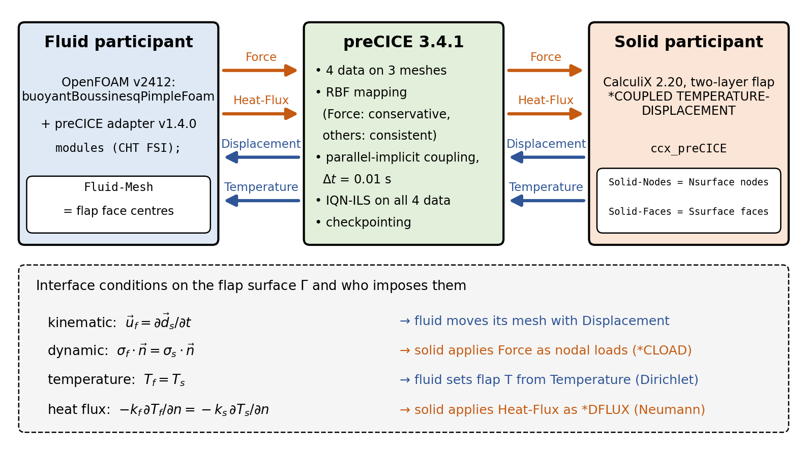
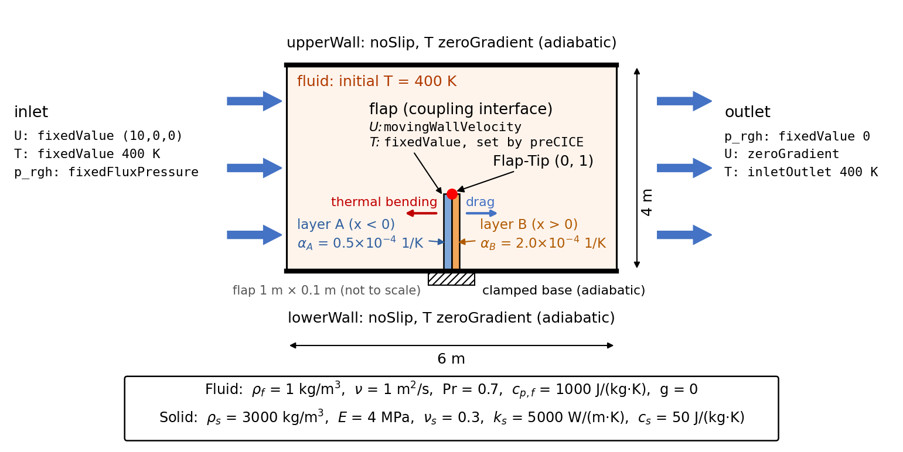
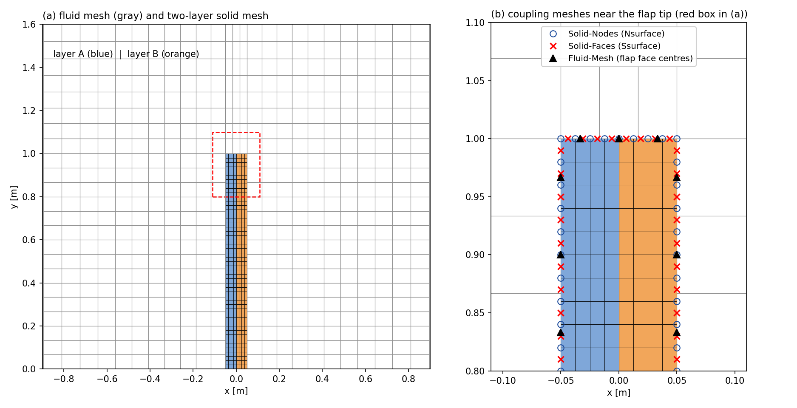
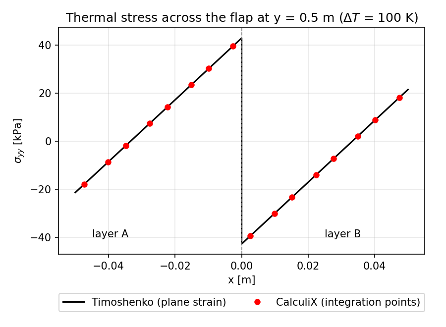
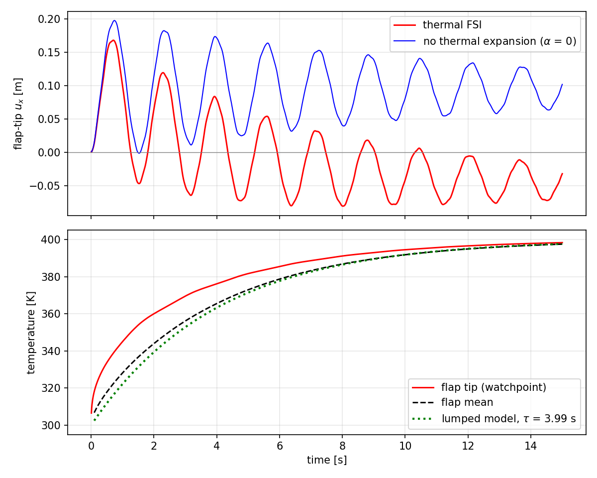
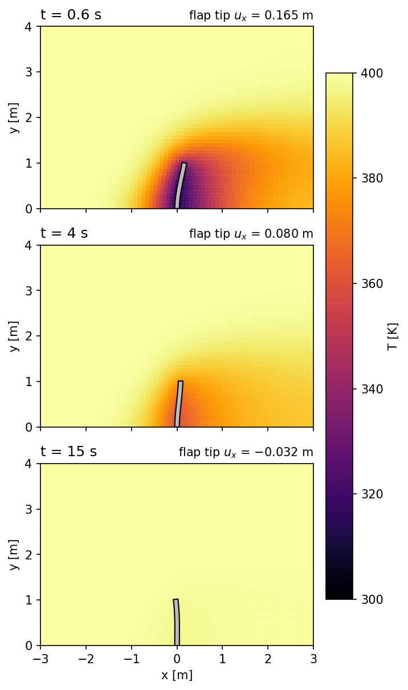
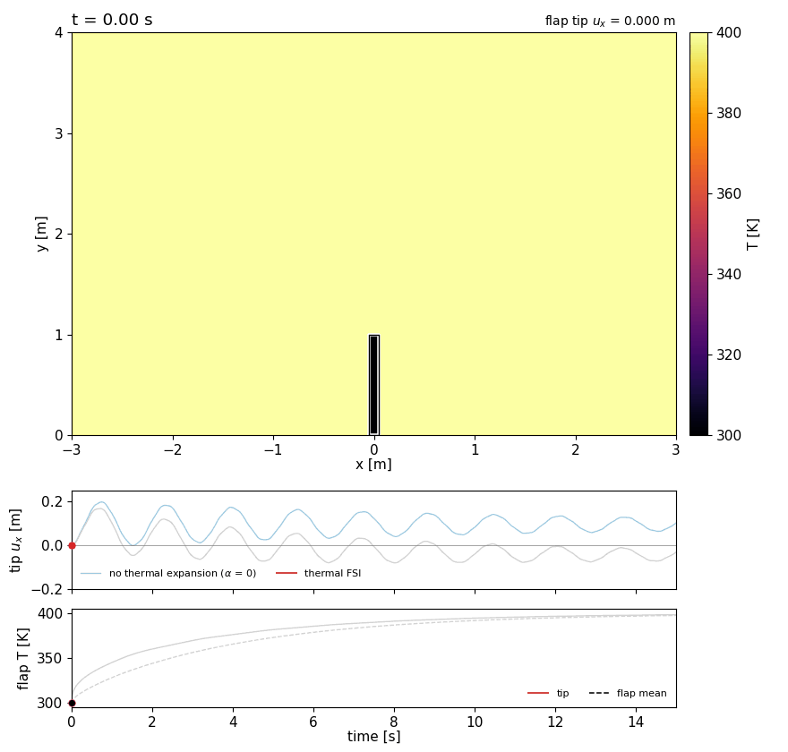

# 예제 22. 열-유체-구조 연성 해석 : 열응력에 의한 열변형 (OpenFOAM + preCICE + CalculiX)

**참고**:

- 이 예제는 [예제 20](20_FSI1-preCICE-연성-해석-환경-구성.md)에서 구성한 preCICE 연성 환경으로 **열-유체-구조 연성 해석**(thermal fluid-structure interaction)을 수행한다. 유체와 구조는 힘과 변위에 더하여 온도와 열유속도 주고받는다. 뜨거운 유동이 열팽창계수가 서로 다른 두 층으로 된 플랩(바이메탈)을 가열하면, 두 층의 열팽창 차이로 생긴 **열응력**(thermal stress)이 플랩을 휘게 만든다(**열변형**). 휘어진 플랩은 다시 주변의 유동과 열전달을 바꾼다.
- 해석 케이스는 [예제 21](21_FSI2-유체-구조-연성-해석-preCICE-CalculiX.md)의 perpendicular-flap 케이스(preCICE 공식 튜토리얼, [https://github.com/precice/tutorials](https://github.com/precice/tutorials), LGPL 3.0)를 바탕으로 이 예제를 위해 새로 구성하였다. preCICE 공식 튜토리얼에는 OpenFOAM과 CalculiX로 열 연성과 FSI를 동시에 푸는 예제가 없으므로, 이 예제의 설정과 검증은 이 책에서 직접 수행한 것이다.
- 사용하는 외부 소프트웨어와 라이선스는 예제 20과 같다: preCICE (LGPL 3.0), OpenFOAM-preCICE 어댑터 (GPL 3.0), CalculiX-preCICE 어댑터 (GPL 3.0), CalculiX (GPL 2.0).
- 이 예제는 OpenFOAM 튜토리얼(한국어판)에 새로 추가된 내용으로, [CC BY-NC-SA 3.0](https://creativecommons.org/licenses/by-nc-sa/3.0/) 라이선스 하에 배포된다.
- 이 자료는 ESI Group, ESI-OpenCFD 또는 OpenFOAM Foundation에 의해 승인된 자료가 아니다.

**호환성**:

- 예제 20에서 구성한 환경(OpenFOAM v2412, preCICE v3.4.1, OpenFOAM-preCICE 어댑터 v1.4.0, CalculiX-preCICE 어댑터 v2.20.2 (CalculiX 2.20))을 그대로 사용하며, 새로 설치할 것은 없다.
- 소요 시간은 연성 해석 1회에 약 5분이며, 비교 해석(6.3절)까지 2회 실행한다. 구조 단독 검증(4장)은 1초 이내에 끝난다.

**선행 학습**:

- [예제 20. preCICE 연성 해석 환경 구성](20_FSI1-preCICE-연성-해석-환경-구성.md) : **필수**. preCICE 설치, 환경 스크립트(`~/precice/precice-of-env.sh`), 어댑터 빌드
- [예제 21. 유체-구조 연성 해석 (FSI)](21_FSI2-유체-구조-연성-해석-preCICE-CalculiX.md) : **필수**. perpendicular-flap 케이스와 runFSI.sh, 해석 결과(이 예제 6.3절의 비교에 사용). 이 예제는 예제 21의 케이스를 복사하여 수정한다.
- [예제 13. 격자 생성 도구 (`snappyHexMesh` - 다중 영역)](13_격자-생성-도구-snappyHexMesh-다중-영역.md) : `chtMultiRegionFoam`을 이용한 복합 열전달(CHT)
- [예제 18. 사용자 정의 솔버 만들기](18_사용자-정의-솔버-만들기-전기수력학.md) : 운동학적 압력

---

## 목차

1. 배경
   - 1.1 열응력과 열변형
   - 1.2 이중층 판(바이메탈)의 열 굽힘
   - 1.3 열-유체-구조 연성
   - 1.4 분할 방식 열 연성의 경계 조건 배분
   - 1.5 시간 척도와 집중 열용량 모델
2. 예제 개요
3. 케이스 구성
   - 3.1 케이스 디렉토리 만들기
   - 3.2 구조 participant : 격자 생성
   - 3.3 구조 participant : 재료와 해석 입력
   - 3.4 구조 participant : config.yml과 run.sh
   - 3.5 유체 participant : 솔버와 필드
   - 3.6 유체 participant : 수치 기법과 어댑터 설정
   - 3.7 preCICE 설정 : precice-config.xml
4. 열응력 단독 검증 : 유동 없는 바이메탈 굽힘
5. 연성 해석 실행
6. 후처리 및 검증
   - 6.1 연성 수렴 확인
   - 6.2 플랩 끝단의 변위와 온도
   - 6.3 열팽창을 끈 비교 해석
   - 6.4 열 수지 확인
   - 6.5 ParaView 가시화
7. 실행 순서 요약
8. 문제 해결
9. 마무리
10. 참고 문헌

## 1. 배경

### 1.1 열응력과 열변형

고체는 온도가 올라가면 팽창한다. 온도 변화 $\Delta T$에 의한 **열변형률**(thermal strain)은 선팽창계수 $\alpha$에 비례한다.

$$\varepsilon_{th} = \alpha \, \Delta T$$

온도 변화로 물체의 모양과 크기가 바뀌는 것을 **열변형**이라 한다. 물체가 자유롭게 늘어날 수 있으면 열변형률만큼 변형될 뿐 응력은 생기지 않는다. 그러나 팽창이 어딘가에서 구속되면 실제 변형률 $\varepsilon$과 열변형률 $\varepsilon_{th}$의 차이만큼 응력이 생긴다. 1차원 막대에서는 다음과 같다.

$$\sigma = E \left( \varepsilon - \alpha \, \Delta T \right)$$

여기서 $E$는 영률이다. 예를 들어 양 끝이 벽에 고정된 막대($\varepsilon = 0$)를 가열하면 변형 없이 $\sigma = -E\alpha\Delta T$의 압축 응력만 생긴다. 이처럼 팽창이 구속되어 생기는 응력을 **열응력**이라 하며, 열응력이 생기는 원인은 크게 세 가지이다.

| 원인 | 예 |
| --- | --- |
| 외부 구속 | 양 끝이 고정된 배관이나 레일의 가열 |
| 물체 내부의 온도 분포 | 한쪽 면만 가열된 두꺼운 판, 급랭하는 유리 |
| 재료 사이의 열팽창계수 차이 | 바이메탈, 반도체 패키지, 코팅층, 용접부 |

이 예제는 세 번째 원인을 다룬다. 열팽창계수가 다른 두 층을 붙인 판을 가열하면 두 층이 서로의 팽창을 구속하므로, 열응력과 열변형(굽힘)이 함께 생긴다.

3차원에서도 응력은 실제 변형률에서 열변형률을 뺀 값에 비례하며, CalculiX는 재료에 `*EXPANSION`(선팽창계수)이 정의되어 있으면 이 열변형률을 자동으로 고려한다.

> **Note:** 3차원 등방성 선형 탄성체의 응력-변형률 관계(Duhamel–Neumann 관계)는 $\pmb{\sigma} = \lambda \, \mathrm{tr}(\pmb{\varepsilon}) \, \mathbf{I} + 2\mu \, \pmb{\varepsilon} - (3\lambda + 2\mu) \, \alpha \, \Delta T \, \mathbf{I}$이다. 여기서 $\lambda = E\nu_s/[(1+\nu_s)(1-2\nu_s)]$, $\mu = E/[2(1+\nu_s)]$는 라메 상수, $\nu_s$는 푸아송 비이며, 마지막 항이 열변형률에 의한 항이다.

### 1.2 이중층 판(바이메탈)의 열 굽힘

열팽창계수가 다른 두 금속판을 붙인 **바이메탈**(bimetal)은 온도가 오르면 열팽창계수가 큰 쪽이 더 늘어나므로, 열팽창계수가 작은 쪽으로 휜다. 온도 조절기(thermostat)의 스위치, 온도계, 열 구동기 등에 쓰인다. 두 층의 접합면에서는 두 층의 변형이 같아야 하므로, 더 늘어나려는 층은 전체적으로 압축되고 덜 늘어나려는 층은 인장되어 열응력이 생기며, 이 응력이 만드는 굽힘 모멘트가 판을 휘게 한다.

Timoshenko[1]는 두께 $t_1$, $t_2$, 영률 $E_1$, $E_2$, 선팽창계수 $\alpha_1$, $\alpha_2$인 두 층이 균일한 온도 변화 $\Delta T$를 받을 때의 곡률 $\kappa$(곡률 반지름 $R$의 역수)를 다음과 같이 유도하였다.

$$\kappa = \frac{1}{R} = \frac{6 \, (\alpha_2 - \alpha_1) \, \Delta T \, (1+m)^2}{H \left[ 3(1+m)^2 + (1+mn)\left(m^2 + \dfrac{1}{mn}\right) \right]}, \qquad m = \frac{t_1}{t_2}, \quad n = \frac{E_1}{E_2}, \quad H = t_1 + t_2$$

두 층의 두께와 영률이 같으면($m = n = 1$) 다음과 같이 간단해진다.

$$\kappa = \frac{3 \, (\alpha_2 - \alpha_1) \, \Delta T}{2H}$$

이 예제에서는 열팽창계수가 작은 상류 쪽 층 A($x$ < 0)를 층 1, 하류 쪽 층 B($x$ > 0)를 층 2로 둔다. $\kappa$ > 0이면 플랩은 층 A 쪽($-x$ 방향)으로 휘며, 길이 $L$인 외팔보의 끝단 변위는 변형이 작을 때 $u_x = -\kappa L^2 / 2$이다.

Timoshenko의 식은 폭이 좁은 판에 대한 것으로, 깊이($z$) 방향의 응력이 0인 **평면 응력** 상태이다. 이 예제의 구조 모델은 예제 21과 같이 $z$ 방향 변위를 막았으므로, 깊이 방향의 변형이 0인 **평면 변형률** 상태(깊이 방향으로 매우 긴 판)이다. 평면 변형률에서는 깊이 방향으로 늘어나지 못한 열팽창이 푸아송 효과로 다른 방향의 변형에 더해진다. 두께 방향 응력을 무시하고($\sigma_{xx} \approx 0$) $\varepsilon_{zz} = 0$을 Hooke의 법칙에 넣으면 $\sigma_{zz} = \nu_s\sigma_{yy} - E\alpha\Delta T$이므로 다음 관계를 얻는다.

$$\varepsilon_{yy} = \frac{1-\nu_s^2}{E}\sigma_{yy} + (1+\nu_s)\,\alpha\,\Delta T$$

즉 평면 응력의 식에서 $E$를 $E' = E/(1-\nu_s^2)$로, $\alpha$를 $\alpha' = (1+\nu_s)\alpha$로 바꾸면 평면 변형률의 식이 된다[2]. 두 층의 푸아송 비가 같으면 $n$은 변하지 않으므로, 평면 변형률의 곡률은 평면 응력의 $(1+\nu_s)$배가 된다($\nu_s$ = 0.3이면 30% 크다).

$$\kappa_{\text{plane strain}} = \frac{3 \, (1+\nu_s) \, (\alpha_2 - \alpha_1) \, \Delta T}{2H}$$

판 내부의 축 방향 응력(이 예제에서는 $\sigma_{yy}$)은 두께 방향 좌표 $x$(두께 중앙이 0)에 대해 층마다 직선으로 분포하고, 접합면에서 불연속이 된다. 두께와 영률이 같은 두 층에서는 힘과 모멘트의 평형으로부터 다음과 같이 구할 수 있다.

$$\sigma_{yy}(x) = E' \left[ \frac{\alpha_1' + \alpha_2'}{2} \Delta T + \kappa x - \alpha_i' \Delta T \right]$$

여기서 $\alpha_i'$는 점 $x$가 속한 층의 값이다. 괄호 안의 앞의 두 항은 실제 변형률(두께 중앙의 늘어남과 굽힘에 의한 늘어남 $\kappa x$)이고 마지막 항은 열변형률이므로, 이 식은 1.1절의 $\sigma = E(\varepsilon - \alpha\Delta T)$와 같은 형태이다. 접합면 바로 양쪽의 응력은 $\pm E'(\alpha_2' - \alpha_1')\Delta T/2$이다. 4장에서 CalculiX의 결과를 이 식들과 비교한다.

### 1.3 열-유체-구조 연성

유체 속 구조물의 온도가 주변 유체와 다르면, 유체와 구조 사이에 열이 전달되면서 구조물의 온도가 바뀐다. 이처럼 유체의 대류 열전달과 고체의 열전도를 함께 푸는 것을 **복합 열전달**(conjugate heat transfer, CHT)이라 한다. 구조물의 온도가 바뀌면 열변형이 생기고(팽창이 구속되면 열응력도 함께 생긴다), 구조물이 변형되면 유동장과 열전달이 다시 바뀐다. 이처럼 열전달과 FSI가 함께 일어나는 현상을 **열-유체-구조 연성**(thermal FSI)이라 한다. 극초음속 비행체의 외피 패널[3], 가스 터빈 블레이드, 열교환기, 배기계 부품, 전자 장비의 냉각 등에서 중요하다.

[예제 13](13_격자-생성-도구-snappyHexMesh-다중-영역.md)의 `chtMultiRegionFoam`은 고체의 열전도는 풀지만 고체의 변형(열응력)과 이동 격자는 다루지 않는다. 그래서 이 예제는 예제 21의 preCICE 연성에 열 데이터를 추가하여, 고체의 열전도와 변형을 CalculiX가 함께 풀도록 한다.

경계면 $\Gamma$에서는 예제 21의 두 조건(운동학적 조건, 동역학적 조건)에 다음 두 열적 조건이 추가된다.

- **온도 연속 조건** : 경계면에서 유체와 고체의 온도가 같다.

$$T_f = T_s \qquad \text{on } \Gamma$$

- **열유속 연속 조건** : 경계면을 통해 유체에서 나간 열은 모두 고체로 들어간다(에너지 보존).

$$-k_f \frac{\partial T_f}{\partial n} = -k_s \frac{\partial T_s}{\partial n} \qquad \text{on } \Gamma$$

여기서 $k_f$, $k_s$는 유체와 고체의 열전도율, $n$은 경계면의 법선 방향이다. 이 예제에서 유체와 구조는 다음 네 가지 데이터를 주고받는다.

| 데이터 | 방향 | 받는 쪽에서의 사용 |
| --- | --- | --- |
| `Force` (힘) | 유체 → 구조 | 경계면 절점의 집중 하중 |
| `Heat-Flux` (열유속) | 유체 → 구조 | 경계면의 열유속 경계 조건 (Neumann 조건) |
| `Displacement` (변위) | 구조 → 유체 | 이동 격자의 경계면 변위 |
| `Temperature` (온도) | 구조 → 유체 | 경계면의 온도 경계 조건 (Dirichlet 조건) |



그림의 위쪽은 두 participant와 preCICE 사이의 데이터 흐름이고, 아래쪽은 네 경계면 조건을 각각 어느 쪽이 부과하는지 보여 준다.

### 1.4 분할 방식 열 연성의 경계 조건 배분

분할 방식에서 두 열적 조건(온도 연속, 열유속 연속)을 동시에 직접 만족시킬 수는 없다. 그래서 한쪽 솔버에는 상대방의 온도를 경계 조건으로 주고(Dirichlet 조건), 다른 쪽 솔버에는 상대방의 열유속을 주며(Neumann 조건), 두 조건이 함께 만족될 때까지 반복한다. 이를 **Dirichlet–Neumann 연성**이라 한다. Dirichlet 조건은 경계의 값을 정하는 조건(OpenFOAM의 `fixedValue`)이고, Neumann 조건은 경계의 기울기, 즉 플럭스(flux)를 정하는 조건(`fixedGradient`. [예제 1](01_기초-케이스-설정.md)의 `zeroGradient`는 기울기가 0인 경우)이다. 예제 21의 FSI도 같은 구조였다. 유체는 구조의 변위(값)를 받고, 구조는 유체의 힘(경계면을 지나는 운동량 플럭스)을 받는다.

어느 쪽에 온도를 줄지는 연성 반복의 수렴성에 영향을 준다. 분할 방식의 안정성 해석[4–6]에 따르면 규칙은 다음과 같다.

- **비정상 문제** : 열 침투율(thermal effusivity) $e = \sqrt{k \rho c}$가 작은 쪽(보통 유체)에 **온도**를, 큰 쪽(보통 고체)에 **열유속**을 준다[4]. 열 침투율은 표면 온도가 바뀔 때 물체가 열을 얼마나 빨리 받아들이는지를 나타내며, 열전도율 $k$와 체적 열용량 $\rho c$를 함께 고려한다.
- **정상 상태에 가까운 문제**(시간 간격이 큰 경우) : 위와 같이 배분하면 고체의 **Biot 수**가 1보다 작을 때 연성 반복이 수렴한다[5, 6]. 반대로 배분하면 발산할 수 있다.

$$Bi = \frac{h \, L_c}{k_s}$$

여기서 $h$는 경계면의 대류 열전달 계수, $L_c$는 고체의 대표 길이로, 보통 부피 ÷ 열이 들어오는 표면적을 쓴다(양면에서 가열되는 얇은 판에서는 두께의 절반). Biot 수는 고체 내부의 전도 열저항 $L_c/k_s$와 표면의 대류 열저항 $1/h$의 비이다. 위의 수렴 조건은 완화 없이 단순 반복할 때의 조건이며, 완화나 가속 기법(Aitken, IQN-ILS)은 수렴 범위를 넓혀 준다.

이 예제의 열 침투율은 유체 $e_f \approx 1.2 \times 10^3$, 고체 $e_s \approx 2.7 \times 10^4$ $\mathrm{W \cdot s^{1/2}/(m^2 \cdot K)}$(비 0.044)이고 Biot 수는 약 0.02(2장)이므로, 두 기준 모두 유체가 `Temperature`를 받고 구조가 `Heat-Flux`를 받는 배분을 가리킨다.

> **Note:** preCICE 공식 튜토리얼 flow-over-heated-plate[7]는 반대로 유체가 열유속을, 고체가 온도를 받는다. 이 튜토리얼은 유체와 고체의 열전도율이 같지만(100 W/(m·K)), 유체의 체적 열용량($\rho c_p \approx 1 \times 5000$)이 고체($\rho c$ = 100 $\mathrm{J/(m^3 \cdot K)}$)보다 커서 열 침투율은 유체(약 707 $\mathrm{W \cdot s^{1/2}/(m^2 \cdot K)}$)가 고체(100)보다 크다. 따라서 위의 기준으로도 고체에 온도를 주는 배분이 맞다. 열전도율만이 아니라 열용량도 함께 보아야 한다는 예이다. 두 배분 모두 수렴이 어려우면, 열유속 대신 대류 열전달 계수와 기준 온도를 주고받는 Robin 연성(`Sink-Temperature`, `Heat-Transfer-Coefficient`)을 사용할 수 있다.

### 1.5 시간 척도와 집중 열용량 모델

이 예제에는 서로 다른 세 시간 척도가 있다.

| 현상 | 시간 척도 |
| --- | --- |
| 유동 (입구 유속 10 m/s로 채널 길이 6 m를 지나는 시간) | 약 0.6 s |
| 플랩의 1차 굽힘 진동 주기 (예제 21의 5.4절) | 약 1.6 s |
| 플랩의 가열 | 약 4 s (아래) |

고체 내부의 온도 차이가 작으면(Biot 수가 약 0.1보다 작으면) 고체 전체를 온도가 하나인 덩어리로 볼 수 있다. 이를 **집중 열용량 모델**(lumped capacitance model)이라 한다[8]. 1.4절의 Bi < 1은 연성 반복의 수렴 조건이고, 여기의 Bi < 0.1은 고체 온도를 하나의 값으로 볼 수 있는지의 기준이다. 초기 온도 $T_0$인 고체를 온도 $T_\infty$인 유체에 넣으면 고체의 온도는 다음과 같이 지수적으로 유체 온도에 접근한다.

$$T(t) = T_\infty - (T_\infty - T_0) \, e^{-t/\tau}, \qquad \tau = \frac{\rho_s c_s V}{h A}$$

여기서 $\rho_s$, $c_s$, $V$는 고체의 밀도, 비열, 부피이고, $A$는 열이 전달되는 표면적이다. 시간 상수 $\tau$는 고체의 열용량(분자)과 표면의 열전달 능력(분모)의 비이다. 6.2절에서 연성 해석 결과로부터 $\tau$를 구하고, 플랩의 평균 온도가 이 모델을 얼마나 따르는지 확인한다.

열 시간 척도가 유동이나 진동의 시간 척도보다 훨씬 길면(예: 실제 금속 구조물의 가열은 수 분–수 시간), 연성 해석에 필요한 시간 창의 수가 매우 많아진다. 이 예제는 연성 현상을 짧은 시간 안에 볼 수 있도록 구조의 열 물성을 가상의 값으로 정하였다.

- **비열** $c_s$ : 가열 시간 상수를 수 초로 맞추기 위한 값이다. 열전달 계수는 해석 전에는 알 수 없으므로, 짧은 예비 연성 해석(0.3 s)에서 얻은 열전달 계수 약 2500 $\mathrm{W/(m^2 \cdot K)}$로 $\tau = 3000 \times 50 \times 0.1/(2500 \times 2.1) \approx 2.9$ s(단위 깊이당 부피 $V$ = 0.1 $\mathrm{m^2}$, 표면적 $A$ = 1 + 1 + 0.1 = 2.1 m. 바닥은 단열)가 되도록 $c_s$ = 50 J/(kg·K)를 정하였다. 실제 해석의 평균 열전달 계수는 이보다 작아 $\tau$는 약 4 s가 되었다(6.2절).
- **열전도율** $k_s$ : $\tau$에는 영향을 주지 않으며, Biot 수를 작게 하여 두께 방향 온도를 균일하게 만들기 위한 값이다. 그래야 1.2절의 해석해와 비교할 수 있고 1.4절의 배분 규칙도 만족한다. $k_s$ = 5000 W/(m·K)이면 Bi ≈ 0.02이고, 금속과 비슷한 50 W/(m·K)이면 Bi ≈ 1.8이 된다(9장의 "한쪽 면 가열").

예제 21의 유체 물성(동점성 계수 1 $\mathrm{m^2/s}$)과 구조 물성(영률 4 MPa)도 원래 가상의 값이다.

## 2. 예제 개요

### 예제 구성

예제 21의 2차원 채널과 수직 플랩을 그대로 사용하되, 다음을 바꾸었다.

- 유체 : 온도 방정식을 함께 푸는 `buoyantBoussinesqPimpleFoam`으로 바꾸고, 중력을 0으로 두어 부력 없이 온도를 수동적으로 운반하는 강제 대류 문제로 만들었다.
- 구조 : 플랩을 두께 방향으로 두 층으로 나누고, 열전도를 포함한 열-변위 연성 해석(`*COUPLED TEMPERATURE-DISPLACEMENT`)으로 바꾸었다.
- 연성 데이터 : `Force`, `Displacement`에 `Temperature`, `Heat-Flux`를 추가하였다.

주요 사양은 다음과 같다.

- 유체 영역 : 6 m $\times$ 4 m 2차원 채널, 입구 유속 10 m/s (균일), 층류 (예제 21과 같음)
- 플랩 : 높이 1 m, 두께 $H$ = 0.1 m. 상류 쪽 층 A ($x$ < 0)와 하류 쪽 층 B ($x$ > 0)의 두께는 각각 0.05 m이다.
- 온도 : 유체는 처음부터 400 K이고 입구로 400 K의 유체가 계속 들어온다. 플랩은 처음에 300 K이며, 이 온도에서 응력이 없다.
- 열 경계 조건 : 채널 위아래 벽과 플랩 바닥(고정부)은 단열이다.
- 시간 : 0–15 s, 시간 간격 0.01 s (= preCICE의 시간 창 크기)

| 물성 | 유체 | 층 A (상류) | 층 B (하류) |
| --- | --- | --- | --- |
| 밀도 $\rho$ [$\mathrm{kg/m^3}$] | 1 | 3000 | 3000 |
| 동점성 계수 $\nu$ [$\mathrm{m^2/s}$] | 1 | — | — |
| Prandtl 수 $\mathrm{Pr}$ | 0.7 | — | — |
| 비열 $c_p$, $c_s$ [J/(kg·K)] | 1000 | 50 | 50 |
| 열전도율 $k$ [W/(m·K)] | 1429 ($= \rho c_p \nu / \mathrm{Pr}$) | 5000 | 5000 |
| 영률 $E$ [MPa] | — | 4 | 4 |
| 푸아송 비 $\nu_s$ | — | 0.3 | 0.3 |
| 선팽창계수 $\alpha$ [1/K] | — | $0.5 \times 10^{-4}$ | $2.0 \times 10^{-4}$ |



그림과 같이 하류 쪽 층 B의 열팽창계수가 더 크므로, 플랩이 가열되면 하류 쪽 면이 더 늘어나 플랩은 **상류 쪽으로**, 즉 유동을 거슬러 휜다. 유동의 힘(항력)은 플랩을 하류 쪽으로 밀기 때문에, 두 효과가 서로 반대 방향으로 경쟁한다.

이 문제의 주요 무차원수는 다음과 같다.

| 무차원수 | 정의 | 값 | 의미 |
| --- | --- | --- | --- |
| Reynolds 수 | $UL/\nu$ | 10 | 점성 지배 층류 (와류 흘림 없음) |
| Prandtl 수 | $\nu/\alpha_f$ | 0.7 | 공기와 비슷한 값 ($\alpha_f$는 유체의 열확산계수) |
| Péclet 수 | $\mathrm{Re} \cdot \mathrm{Pr}$ | 7 | 열 경계층이 두껍다 |
| Biot 수 (두께 방향) | $\bar{h} \, (H/2)/k_s$ | 약 0.02 | 두께 방향 온도 차이가 매우 작다 → 1.2절의 균일 온도 가정 성립 |

Biot 수의 $\bar{h}$는 플랩 표면의 평균 열전달 계수(약 1800 $\mathrm{W/(m^2 \cdot K)}$)로, 6.2절에서 해석 결과로부터 구한다.

### 목표

- 열-유체-구조 연성의 경계면 조건과 Dirichlet–Neumann 열 연성의 경계 조건 배분 원리를 이해한다.
- 예제 21의 FSI 케이스에 열 연성을 추가하여 네 가지 데이터(힘, 변위, 온도, 열유속)를 주고받는 연성 해석을 구성한다.
- CalculiX의 열-변위 연성 해석과 이중층 재료를 설정하고, 열응력과 열변형을 Timoshenko 해석해와 비교하여 검증한다.
- 열팽창을 끈 비교 해석과 열 수지 확인으로 연성 해석 결과의 타당성을 확인한다.

### 데이터 처리

- 구조 단독 검증(4장, 유동 없음)에서 플랩 끝단 변위와 두께 방향 응력 분포를 Python으로 Timoshenko 해석해와 비교한다.
- 연성 해석의 감시점(플랩 끝단)과 CalculiX 출력 파일에서 끝단 변위, 끝단 온도, 플랩 평균 온도의 이력을 그리고, 집중 열용량 모델과 비교한다.
- 유체 쪽에서 플랩으로 전달된 열량과 구조에 저장된 열량을 비교한다(열 수지).
- ParaView에서 변형된 격자 위의 온도 분포를 확인한다.

## 3. 케이스 구성

### 3.1 케이스 디렉토리 만들기

예제 21의 perpendicular-flap 케이스에서 필요한 파일만 복사하여 새 케이스 thermal-flap/을 만든다. 이 장의 명령은 모두 환경 스크립트를 불러온 터미널에서 실행한다.

```bash
source ~/precice/precice-of-env.sh
cd $FOAM_RUN/preciceFSI
mkdir -p thermal-flap/fluid-openfoam/constant thermal-flap/solid-calculix
```

```bash
P=perpendicular-flap
cp -r $P/fluid-openfoam/0 $P/fluid-openfoam/system thermal-flap/fluid-openfoam/
cp $P/fluid-openfoam/run.sh $P/fluid-openfoam/clean.sh thermal-flap/fluid-openfoam/
cp $P/fluid-openfoam/constant/dynamicMeshDict $P/fluid-openfoam/constant/turbulenceProperties \
   thermal-flap/fluid-openfoam/constant/
cp $P/solid-calculix/run.sh $P/solid-calculix/clean.sh thermal-flap/solid-calculix/
cp $P/runFSI.sh thermal-flap/
rm thermal-flap/fluid-openfoam/0/p      # replaced by 0/p_rgh (section 3.5)
cd thermal-flap
```

runFSI.sh는 예제 21의 4.6절 (B)에서 만든 스크립트이다. 스크립트가 있는 디렉토리로 이동하여 실행하도록 되어 있으므로 그대로 사용할 수 있다. 만들지 않았다면 예제 21의 4.6절 (B)를 참조하여 thermal-flap/ 디렉토리에 만든다.

이 예제에서 만들거나 수정하는 파일을 모두 포함한 케이스 구조는 다음과 같다. (복사)는 예제 21의 파일을 그대로 사용하는 것이고, (수정)은 복사한 파일을 고치는 것, (새 파일)은 새로 만드는 것이다.

```text
preciceFSI/
├── tools/                         (예제 21과 공유하는 보조 스크립트)
├── perpendicular-flap/            (예제 21)
└── thermal-flap/
    ├── precice-config.xml         (새 파일, 3.7절)
    ├── runFSI.sh                  (복사)
    ├── postprocess.py             (새 파일, 6.2절)
    ├── fluid-openfoam/
    │   ├── 0/        T  p_rgh  alphat (새 파일),  U  phi  pointDisplacement (복사)
    │   ├── constant/ g  transportProperties (새 파일),
    │   │             dynamicMeshDict  turbulenceProperties (복사)
    │   ├── system/   controlDict  fvSchemes  fvSolution  preciceDict (수정),
    │   │             blockMeshDict  decomposeParDict (복사)
    │   └── run.sh  clean.sh       (복사)
    └── solid-calculix/
        ├── gen_mesh.py            (새 파일 : 격자 생성 스크립트, 3.2절)
        ├── material.inp           (새 파일 : 재료, 3.3절)
        ├── flap.inp               (새 파일 : 연성 해석 입력, 3.3절)
        ├── config.yml             (새 파일 : CalculiX 어댑터 설정, 3.4절)
        ├── run.sh                 (수정, 3.4절)  clean.sh (복사)
        ├── bimorph_static.inp     (새 파일 : 유동 없는 열 굽힘 검증, 4장)
        └── check_bimorph.py       (새 파일 : 4장)
```

파일은 텍스트 편집기(예: `nano 파일이름`)로 만들거나 고친다. 예제 21의 4.6절 (B)에 있는 첫 번째 Note와 같이 Windows 편집기로 저장한 파일은 줄 끝 문자 때문에 오류가 날 수 있으므로 주의한다.

### 3.2 구조 participant : 격자 생성

예제 21의 플랩 격자(all.msh)는 두께 방향 요소가 2개뿐이다. 이 예제에서는 두께 방향의 응력 분포를 보기 위해 층마다 요소 4개(두께 방향 8개), 높이 방향 50개로 격자를 새로 만든다. 형상이 단순한 직사각형이므로, 다음 Python 스크립트 gen_mesh.py를 solid-calculix/ 디렉토리에 만들어 CalculiX 형식의 격자를 직접 생성한다.

```python
#!/usr/bin/env python3
# Two-layer (bimorph) flap mesh for CalculiX, quasi-2D (one C3D8I element in z).
#   x in [-W/2, W/2] : layer A (x < 0, upstream) and layer B (x > 0, downstream)
#   y in [0, L]      : clamped at y = 0
#   z in [0, D]      : one element; u_z = 0 is set in the .inp (plane strain)
# usage: python3 gen_mesh.py [NX_PER_LAYER] [NY]   -> writes flap.msh
import sys

W, L, D = 0.1, 1.0, 1.0
nxl = int(sys.argv[1]) if len(sys.argv) > 1 else 4
ny = int(sys.argv[2]) if len(sys.argv) > 2 else 50
nx = 2 * nxl


def nid(i, j, k):
    # node number of grid point (i, j, k), starting at 1
    return 1 + i + (nx + 1) * (j + (ny + 1) * k)


out = ["*NODE, NSET=Nall"]
for k in range(2):
    for j in range(ny + 1):
        for i in range(nx + 1):
            out.append("%d, %.10e, %.10e, %.10e"
                       % (nid(i, j, k), -W / 2 + W * i / nx, L * j / ny, D * k))

out.append("*ELEMENT, TYPE=C3D8I, ELSET=Eall")
layerA, layerB, faces = [], [], []
for j in range(ny):
    for i in range(nx):
        e = 1 + i + nx * j
        out.append("%d, %d, %d, %d, %d, %d, %d, %d, %d" % (
            e, nid(i, j, 0), nid(i + 1, j, 0), nid(i + 1, j + 1, 0), nid(i, j + 1, 0),
            nid(i, j, 1), nid(i + 1, j, 1), nid(i + 1, j + 1, 1), nid(i, j + 1, 1)))
        (layerA if i < nxl else layerB).append(e)
        # C3D8 faces: S6 = -x, S4 = +x, S5 = +y
        if i == 0:
            faces.append((e, "S6"))
        if i == nx - 1:
            faces.append((e, "S4"))
        if j == ny - 1:
            faces.append((e, "S5"))


def write_set(kind, name, ids):
    out.append("*%s, %s=%s" % (kind, kind, name))
    for a in range(0, len(ids), 10):
        out.append(", ".join(str(v) for v in ids[a:a + 10]) + ",")


grid = [(i, j, k) for k in range(2) for j in range(ny + 1) for i in range(nx + 1)]
write_set("ELSET", "EA", layerA)
write_set("ELSET", "EB", layerB)
# row of elements just above mid-height (post-processing)
write_set("ELSET", "Emid", [1 + i + nx * (ny // 2) for i in range(nx)])
# clamped root (y = 0)
write_set("NSET", "Nfix", [nid(i, j, k) for (i, j, k) in grid if j == 0])
# coupling interface nodes: left, right and top faces
write_set("NSET", "Nsurface",
          [nid(i, j, k) for (i, j, k) in grid if i in (0, nx) or j == ny])
# tip centre node (post-processing)
write_set("NSET", "Ntip", [nid(nxl, ny, 0)])

# coupling interface faces (same faces as Nsurface)
out.append("*SURFACE, NAME=Ssurface, TYPE=ELEMENT")
for e, f in faces:
    out.append("%d, %s" % (e, f))

with open("flap.msh", "w") as fh:
    fh.write("\n".join(out) + "\n")
print("flap.msh: %d nodes, %d elements (%d x %d), %d interface faces"
      % (len(grid), nx * ny, nx, ny, len(faces)))
```

실행하면 flap.msh 파일이 만들어진다.

```bash
cd $FOAM_RUN/preciceFSI/thermal-flap/solid-calculix
python3 gen_mesh.py
```

```text
flap.msh: 918 nodes, 400 elements (8 x 50), 108 interface faces
```

예제 21과 같이 $z$ 방향으로 두께 1 m의 요소 1개를 두는 준 2차원 격자이며, 요소 종류도 같은 C3D8I이다. flap.msh에 정의되는 집합은 다음과 같다.

| 이름 | 종류 | 내용 | 사용처 |
| --- | --- | --- | --- |
| `Nall`, `Eall` | 절점, 요소 | 모든 절점과 요소 | 초기 온도, $z$ 변위 고정 |
| `EA`, `EB` | 요소 | 상류 쪽 층 A ($x$ < 0), 하류 쪽 층 B ($x$ > 0) | 층별 재료 지정 |
| `Nfix` | 절점 | 플랩 바닥($y$ = 0) | 고정 경계 조건 |
| `Nsurface` | 절점 | 유체와 맞닿는 왼쪽, 오른쪽, 윗면의 절점 | 힘, 변위, 온도의 연성 (config.yml) |
| `Ssurface` | 요소 면 | `Nsurface`와 같은 위치의 요소 면 108개 | 열유속의 연성 (config.yml) |
| `Ntip`, `Emid` | 절점, 요소 | 끝단 중앙 절점, 높이 0.5 m 위의 요소 한 줄 | 4장의 결과 출력 |

요소 면은 "요소 번호, 면 번호"로 지정한다. 8절점 6면체 요소의 면 번호는 절점 순서로 정해지며, 이 격자에서 S4는 $+x$ 면, S5는 $+y$ 면(윗면), S6은 $-x$ 면이다.

> **Note:** C3D8I 요소는 균일한 온도에 의한 굽힘은 요소 수와 관계없이 정확하게 표현하지만, 두께 방향의 온도 기울기에 의한 굽힘은 두께 방향 요소 수를 $n_x$라 할 때 곡률을 약 $1/n_x^2$만큼 작게 계산한다(이 예제의 격자로 두께 방향에 직선 온도 분포를 준 시험에서 $n_x$ = 2이면 −25%, 8이면 −1.6%). 이 예제는 두께 방향 온도 차이가 매우 작으므로(2장의 Biot 수) 영향이 없지만, 한쪽 면만 가열되는 문제에서는 두께 방향 요소를 충분히 두어야 한다. `python3 gen_mesh.py 8 100`과 같이 인자를 주면 층마다 요소 8개, 높이 방향 100개로 세분할 수 있다.

### 3.3 구조 participant : 재료와 해석 입력

solid-calculix/ 디렉토리에 두 층의 재료를 정의하는 파일 material.inp를 만든다. 연성 해석(flap.inp)과 4장의 구조 단독 검증(bimorph_static.inp)이 같은 파일을 불러오므로, 물성을 바꿀 때 한 곳만 고치면 된다.

```text
** Flap materials (fictitious values, SI units)
** Layer A (x < 0, upstream) : small thermal expansion
*MATERIAL, NAME=LAYER_A
*ELASTIC
 4.0E6, 0.3
*EXPANSION
 0.5E-4
*DENSITY
 3000.
*CONDUCTIVITY
 5000.
*SPECIFIC HEAT
 50.
**
** Layer B (x > 0, downstream) : large thermal expansion
*MATERIAL, NAME=LAYER_B
*ELASTIC
 4.0E6, 0.3
*EXPANSION
 2.0E-4
*DENSITY
 3000.
*CONDUCTIVITY
 5000.
*SPECIFIC HEAT
 50.
**
*SOLID SECTION, ELSET=EA, MATERIAL=LAYER_A
*SOLID SECTION, ELSET=EB, MATERIAL=LAYER_B
```

| 키워드 | 의미 |
| --- | --- |
| `*ELASTIC` | 영률 [Pa], 푸아송 비 (예제 21과 같음) |
| `*EXPANSION` | 선팽창계수 [1/K]. 두 층에서 다른 값을 주는 것이 바이메탈의 핵심이다 |
| `*DENSITY` | 밀도 [$\mathrm{kg/m^3}$] (예제 21과 같음) |
| `*CONDUCTIVITY` | 열전도율 [W/(m·K)] |
| `*SPECIFIC HEAT` | 비열 [J/(kg·K)] |
| `*SOLID SECTION` | 요소 집합 `EA`에는 `LAYER_A`, `EB`에는 `LAYER_B`를 적용한다 |

> **Note:** CalculiX에는 단위가 없으므로, 모든 값을 같은 단위계(이 예제는 SI 단위, 온도는 K)로 입력해야 한다. 유체 쪽(OpenFOAM)과 주고받는 힘, 변위, 온도, 열유속의 단위도 이 단위계를 따른다.

같은 디렉토리에 연성 해석의 입력 파일 flap.inp를 새로 만든다(예제 21의 flap.inp는 복사하지 않았다).

```text
** Two-layer flap: coupled temperature-displacement analysis (CalculiX + preCICE)
*INCLUDE, INPUT=flap.msh
*INCLUDE, INPUT=material.inp
**
** Stress-free initial temperature
*INITIAL CONDITIONS, TYPE=TEMPERATURE
 Nall, 300.
**
*STEP, INC=1000000
*COUPLED TEMPERATURE-DISPLACEMENT, ALPHA=0.0, DIRECT
 0.01, 15.0
*BOUNDARY
 Nfix, 1, 3
*BOUNDARY
 Nall, 3
** Placeholders overwritten by the preCICE adapter
*CLOAD
 Nsurface, 1, 0.0
 Nsurface, 2, 0.0
 Nsurface, 3, 0.0
*DFLUX
 Ssurface, S, 0.0
*NODE FILE, FREQUENCY=10
 U, NT
*EL FILE, FREQUENCY=10
 S
*NODE PRINT, NSET=Nall, FREQUENCY=10
 NT
*END STEP
```

예제 21의 flap.inp와 다른 부분은 다음과 같다.

| 키워드 | 의미 |
| --- | --- |
| `*INITIAL CONDITIONS, TYPE=TEMPERATURE` | 모든 절점의 초기 온도 300 K. 열변형률은 이 초기 온도로부터의 온도 변화로 계산되므로, 300 K가 응력이 없는 기준 온도가 된다. 열-변위 연성 해석에서는 반드시 있어야 한다 |
| `*COUPLED TEMPERATURE-DISPLACEMENT, ALPHA=0.0, DIRECT` | 변위와 온도를 함께 푸는 열-변위 연성 해석[9, 7.25절]. 둘째 줄은 시간 증분 0.01 s, 해석 시간 15 s이다. 이 단계는 비정상 열전도와 함께 관성을 포함한 운동 방정식을 풀므로, 예제 21의 `*DYNAMIC`을 그대로 대신한다. `ALPHA`, `DIRECT`의 의미는 예제 21과 같다 |
| `*DFLUX Ssurface, S, 0.0` | 경계면 요소 면의 열유속 [$\mathrm{W/m^2}$]. `*CLOAD`와 같이 값은 0으로 두지만, 해석 중에 어댑터가 유체에서 받은 열유속으로 덮어쓴다 |
| `*NODE FILE ... U, NT` | 변위(U)와 절점 온도(NT)를 10 증분(0.1 s)마다 flap.frd에 기록한다 |
| `*EL FILE ... S` | 응력(S)을 10 증분마다 flap.frd에 기록한다 |
| `*NODE PRINT ... NT` | 모든 절점의 온도를 10 증분마다 텍스트 파일 flap.dat에 기록한다. 6.2절의 후처리 스크립트(postprocess.py)에서 플랩 평균 온도를 계산하는 데 사용한다 |

플랩 바닥(`Nfix`)에는 열 경계 조건을 주지 않았다. CalculiX에서 아무 열 조건도 주지 않은 면은 단열면이다.

> **Note:** CalculiX 어댑터는 해석 단계(step)의 종류에 따라 연성 경로를 고른다. 열 연성에는 열전도를 푸는 단계(`*HEAT TRANSFER` 또는 `*COUPLED TEMPERATURE-DISPLACEMENT`)가 필요하며, 실행하면 log.solid에 `Starting CHT analysis via preCICE...`가 출력된다. 이 메시지는 열-변위 연성 해석에서도 출력되므로 정상이다. `*DYNAMIC` 단계는 열전도를 풀지 않으므로 열 연성에 사용할 수 없다.

> **Note:** 이 예제의 구조 해석도 예제 21과 같이 기하학적으로 선형이며, `NLGEOM`(기하학적 비선형)을 사용하지 않는다. CalculiX 2.20에서 `NLGEOM`과 열팽창을 함께 쓰면, 판이 미리 회전해 있을 때 같은 온도 변화에 의한 열변형이 작게 계산되는 현상이 이 예제의 구조 모델로 한 시험에서 확인되었다. 플랩 바닥을 1 rad 강체 회전시킨 뒤 300 K에서 400 K로 가열하면, 열 굽힘에 의한 끝단 회전각이 0.283 rad(회전 없음)에서 0.167 rad로 줄었고, 한 가지 재료로 된 플랩의 길이 방향 열팽창도 13.1 mm에서 8.4 mm로 줄었다. 요소 종류(C3D8I, C3D8, C3D20R)와 시간 증분에 관계없이 나타났다.

### 3.4 구조 participant : config.yml과 run.sh

solid-calculix/ 디렉토리에 CalculiX 어댑터 설정 파일 config.yml을 만든다.

```yaml
participants:

    Solid:
        interfaces:
        - nodes-mesh: Solid-Nodes
          patch: surface
          read-data: [Force]
          write-data: [Displacement, Temperature]
        - faces-mesh: Solid-Faces
          patch: surface
          read-data: [Heat-Flux]

precice-config-file: ../precice-config.xml
```

예제 21과 달리 연성 경계면(`interfaces`)이 2개이다. CalculiX 어댑터는 데이터의 종류에 따라 사용하는 위치가 정해져 있기 때문이다.

| 데이터 | 위치 | CalculiX에서의 처리 |
| --- | --- | --- |
| `Force` (읽기) | 절점 (`nodes-mesh`) | `*CLOAD` 값을 덮어쓴다 |
| `Displacement`, `Temperature` (쓰기) | 절점 (`nodes-mesh`) | 절점의 변위와 온도를 보낸다 |
| `Heat-Flux` (읽기) | 요소 면의 중심 (`faces-mesh`) | `*DFLUX` 값을 덮어쓴다 |

`patch: surface`는 두 경계면에서 같지만, 어댑터는 `nodes-mesh`에서는 절점 집합 `Nsurface`를, `faces-mesh`에서는 요소 면 집합 `Ssurface`를 찾는다. 한 경계면 항목의 데이터는 모두 하나의 mesh로 주고받으므로(두 mesh를 한 항목에 함께 적으면 요소 면 mesh만 쓰인다), 절점 데이터와 요소 면 데이터는 이처럼 항목을 나누어 정의한다.



그림 (b)는 플랩 끝단 부근에서 preCICE가 다루는 세 mesh의 점을 보여 준다. 구조 participant의 `Solid-Nodes`(절점, 파란 원)와 `Solid-Faces`(요소 면의 중심, 빨간 ×)는 서로 엇갈려 놓여 있고, 유체 participant의 `Fluid-Mesh`(유체 격자 면의 중심, 검은 삼각형)는 이보다 훨씬 성기다. preCICE는 이 서로 다른 점들 사이에서 데이터를 보간한다(3.7절).

solid-calculix/run.sh는 격자 파일이 없으면 먼저 만든 뒤 `ccx_preCICE`를 실행하도록 고친다.

```bash
#!/usr/bin/env bash
set -e -u

. ../../tools/log.sh
exec > >(tee --append "$LOGFILE") 2>&1

[ -f flap.msh ] || python3 gen_mesh.py
ccx_preCICE -i flap -precice-participant Solid

close_log
```

> **Note:** CalculiX는 기본적으로 단일 스레드로 실행된다. 환경 변수 `OMP_NUM_THREADS`를 1보다 크게 설정하면 CalculiX가 다중 스레드로 연립방정식을 푸는데, 이때 드물게 잘못된 결과가 나왔다. 이 예제의 환경에서 4장의 구조 단독 검증을 4개 스레드로 30회 반복 실행하였더니, 3회가 정상값(−0.14769 m)과 다른 끝단 변위(−0.11264, −0.14776, −0.14950 m)를 출력하였다(단일 스레드에서는 30회 모두 같은 결과). 같은 시험을 다시 하면 빈도가 수십 회 중 0–1회로 달라지기도 하므로, 몇 번 정상으로 보인다고 안심할 수 없다. 다른 프로그램을 위해 `~/.bashrc`에 `OMP_NUM_THREADS`를 설정해 두었다면, CalculiX를 실행하기 전에 `export OMP_NUM_THREADS=1`로 되돌린다.

### 3.5 유체 participant : 솔버와 필드

예제 21의 `pimpleFoam`은 온도를 풀지 않는다. 이 예제에서는 비압축성 유동과 함께 온도 방정식을 푸는 `buoyantBoussinesqPimpleFoam`을 사용하고, 중력을 0으로 두어 부력을 없앤다. 그러면 이 솔버는 `pimpleFoam`에 다음 온도 방정식(에너지 방정식)을 더한 것과 같다.

$$\frac{\partial T}{\partial t} + \nabla \cdot (\vec{u} T) = \nabla \cdot \left[ \left( \frac{\nu}{\mathrm{Pr}} + \frac{\nu_t}{\mathrm{Pr}_t} \right) \nabla T \right]$$

이 솔버를 고른 이유는 다음과 같다.

- 비압축성 솔버이므로 예제 21과 같이 운동학적 압력을 사용한다. 압축성 솔버(`buoyantPimpleFoam`, `rhoPimpleFoam`)는 절대 압력(약 $10^5$ Pa)을 사용하는데, 어댑터는 경계면의 힘을 계산할 때 기준 압력을 빼지 않는다. 그러면 유동이 만드는 압력 차이(수백 Pa)보다 수백 배 큰 대기압이 플랩의 모든 면에 하중으로 전달된다. 양 옆면의 큰 힘(면마다 약 $10^5$ N/m)이 힘 보간 뒤에도 정확히 상쇄되어야 하므로 보간의 작은 오차도 항력(약 240 N/m)과 비슷한 크기의 가짜 하중이 되고, 영률 4 MPa의 플랩은 이 압력만으로 약 1% 압축된다.
- ESI 판 OpenFOAM v2412의 `buoyantBoussinesqPimpleFoam`은 이동 격자(`dynamicMeshDict`)를 지원한다.
- 어댑터의 CHT 모듈이 비압축성 솔버의 열유속을 계산하는 기능을 지원한다(3.6절).

이 절과 3.6절의 파일 경로는 thermal-flap/fluid-openfoam/ 디렉토리 기준이다(`cd $FOAM_RUN/preciceFSI/thermal-flap/fluid-openfoam`).

**system/controlDict** : 파일 전체를 다음 내용으로 바꾼다(머리말 `FoamFile`은 그대로 둔다). 예제 21과 달라진 곳은 `application`(`buoyantBoussinesqPimpleFoam`), `endTime`(5 → 15), `writeInterval`(0.1 → 0.2), 그리고 `functions`(후처리용 함수 객체 3개 추가, 최상위에 있던 `libs`를 `preCICE_Adapter` 안으로 이동)이다.

```cpp
application     buoyantBoussinesqPimpleFoam;

startFrom       startTime;

startTime       0;

stopAt          endTime;

endTime         15;

deltaT          0.01;

writeControl    adjustableRunTime;

writeInterval   0.2;

purgeWrite      0;

writeFormat     ascii;

writePrecision  6;

writeCompression off;

timeFormat      general;

timePrecision   6;

functions
{
    // total fluid force on the flap [N per 1 m depth]
    flapForces
    {
        type            forces;
        libs            (forces);
        patches         (flap);
        rho             rhoInf;
        rhoInf          1;
        CofR            (0 0 0);
        log             false;
    }

    // heat flow from the fluid into the flap [W per 1 m depth] :
    //   Q = -k_f * (sum over the flap faces of grad(T) . Sf)
    gradT
    {
        type            grad;
        libs            (fieldFunctionObjects);
        field           T;
        writeControl    writeTime;
    }

    flapHeat
    {
        type            surfaceFieldValue;
        libs            (fieldFunctionObjects);
        regionType      patch;
        name            flap;
        operation       areaNormalIntegrate;
        fields          (grad(T));
        writeFields     false;
        log             false;
    }

    // preCICE adapter : keep it last
    preCICE_Adapter
    {
        type            preciceAdapterFunctionObject;
        libs            ("libpreciceAdapterFunctionObject.so");
        errors          strict;
    }
}
```

| 함수 객체 | 출력 | 의미 |
| --- | --- | --- |
| `flapForces` | postProcessing/flapForces/0/force.dat | `flap` 패치에 작용하는 유체력(압력 + 점성력). 운동학적 압력에 `rhoInf`(1 $\mathrm{kg/m^3}$)를 곱해 실제 힘 \[N/m\](단위 깊이당)으로 계산한다. 6.3절의 항력 비교에 사용한다 |
| `gradT` | 시간 디렉토리의 grad(T) | 온도 기울기 $\nabla T$ |
| `flapHeat` | postProcessing/flapHeat/0/surfaceFieldValue.dat | `flap` 패치의 면마다 $\nabla T \cdot \vec{S}_f$를 더한 값 ($\vec{S}_f$는 크기가 면적이고 유체 영역 바깥, 즉 플랩 쪽을 향하는 면 벡터). 6.4절의 열 수지 확인에 사용한다 |

`flapHeat`의 값에 유체의 열전도율 $k_f$를 곱하고 부호를 바꾸면 유체에서 플랩으로 흘러가는 열유량 $Q$ \[W/m\](단위 깊이당)가 된다. 비압축성 솔버에는 열유속을 직접 계산하는 함수 객체(`wallHeatFlux`)를 쓸 수 없으므로 이 방법을 사용한다. OpenFOAM은 경계면에서 `grad(T)`의 법선 성분을 경계면의 법선 방향 기울기와 같게 보정하므로, 이 값은 경계면의 열유속을 정확히 합산한 것이다.

$$Q = -k_f \sum_{\text{flap}} \nabla T \cdot \vec{S}_f$$

함수 객체는 등록한 순서대로 실행되므로 어댑터를 맨 마지막에 둔다. 어댑터 라이브러리(`libs`)는 예제 21의 4.4.1절 첫 번째 Note에서 권장한 대로 `preCICE_Adapter` 안에 두었다. 그러면 `blockMesh` 같은 유틸리티는 어댑터를 불러오지 않는다.

> **Note:** 암시적 연성에서는 한 시간 창을 여러 번 다시 계산하므로, 함수 객체도 같은 시각의 값을 반복 횟수만큼 여러 번 기록한다. 마지막에 기록된 값이 수렴한 값이다. 6.2절의 후처리 스크립트(postprocess.py)는 각 시각의 마지막 값만 사용한다.

**constant/g** : 중력 가속도를 0으로 둔다(새 파일).

```cpp
FoamFile
{
    version     2.0;
    format      ascii;
    class       uniformDimensionedVectorField;
    object      g;
}

dimensions      [0 1 -2 0 0 0 0];
value           (0 0 0);
```

**constant/transportProperties** : 온도 방정식에 필요한 물성을 추가한다(새 파일).

```cpp
FoamFile
{
    version     2.0;
    format      ascii;
    class       dictionary;
    object      transportProperties;
}

transportModel  Newtonian;

nu              [0 2 -1 0 0 0 0] 1;       // kinematic viscosity
beta            [0 0 0 -1 0 0 0] 3e-03;   // thermal expansion (unused: g = 0)
TRef            [0 0 0 1 0 0 0] 300;      // reference temperature
Pr              [0 0 0 0 0 0 0] 0.7;      // laminar Prandtl number
Prt             [0 0 0 0 0 0 0] 0.85;     // turbulent Prandtl number (unused: laminar)
```

`beta`(유체의 체적 팽창계수)와 `TRef`는 Boussinesq 근사의 부력 항 $\vec{g}\,[1 - \beta (T - T_{\mathrm{ref}})]$에 쓰이지만, $\vec{g} = 0$이므로 결과에 영향이 없다. 그래도 솔버가 읽으므로 입력해야 한다. `Prt`도 층류에서는 쓰이지 않는다.

**0/T** : 온도 경계 조건이다(새 파일).

```cpp
FoamFile
{
    version     2.0;
    format      ascii;
    class       volScalarField;
    object      T;
}

dimensions      [0 0 0 1 0 0 0];

internalField   uniform 400;

boundaryField
{
    inlet
    {
        type            fixedValue;
        value           uniform 400;
    }

    outlet
    {
        type            inletOutlet;
        inletValue      uniform 400;
        value           uniform 400;
    }

    flap
    {
        type            fixedValue;
        value           uniform 300;
    }

    upperWall
    {
        type            zeroGradient;
    }

    lowerWall
    {
        type            zeroGradient;
    }

    frontAndBack
    {
        type            empty;
    }
}
```

- `internalField uniform 400` : 유체 영역 전체가 처음부터 400 K이다. 300 K의 플랩을 뜨거운 유동 속에 갑자기 넣은 것과 같다.
- `flap` : `fixedValue`로 두지만, 실제 값은 해석 중에 어댑터가 구조에서 받은 온도(`Temperature`)로 매 반복마다 덮어쓴다(Dirichlet 조건). 처음 값 300 K는 플랩의 초기 온도이다.
- `outlet` : 유체가 나가는 곳에서는 기울기 0, 혹시 역류가 생기면 400 K의 유체가 들어오도록 하는 `inletOutlet` 조건이다.
- `upperWall`, `lowerWall` : 기울기 0, 즉 단열 벽이다.

**0/p_rgh** : `buoyantBoussinesqPimpleFoam`은 정수압 성분을 뺀 압력 `p_rgh`를 푼다. 예제 21의 0/p 대신 이 파일을 만든다(새 파일).

```cpp
FoamFile
{
    version     2.0;
    format      ascii;
    class       volScalarField;
    object      p_rgh;
}

dimensions      [0 2 -2 0 0 0 0];

internalField   uniform 0;

boundaryField
{
    inlet
    {
        type            fixedFluxPressure;
        value           uniform 0;
    }

    outlet
    {
        type            fixedValue;
        value           uniform 0;
    }

    flap
    {
        type            fixedFluxPressure;
        value           uniform 0;
    }

    upperWall
    {
        type            fixedFluxPressure;
        value           uniform 0;
    }

    lowerWall
    {
        type            fixedFluxPressure;
        value           uniform 0;
    }

    frontAndBack
    {
        type            empty;
    }
}
```

`fixedFluxPressure`는 속도가 주어진 경계에서, 압력 방정식으로 계산되는 경계면의 체적 플럭스가 속도 경계 조건과 맞도록 압력의 법선 방향 기울기를 정하는 조건이다. 부력 솔버의 벽과 속도 입구에 사용하는 표준 조건이다. 운동학적 압력 `p`는 솔버가 `p_rgh`에 정수압 성분을 더해 계산하여 저장하므로(중력이 0이면 `p` = `p_rgh`) 0/p 파일은 필요 없다. 어댑터는 이 `p`로 힘을 계산한다.

**0/alphat** : 난류 열확산계수이다. 층류에서는 0이지만 솔버가 반드시 읽으므로 만든다(새 파일).

```cpp
FoamFile
{
    version     2.0;
    format      ascii;
    class       volScalarField;
    object      alphat;
}

dimensions      [0 2 -1 0 0 0 0];

internalField   uniform 0;

boundaryField
{
    ".*"
    {
        type            calculated;
        value           uniform 0;
    }

    frontAndBack
    {
        type            empty;
    }
}
```

0/U, 0/phi, 0/pointDisplacement는 예제 21의 파일을 그대로 사용한다.

### 3.6 유체 participant : 수치 기법과 어댑터 설정

**system/fvSchemes** : 온도의 대류항 `div(phi,T)`를 추가한다. 복사한 파일의 `divSchemes`를 다음과 같이 고친다. 온도의 대류항에는 `bounded` 키워드를 붙이지 않는다(아래 Note).

```cpp
divSchemes
{
    default         none;
    div(phi,U)      bounded Gauss upwind;
    div(phi,T)      Gauss upwind;
    div((nuEff*dev2(T(grad(U))))) Gauss linear;
}
```

> **Note:** 이름과 달리 `bounded` 키워드는 [예제 5](05_이산화-기법-2.md)에서 다룬 유계성(boundedness)을 보장하는 기법이 아니라, 대류항에서 $T \, \nabla \cdot \phi$ 항을 빼는 보정이다(upwind 보간 자체의 성질은 이 키워드와 관계없다). 정상 상태 해석에서 수렴 중의 연속 방정식 오차가 대류항에 섞이지 않도록 쓴다. 그런데 이동 격자에서는 플럭스 `phi`가 격자 운동을 뺀 상대 플럭스이므로, $\nabla \cdot \phi$에는 격자 체적의 변화율이 들어 있다. 이 항을 빼 버리면 압축되는 격자는 데워지고 팽창하는 격자는 식는 가짜 열원이 생긴다. 실제로 유체와 플랩을 모두 300 K로 두어 온도가 변하지 않아야 하는 시험 해석에서, `bounded Gauss upwind`를 쓰면 유체 온도가 290–313 K 사이에서 변하였고, `Gauss upwind`로 바꾸면 300.00000 K가 그대로 유지되었다. 속도의 대류항(`div(phi,U)`)에도 같은 종류의 오차가 생기지만 영향은 작다. 예제 21을 `div(phi,U) Gauss upwind;`로 바꾸어 다시 실행하면 끝단 변위의 차이는 최대 약 1 mm(최대 변위의 0.5%)이다. 여기서는 예제 21(공식 튜토리얼)의 설정을 그대로 두었다.

**system/fvSolution** : 압력 변수의 이름을 `p_rgh`로 바꾸고 온도 `T`의 선형 솔버를 추가한다. 예제 21의 PIMPLE `consistent` 항목(SIMPLEC 방식. 이 예제 3.7절의 preCICE 보간 `consistent`와는 다른 것)과 `Phi`, `potentialFlow` 항목은 이 솔버에서 쓰이지 않으므로 지운다. 파일 전체를 다음 내용으로 바꾼다(머리말 `FoamFile`은 그대로 둔다).

```cpp
solvers
{
    p_rgh
    {
        solver          PCG;
        preconditioner  DIC;
        tolerance       1e-8;
        relTol          1e-3;
    }

    p_rghFinal
    {
        $p_rgh;
        relTol          0;
    }

    pcorr
    {
        $p_rgh;
    }

    pcorrFinal
    {
        $pcorr;
        relTol          0;
    }

    "(U|T|cellDisplacement)"
    {
        solver          smoothSolver;
        smoother        symGaussSeidel;
        tolerance       1e-6;
        relTol          1e-4;
        minIter         2;
    }

    "(U|T|cellDisplacement)Final"
    {
        $U;
        relTol          0;
    }
}

PIMPLE
{
    nCorrectors              4;
    nNonOrthogonalCorrectors 1;
    correctPhi               true;
    momentumPredictor        true;
    nOuterCorrectors         1;
}
```

**system/preciceDict** : 어댑터[10]의 CHT 모듈과 FSI 모듈을 함께 켜고, 읽고 쓰는 데이터를 추가한다. 파일 전체를 다음 내용으로 바꾼다(머리말은 그대로 둔다).

```cpp
preciceConfig "../precice-config.xml";

participant Fluid;

modules (CHT FSI);

interfaces
{
  Interface1
  {
    mesh              Fluid-Mesh;
    patches           (flap);
    locations         faceCenters;

    readData
    (
      Displacement
      Temperature
    );

    writeData
    (
      Force
      Heat-Flux
    );
  };
};

CHT
{
  solverType incompressible;
  rho [1 -3 0 0 0 0 0] 1;
  Cp  [0 2 -2 -1 0 0 0] 1000;
  Pr  [0 0 0 0 0 0 0] 0.7;
};

FSI
{
  solverType incompressible;
  rho rho [1 -3 0 0 0 0 0] 1;
}
```

| 항목 | 의미 |
| --- | --- |
| `modules (CHT FSI)` | 열 연성(CHT) 모듈과 FSI 모듈을 함께 사용한다. 각 데이터는 이름에 따라 해당 모듈이 처리한다(`Temperature`, `Heat-Flux` → CHT, `Force`, `Displacement` → FSI) |
| `readData` | 구조에서 받은 변위로 격자를 움직이고, 구조에서 받은 온도를 `flap` 패치의 `T` 값으로 쓴다 |
| `writeData` | `flap` 패치의 힘과 열유속을 계산하여 보낸다 |
| `CHT { ... }` | 비압축성 솔버는 운동학적 물리량을 쓰므로, 어댑터가 실제 열유속 [$\mathrm{W/m^2}$]을 계산하려면 밀도, 비열, Prandtl 수가 필요하다 |
| `solverType incompressible` | 생략하면 어댑터가 압력의 단위로 솔버 종류를 추정하지만, 명시하는 것이 안전하다 |

어댑터는 경계면의 열유속을 다음과 같이 계산한다.

$$q = -k_{\mathrm{eff}} \frac{\partial T}{\partial n}, \qquad k_{\mathrm{eff}} = \rho \, c_p \left( \frac{\nu}{\mathrm{Pr}} + \alpha_t \right)$$

층류에서는 $\alpha_t = 0$이므로 $k_{\mathrm{eff}} = 1 \times 1000 \times 1 / 0.7$ = 1429 W/(m·K)이다. 이 식의 $\mathrm{Pr}$은 `CHT` 항목의 `Pr`이고, 유체의 온도 방정식은 transportProperties의 `Pr`을 사용하므로, **두 값은 반드시 같아야 한다**.

### 3.7 preCICE 설정 : precice-config.xml

thermal-flap/ 디렉토리에 precice-config.xml을 만든다.

```xml
<?xml version="1.0" encoding="UTF-8" ?>
<precice-configuration>
  <log>
    <sink
      filter="%Severity% > debug and %Rank% = 0"
      format="---[precice] %ColorizedSeverity% %Message%"
      enabled="true" />
  </log>

  <data:vector name="Force" />
  <data:vector name="Displacement" />
  <data:scalar name="Temperature" />
  <data:scalar name="Heat-Flux" />

  <mesh name="Fluid-Mesh" dimensions="2">
    <use-data name="Force" />
    <use-data name="Displacement" />
    <use-data name="Temperature" />
    <use-data name="Heat-Flux" />
  </mesh>

  <mesh name="Solid-Nodes" dimensions="2">
    <use-data name="Force" />
    <use-data name="Displacement" />
    <use-data name="Temperature" />
  </mesh>

  <mesh name="Solid-Faces" dimensions="2">
    <use-data name="Heat-Flux" />
  </mesh>

  <participant name="Fluid">
    <provide-mesh name="Fluid-Mesh" />
    <receive-mesh name="Solid-Nodes" from="Solid" />
    <receive-mesh name="Solid-Faces" from="Solid" />
    <write-data name="Force" mesh="Fluid-Mesh" />
    <write-data name="Heat-Flux" mesh="Fluid-Mesh" />
    <read-data name="Displacement" mesh="Fluid-Mesh" />
    <read-data name="Temperature" mesh="Fluid-Mesh" />
    <mapping:rbf direction="write" from="Fluid-Mesh" to="Solid-Nodes"
                 constraint="conservative">
      <basis-function:compact-polynomial-c6 support-radius="1." />
    </mapping:rbf>
    <mapping:rbf direction="write" from="Fluid-Mesh" to="Solid-Faces" constraint="consistent">
      <basis-function:compact-polynomial-c6 support-radius="1." />
    </mapping:rbf>
    <mapping:rbf direction="read" from="Solid-Nodes" to="Fluid-Mesh" constraint="consistent">
      <basis-function:compact-polynomial-c6 support-radius="1." />
    </mapping:rbf>
  </participant>

  <participant name="Solid">
    <provide-mesh name="Solid-Nodes" />
    <provide-mesh name="Solid-Faces" />
    <write-data name="Displacement" mesh="Solid-Nodes" />
    <write-data name="Temperature" mesh="Solid-Nodes" />
    <read-data name="Force" mesh="Solid-Nodes" />
    <read-data name="Heat-Flux" mesh="Solid-Faces" />
    <watch-point mesh="Solid-Nodes" name="Flap-Tip" coordinate="0.0;1.0" />
  </participant>

  <m2n:sockets acceptor="Fluid" connector="Solid" exchange-directory=".." />

  <coupling-scheme:parallel-implicit>
    <time-window-size value="0.01" />
    <max-time value="15" />
    <participants first="Fluid" second="Solid" />
    <exchange data="Force" mesh="Solid-Nodes" from="Fluid" to="Solid" />
    <exchange data="Heat-Flux" mesh="Solid-Faces" from="Fluid" to="Solid" />
    <exchange data="Displacement" mesh="Solid-Nodes" from="Solid" to="Fluid" />
    <exchange data="Temperature" mesh="Solid-Nodes" from="Solid" to="Fluid" />
    <max-iterations value="50" />
    <relative-convergence-measure limit="5e-3" data="Force" mesh="Solid-Nodes" />
    <relative-convergence-measure limit="5e-3" data="Displacement" mesh="Solid-Nodes" />
    <relative-convergence-measure limit="5e-3" data="Heat-Flux" mesh="Solid-Faces" />
    <relative-convergence-measure limit="1e-5" data="Temperature" mesh="Solid-Nodes" />
    <acceleration:IQN-ILS>
      <data name="Force" mesh="Solid-Nodes" />
      <data name="Displacement" mesh="Solid-Nodes" />
      <data name="Heat-Flux" mesh="Solid-Faces" />
      <data name="Temperature" mesh="Solid-Nodes" />
      <filter type="QR2" limit="1e-2" />
      <initial-relaxation value="0.5" />
      <max-used-iterations value="100" />
      <time-windows-reused value="15" />
    </acceleration:IQN-ILS>
  </coupling-scheme:parallel-implicit>
</precice-configuration>
```

예제 21의 4.3절 설정과 다른 부분은 다음과 같다. 이 밖에 `max-time`을 15로 늘렸고, 결과에 영향이 없는 성능 측정 기록(`<profiling>`)은 생략하였다.

**data** : 온도와 열유속은 크기만 있는 스칼라(`data:scalar`)이다.

**mesh** : 구조 participant가 mesh 2개(`Solid-Nodes`, `Solid-Faces`)를 제공한다. 3.4절의 config.yml에 정의한 두 경계면과 이름이 같아야 한다. 유체 participant는 하나의 mesh(`flap` 패치의 면 중심)로 네 데이터를 모두 주고받는다.

**mapping** : 쓰기 방향 2개, 읽기 방향 1개의 RBF 보간을 정의한다. 하나의 보간은 그 방향으로 주고받는 데이터를 모두 옮긴다(쓰기 보간은 participant가 쓰는 데이터, 읽기 보간은 읽는 데이터). 예를 들어 읽기 방향 보간(`Solid-Nodes` → `Fluid-Mesh`)은 `Displacement`와 `Temperature`를 함께 옮긴다.

- 힘(`Force`) : 예제 21과 같이 합이 보존되는 `conservative` 보간이다.
- 열유속(`Heat-Flux`) : `conservative` 보간은 점마다의 값의 **합**을 보존한다. 힘처럼 그 점이 맡은 면적에 대해 이미 적분된 양[N]에는 맞는 방법이지만, 열유속은 면적당 값($\mathrm{W/m^2}$)이다. 열유속을 `conservative`로 옮기면 유체 면 하나의 값이 구조 면 약 3개(3.4절 그림 (b))에 나뉘어 들어가, 구조가 받는 열유속이 약 1/3로 작아진다. 따라서 열유속은 변위, 온도와 같이 `consistent` 보간을 사용한다. 즉 보간 방식은 쓰기/읽기 방향이 아니라 데이터의 종류(적분된 양인가, 면적당 값 또는 점의 값인가)로 정한다. 대신 `consistent` 보간은 경계면 전체의 열량(열유속 × 면적의 합)을 정확히 보존하지는 않으며, 6.4절에서 이 오차를 확인한다.

**exchange, convergence, acceleration** : 네 데이터를 모두 교환하고, 네 데이터 모두 수렴 조건과 IQN-ILS 가속에 넣는다. 온도의 수렴 기준만 `1e-5`로 작은 이유는 상대 변화량을 절대 온도(약 300–400 K)로 나누기 때문이다. `1e-5`는 약 0.004 K의 변화에 해당한다. preCICE 공식 튜토리얼의 열 연성 예제(flow-over-heated-plate)도 같은 값을 사용한다.

**watch-point** : 감시점을 `Solid-Nodes` 위에 두었으므로, 감시점 파일에는 끝단의 힘, 변위와 함께 **온도**도 기록된다.

설정 파일 사이의 이름 연결은 다음과 같다.

| precice-config.xml | fluid-openfoam/system/preciceDict | solid-calculix/config.yml |
| --- | --- | --- |
| `<mesh name="Fluid-Mesh">` | `mesh Fluid-Mesh;` | — |
| `<mesh name="Solid-Nodes">` | — | `nodes-mesh: Solid-Nodes` |
| `<mesh name="Solid-Faces">` | — | `faces-mesh: Solid-Faces` |
| `Force`, `Heat-Flux` | `writeData (Force Heat-Flux);` | `read-data: [Force]`, `read-data: [Heat-Flux]` |
| `Displacement`, `Temperature` | `readData (Displacement Temperature);` | `write-data: [Displacement, Temperature]` |

설정 파일의 문법은 해석 전에 확인해 둔다.

```bash
cd $FOAM_RUN/preciceFSI/thermal-flap
precice-config-validate precice-config.xml
```

```text
Checking precice-config.xml for syntax and basic setup issues...
No major issues detected
```

> **Note:** 이 예제의 열유속 보간도 처음에는 preCICE 열 연성 튜토리얼처럼 가장 가까운 점의 값을 그대로 옮기는 `mapping:nearest-neighbor`를 사용하였다. 이 경우 유체가 보낸 열량과 구조가 받은 열량의 차이가 약 1.7%였고, RBF 보간으로 바꾸자 약 0.7%로 줄었다(6.4절). 유체 격자(플랩 옆면에 15개 면)가 구조 격자(50개 면)보다 성기므로, 가장 가까운 점 보간은 유체 면 하나의 값을 구조 면 3–4개에 계단 모양으로 나누어 주게 되고, 이것이 오차를 키운 것으로 볼 수 있다.

## 4. 열응력 단독 검증 : 유동 없는 바이메탈 굽힘

연성 해석을 하기 전에, 구조 모델(이중층 재료, 평면 변형률 조건, 고정 조건)이 열응력과 열변형을 올바르게 계산하는지 유동 없이 먼저 확인한다. 플랩 전체의 온도를 300 K에서 400 K로 균일하게 올리는 정적 해석을 하고, 결과를 1.2절의 Timoshenko 해석해와 비교한다. 연성 해석에서 문제가 생겼을 때 원인을 구조 모델과 연성 설정으로 나누어 찾을 수 있도록, 이처럼 구성 요소를 하나씩 검증하는 습관을 들이는 것이 좋다.

solid-calculix/ 디렉토리에 bimorph_static.inp를 만든다.

```text
** Thermal bending check without flow: uniform temperature rise 300 K -> 400 K
*INCLUDE, INPUT=flap.msh
*INCLUDE, INPUT=material.inp
*INITIAL CONDITIONS, TYPE=TEMPERATURE
 Nall, 300.
*STEP
*STATIC
*BOUNDARY
 Nfix, 1, 3
*BOUNDARY
 Nall, 3
*TEMPERATURE
 Nall, 400.
*NODE PRINT, NSET=Ntip
 U
*EL PRINT, ELSET=Emid
 S
*NODE FILE
 U, NT
*EL FILE
 S
*END STEP
```

| 키워드 | 의미 |
| --- | --- |
| `*STATIC` | 관성을 무시한 정적 해석 |
| `*TEMPERATURE Nall, 400.` | 모든 절점의 온도를 400 K로 지정한다. 열전도를 풀지 않고 온도를 하중처럼 주는 방법이다 |
| `*NODE PRINT, NSET=Ntip` | 끝단 중앙 절점의 변위를 bimorph_static.dat에 출력한다 |
| `*EL PRINT, ELSET=Emid` | 높이 0.5 m 위 요소들의 적분점 응력을 bimorph_static.dat에 출력한다 |

고정 조건과 재료는 연성 해석(flap.inp)과 같다. `-precice-participant` 옵션 없이 실행하면 `ccx_preCICE`는 연성 없이 일반 CalculiX로 동작한다.

```bash
cd $FOAM_RUN/preciceFSI/thermal-flap/solid-calculix
ccx_preCICE -i bimorph_static > /dev/null
```

1초 이내에 끝나며, 결과는 bimorph_static.dat에 기록된다. 해석해와 비교하는 Python 스크립트 check_bimorph.py를 같은 디렉토리에 만든다.

```python
#!/usr/bin/env python3
# Compare bimorph_static.dat (CalculiX) with the Timoshenko bimetal solution (plane strain).
import math
import matplotlib
matplotlib.use("Agg")
import matplotlib.pyplot as plt

E, nu, H, L, dT = 4.0e6, 0.3, 0.1, 1.0, 100.0   # H : total thickness of the flap
aA, aB = 0.5e-4, 2.0e-4                  # layer A (x < 0), layer B (x > 0)

# plane strain: E -> E/(1-nu^2), alpha -> (1+nu) alpha
Ep = E / (1 - nu**2)
aAp, aBp = (1 + nu) * aA, (1 + nu) * aB
kappa = 1.5 * (aBp - aAp) * dT / H       # Timoshenko, equal layers (m = n = 1)
tip = -kappa * L**2 / 2                   # small-deflection tip x-displacement


def sigma(x):                            # axial stress sigma_yy across the thickness
    eps0 = 0.5 * (aAp + aBp) * dT        # strain at the centre line
    a = aAp if x < 0 else aBp
    return Ep * (eps0 + kappa * x - a * dT)


lines = open("bimorph_static.dat").read().splitlines()
k = [i for i, s in enumerate(lines) if "displacements" in s][0]
ux = float(lines[k + 2].split()[1])
print("curvature (Timoshenko)    : %.4f 1/m" % kappa)
print("tip x-displacement        : CalculiX %.5f m, Timoshenko %.5f m (diff %+.2f %%)"
      % (ux, tip, 100 * (ux / tip - 1)))

k = [i for i, s in enumerate(lines) if "stresses" in s][0]
rows = [s.split() for s in lines[k + 2:] if s.strip()]
elems = sorted({int(r[0]) for r in rows})
nx, dx = len(elems), H / len(elems)
xs, ss = [], []
for r in rows:
    e, ip, syy = int(r[0]), int(r[1]), float(r[3])
    if ip > 2:                           # IP 1, 2 suffice (the others repeat in y, z)
        continue
    i = (e - 1) % nx
    xi = -1 / math.sqrt(3) if ip == 1 else 1 / math.sqrt(3)
    xs.append(-H / 2 + (i + 0.5 + 0.5 * xi) * dx)
    ss.append(syy)
err = max(abs(s - sigma(x)) for x, s in zip(xs, ss))
print("stress sigma_yy at y = 0.5: max |CalculiX - Timoshenko| = %.2g Pa "
      "(interface stress %.0f Pa)"
      % (err, sigma(-1e-12)))

xa = [-H / 2, -1e-12, 1e-12, H / 2]
plt.figure(figsize=(6, 4.4))
plt.plot(xa, [sigma(x) / 1e3 for x in xa], "k-", label="Timoshenko (plane strain)")
plt.plot(xs, [s / 1e3 for s in ss], "ro", ms=5, label="CalculiX (integration points)")
plt.axvline(0, color="gray", lw=0.8, ls="--")
plt.text(-0.045, -40, "layer A", fontsize=10)
plt.text(0.025, -40, "layer B", fontsize=10)
plt.xlabel("x [m]")
plt.ylabel(r"$\sigma_{yy}$ [kPa]")
plt.title(r"Thermal stress across the flap at y = 0.5 m ($\Delta T$ = 100 K)")
plt.legend(loc="upper center", bbox_to_anchor=(0.5, -0.15), ncol=2)
plt.grid(alpha=0.3)
plt.tight_layout()
plt.savefig("bimorph_stress.png", dpi=150)
print("saved bimorph_stress.png")
```

스크립트는 bimorph_static.dat에서 끝단 변위와 적분점 응력을 읽는다. 유한요소 해석은 응력을 요소 안의 정해진 점(적분점, Gauss 점)에서 계산한다. C3D8I 요소에는 2 × 2 × 2 = 8개의 적분점이 있으며, 요소 중심을 원점으로 하는 국부 좌표 $\pm 1/\sqrt{3}$에 놓인다. 스크립트는 요소 번호와 적분점 번호로부터 적분점의 $x$ 좌표를 계산한다.

```bash
python3 check_bimorph.py
```

```text
curvature (Timoshenko)    : 0.2925 1/m
tip x-displacement        : CalculiX -0.14769 m, Timoshenko -0.14625 m (diff +0.99 %)
stress sigma_yy at y = 0.5: max |CalculiX - Timoshenko| = 0.0032 Pa (interface stress 42857 Pa)
saved bimorph_stress.png
```

스크립트가 그린 bimorph_stress.png는 높이 0.5 m에서 플랩 두께 방향의 응력 분포를 해석해와 비교한 것이다.



결과를 정리하면 다음과 같다.

- **변형 방향** : 끝단 변위가 음수, 즉 플랩은 상류 쪽(열팽창계수가 작은 층 A 쪽)으로 휜다. 1.2절의 설명과 같다.
- **응력 분포** : 응력은 층마다 직선으로 분포하고, 접합면에서 층 A 쪽은 +42.9 kPa(인장), 층 B 쪽은 −42.9 kPa(압축)로 불연속이다. 더 늘어나려는 층 B는 층 A에 붙잡혀 전체(합력)로는 압축되고 층 A는 인장되지만, 굽힘 때문에 바깥 면에서는 부호가 바뀐다(층 A 바깥 면 −21.4 kPa, 층 B 바깥 면 +21.4 kPa). CalculiX의 적분점 응력은 해석해와 반올림 오차 수준(0.003 Pa)까지 일치한다.
- **끝단 변위** : 해석해보다 0.99% 크다. Timoshenko의 해는 양 끝이 자유로운 판의 해인데, 이 모델은 플랩 바닥의 모든 절점을 고정하여 바닥 단면이 두께 방향으로 팽창하거나 뒤틀리는 것을 막기 때문이다. 이 차이는 격자를 세분해도 줄어들지 않는, 고정부 근처의 국부적인 2차원 효과이다(아래 Note).

이로써 이중층 재료, 평면 변형률 조건, 열응력의 계산이 올바르다는 것을 확인하였다.

> **Note:** 바닥 절점의 높이 방향 변위만 막고 두께 방향 변위는 바닥 중앙의 절점에서만 막아, 해석해와 같은 지지 조건을 주면 끝단 변위는 −0.14625 m로 해석해와의 차이가 0.01% 미만으로 줄어든다.

> **Note:** solid-calculix/ 디렉토리의 clean.sh는 `*.dat`, `*.frd` 파일을 모두 지우므로, 이 장의 결과 파일(bimorph_static.dat, bimorph_static.frd)도 함께 지워진다. 4장의 결과를 다시 보려면 위의 `ccx_preCICE -i bimorph_static` 명령을 다시 실행한다(1초 이내).

## 5. 연성 해석 실행

예제 21의 4.6절과 같은 방법으로 두 participant를 함께 실행한다. 이 예제의 해석은 약 5분 걸린다.

```bash
cd $FOAM_RUN/preciceFSI/thermal-flap
chmod +x runFSI.sh
./runFSI.sh
```

```text
fluid exit code = 0, solid exit code = 0 (0 = success)
```

터미널 2개로 실행하려면 예제 21의 4.6절 (A)와 같이 두 터미널에서 각각 환경 스크립트를 불러온 뒤 thermal-flap/fluid-openfoam/과 thermal-flap/solid-calculix/에서 `./run.sh`를 실행한다. 해석 중에는 다른 터미널에서 `tail -f log.fluid`로 진행 상황을 볼 수 있다.

해석 출력의 형식은 예제 21의 4.7절과 같다. 이 예제에서 추가로 확인할 부분은 다음과 같다.

- **log.solid** : 처음 부분에 `Starting CHT analysis via preCICE...`가 출력되면 CalculiX가 열-변위 연성 해석 경로로 연성을 시작한 것이다(3.3절의 두 번째 Note). 이후 시간 창마다 어댑터가 데이터를 읽고 쓰는 메시지(`Reading HEAT_FLUX coupling data`, `Writing TEMPERATURE coupling data` 등)가 반복된다.
- **log.fluid** : 시간 간격마다 `Solving for T`(온도 방정식)가 출력된다. 최대 Courant 수는 해석 초기(t = 0.01–0.06 s)에 약 7.1, 그 이후에는 약 5.7로 예제 21(4.7절의 마지막 Note)과 비슷하다.

결과는 thermal-flap/ 아래에 약 140 MB가 저장된다. 대부분은 유체의 시간 디렉토리(0.2 s마다 76개)와 CalculiX 결과 파일(flap.frd, 약 26 MB)이다.

> **Note:** 해석을 처음부터 다시 실행할 때는 두 participant 디렉토리의 clean.sh로 이전 결과를 지운다(`(cd fluid-openfoam && ./clean.sh) && (cd solid-calculix && ./clean.sh)`). 이 케이스에는 예제 21의 clean-tutorial.sh가 없다.

## 6. 후처리 및 검증

이 예제에는 비교할 공식 참조 결과가 없으므로, 결과를 다음 단계로 나누어 검증한다. 각 단계는 서로 다른 부분을 확인하며, 앞 단계가 맞아야 다음 단계의 비교가 의미가 있다.

| 단계 | 확인하는 것 | 기준 | 절 |
| --- | --- | --- | --- |
| 구조 단독 검증 | 이중층 재료, 평면 변형률, 열응력 계산 | Timoshenko 해석해 | 4장 |
| 연성 수렴 | 모든 시간 창의 암시적 반복 | `Convergence` = 1 | 6.1 |
| 열 수지 | 경계면을 지나는 열의 전달 | 유체가 내준 열 = 플랩에 저장된 열 | 6.2, 6.4 |
| 가열 거동 | 플랩 온도의 시간 이력 | 집중 열용량 모델 | 6.2 |
| 비교 해석 | FSI 부분의 정확도와 열변형의 몫 | 예제 21의 결과, 4장의 열 굽힘 | 6.3 |

### 6.1 연성 수렴 확인

예제 21의 5.1절과 같은 명령으로 모든 시간 창이 수렴했는지 확인한다.

```bash
cd $FOAM_RUN/preciceFSI/thermal-flap
awk 'NR>1 {n++; c+=$4; it+=$3; if ($3>m) m=$3}
     END {print n" windows, "c" converged, total "it" iterations, max "m" per window"}' \
    fluid-openfoam/precice-Fluid-iterations.log
```

```text
1500 windows, 1500 converged, total 3019 iterations, max 8 per window
```

1500개 시간 창이 모두 수렴하였다. 2회 반복으로 수렴한 시간 창의 수는 다음 명령으로 셀 수 있다.

```bash
awk 'NR>1 && $3==2' fluid-openfoam/precice-Fluid-iterations.log | wc -l
```

```text
1492
```

반복 횟수가 많은 것은 처음 8개의 시간 창뿐이다. 데이터가 4개로 늘었지만 반복 횟수는 예제 21(시간 창당 약 2회)과 같다. 1.4절의 규칙대로 경계 조건을 배분하고(열 침투율 비 0.044, Biot 수 $\ll 1$), 네 데이터를 모두 IQN-ILS 가속에 넣은 설정과 부합하는 결과이다.

수렴 로그 solid-calculix/precice-Solid-convergence.log에는 반복마다 네 데이터의 상대 변화량이 기록된다. 첫 시간 창과 해석 중반(시간 창 500)의 기록은 다음과 같다.

```text
  TimeWindow  Iteration  ResRel(Solid-Nodes:Force)  ResRel(Solid-Nodes:Displacement)  ResRel(Solid-Faces:Heat-Flux)  ResRel(Solid-Nodes:Temperature)
     1       1   1.00000000e+00              inf   1.00000000e+00   1.00000000e+00
     1       2   5.00866964e-01   1.00000000e+00   2.00000000e-01   5.16779120e-01
     1       3   7.02886296e-03   4.22888609e-01   1.65662090e+00   5.64921663e-04
     1       4   1.80527939e-03   4.42180983e-02   6.93646362e-02   2.16027130e-03
     1       5   4.48064394e-04   1.54286320e-03   3.45813729e-02   1.00723297e-03
     1       6   1.77084108e-05   2.80472080e-04   1.08639262e-02   1.37763628e-04
     1       7   7.19705080e-06   1.69584593e-04   2.75778780e-03   3.41634122e-05
     1       8   1.12194827e-06   2.53803389e-05   3.12013820e-04   1.95563806e-06
...
   500       1   6.51619093e-02   5.21843317e-02   1.56961251e-02   1.71385624e-04
   500       2   1.54054111e-04   1.44886552e-06   8.14170464e-05   8.49985336e-08
```

첫 시간 창에서는 플랩 표면 온도가 300 K에서 갑자기 바뀌므로 열유속의 상대 변화량이 일시적으로 1보다 커지기도 하지만(3번째 반복), 8번째 반복에서 네 데이터 모두 수렴 기준(3.7절) 아래로 내려간다. 해석 중반의 시간 창은 IQN-ILS가 이전 시간 창의 정보를 재사용하므로 2번째 반복에서 바로 수렴한다.

### 6.2 플랩 끝단의 변위와 온도

감시점 파일 solid-calculix/precice-Solid-watchpoint-Flap-Tip.log에는 끝단의 힘, 변위와 함께 온도가 기록된다. 열은 시간, 좌표(x, y), 힘(x, y), 변위(x, y), 온도의 순서이다. 데이터 열은 precice-config.xml에서 그 mesh에 `use-data`를 적은 순서를 따르므로, 예제 21(변위, 힘의 순서)과 순서가 다르다.

```bash
awk 'NR<=4 {print $1, $6, $7, $8}' solid-calculix/precice-Solid-watchpoint-Flap-Tip.log
```

```text
Time Displacement0 Displacement1 Temperature
0.00000000e+00 0.00000000e+00 0.00000000e+00 0.00000000e+00
1.00000000e-02 1.44347415e-03 1.55013469e-04 3.06538621e+02
2.00000000e-02 1.24299669e-03 3.57838431e-04 3.09300849e+02
```

t = 0 줄은 preCICE가 데이터를 받기 전에 기록한 것이므로 값이 모두 0이다(온도도 0으로 기록된다). 후처리에서는 이 줄을 제외한다.

감시점은 끝단 한 점의 값이다. 플랩 전체의 평균 온도는 CalculiX가 flap.dat에 0.1 s마다 기록한 모든 절점의 온도(3.3절의 `*NODE PRINT`)로부터 계산한다. thermal-flap/ 디렉토리에 아래 내용으로 postprocess.py를 만든다.

```python
#!/usr/bin/env python3
# postprocess.py : heat balance, heating time constant and flap-tip history
#                  of the thermal FSI run
# usage: python3 postprocess.py [COMPARISON_CASE]
#        e.g. python3 postprocess.py ../thermal-flap-noexp
import sys
import math
import matplotlib
matplotlib.use("Agg")
import matplotlib.pyplot as plt

T0, TF = 300.0, 400.0                      # initial flap / hot fluid temperature [K]
RHOC_S, AREA = 3000.0 * 50.0, 0.1          # solid rho*c [J/(m3 K)], flap area [m2] (depth 1 m)
K_F = 1.0 * 1000.0 * 1.0 / 0.7             # fluid conductivity rho*cp*nu/Pr [W/(m K)]
WINDOW = 3.2                               # averaging window at the end: two flap periods [s]


def table(path, col):
    # time series from a postProcessing file; implicit coupling repeats a time step,
    # so keep the last (converged) value of each time
    d = {}
    for l in open(path):
        if l.startswith("#") or not l.strip():
            continue
        v = l.replace("(", " ").replace(")", " ").split()
        d[round(float(v[0]), 6)] = float(v[col])
    return sorted(d.items())


def watchpoint(case):
    path = case + "/solid-calculix/precice-Solid-watchpoint-Flap-Tip.log"
    rows = [l.split() for l in open(path) if not l.lstrip().startswith("Time")]
    rows = [r for r in rows if float(r[0]) > 0]       # skip the t = 0 row (no data yet)
    return ([float(r[0]) for r in rows], [float(r[5]) for r in rows],
            [float(r[7]) for r in rows])


def late_mean(series):
    tend = series[-1][0]
    v = [y for t, y in series if t > tend - WINDOW]
    return sum(v) / len(v)


def flap_mean_temperature(case):
    # area-weighted mean of the nodal temperatures in flap.dat (*NODE PRINT, NT)
    xy, node = {}, False
    for l in open(case + "/solid-calculix/flap.msh"):
        if l.startswith("*"):
            node = l.upper().startswith("*NODE")
        elif node:
            n, x, y, z = (float(s) for s in l.split(","))
            if z == 0.0:
                xy[int(n)] = (x, y)
    xs = sorted({p[0] for p in xy.values()})
    ys = sorted({p[1] for p in xy.values()})

    def w(c, v):                             # trapezoidal weight of coordinate v in the list c
        i = c.index(v)
        return 0.5 * ((c[i] - c[i - 1]) if i > 0 else 0.0) \
             + 0.5 * ((c[i + 1] - c[i]) if i < len(c) - 1 else 0.0)

    weight = {n: w(xs, x) * w(ys, y) for n, (x, y) in xy.items()}
    result, temp, t = [], {}, None
    for l in open(case + "/solid-calculix/flap.dat").read().splitlines() + [""]:
        if "temperatures" in l:
            t, temp = float(l.split()[-1]), {}
        elif t is not None and len(l.split()) == 2:
            n, v = l.split()
            temp[int(n)] = float(v)
        elif t is not None and temp and not l.strip():
            result.append((t, sum(weight[n] * temp[n] for n in weight) / sum(weight.values())))
            t = None
    return result


# 1) heat balance: heat that left the fluid vs. heat stored in the flap
heat = table("fluid-openfoam/postProcessing/flapHeat/0/surfaceFieldValue.dat", 1)
dt = heat[1][0] - heat[0][0]
e_fluid, cum = {}, 0.0
for t, g in heat:
    cum += -K_F * g * dt                     # Q = -k_f * sum(grad(T) . Sf)
    e_fluid[t] = cum
tmean = flap_mean_temperature(".")
print("heat balance (per 1 m depth)")
for t, tm in tmean:
    if round(t, 6) in (1.0, 5.0, 10.0, 15.0):
        e_solid = RHOC_S * AREA * (tm - T0)
        print("  t = %4.1f s : from fluid %.4e J, stored in flap %.4e J, diff %+.2f %%"
              % (t, e_fluid[round(t, 6)], e_solid, 100 * (e_solid / e_fluid[round(t, 6)] - 1)))

# 2) heating time constant: least-squares fit of ln((TF - Tmean)/(TF - T0)) = -t/tau
pts = [(t, math.log((TF - tm) / (TF - T0))) for t, tm in tmean]
sxx = sum(t * t for t, _ in pts)
sxy = sum(t * y for t, y in pts)
tau = -sxx / sxy
print("heating time constant tau = %.2f s, flap mean temperature at the end = %.1f K"
      % (tau, tmean[-1][1]))

# 3) flap-tip displacement, drag and flap temperature rise, averaged over the last two periods
t, ux, ttip = watchpoint(".")
drag = table("fluid-openfoam/postProcessing/flapForces/0/force.dat", 1)
print("mean over the last %.1f s : tip ux = %+.4f m, drag = %.1f N/m, flap dT = %.1f K"
      % (WINDOW, late_mean(list(zip(t, ux))), late_mean(drag), late_mean(tmean) - T0))
cmp = sys.argv[1] if len(sys.argv) > 1 else None
if cmp:
    t2, ux2, _ = watchpoint(cmp)
    drag2 = table(cmp + "/fluid-openfoam/postProcessing/flapForces/0/force.dat", 1)
    print("  %s : tip ux = %+.4f m, drag = %.1f N/m"
          % (cmp, late_mean(list(zip(t2, ux2))), late_mean(drag2)))
    print("  difference of tip ux = %+.4f m"
          % (late_mean(list(zip(t, ux))) - late_mean(list(zip(t2, ux2)))))

fig, (a1, a2) = plt.subplots(2, 1, figsize=(8, 6.4), sharex=True)
a1.plot(t, ux, "r-", lw=1.4, label="thermal FSI")
if cmp:
    a1.plot(t2, ux2, "b-", lw=1.0, label=r"no thermal expansion ($\alpha$ = 0)")
a1.axhline(0, color="gray", lw=0.6)
a1.set_ylabel(r"flap-tip $u_x$ [m]")
a1.legend(loc="upper right")
a1.grid(alpha=0.3)
a2.plot(t, ttip, "r-", lw=1.4, label="flap tip (watchpoint)")
a2.plot([p[0] for p in tmean], [p[1] for p in tmean], "k--", lw=1.4, label="flap mean")
a2.plot([p[0] for p in tmean], [TF - (TF - T0) * math.exp(-p[0] / tau) for p in tmean],
        "g:", lw=2, label=r"lumped model, $\tau$ = %.2f s" % tau)
a2.set_ylim(295, 405)
a2.set_xlabel("time [s]")
a2.set_ylabel("temperature [K]")
a2.legend(loc="lower right")
a2.grid(alpha=0.3)
plt.tight_layout()
plt.savefig("tip_history.png", dpi=150)
print("saved tip_history.png")
```

스크립트가 하는 일은 다음과 같다.

1. **열 수지** : 유체의 `flapHeat` 출력(3.5절)에 $-k_f$를 곱해 플랩으로 들어간 열유량 $Q$ [W/m]를 구하고, 시간에 대해 적분하여 유체가 내준 열량을 계산한다. 같은 시각에 CalculiX의 절점 온도로부터 플랩에 저장된 열량 $\rho_s c_s \int (T - T_0) \, dA$를 계산하여 비교한다. 결과는 6.4절에서 설명한다.
2. **가열 시간 상수** : 플랩 평균 온도가 1.5절의 집중 열용량 모델을 따른다고 보고, $\ln[(T_\infty - \bar{T})/(T_\infty - T_0)] = -t/\tau$를 최소 제곱법으로 맞추어 $\tau$를 구한다.
3. **끝단 변위, 항력, 평균 온도 상승** : 해석 끝의 3.2 s(진동 2주기) 동안 끝단 변위, 플랩 전체의 항력(`flapForces`의 $x$ 방향 합력), 플랩 평균 온도의 상승량을 평균한다. 인자로 다른 케이스를 주면 그 케이스의 값도 함께 출력한다(6.3절).

```bash
python3 postprocess.py
```

```text
heat balance (per 1 m depth)
  t =  1.0 s : from fluid 4.1902e+05 J, stored in flap 4.2163e+05 J, diff +0.62 %
  t =  5.0 s : from fluid 1.0862e+06 J, stored in flap 1.0938e+06 J, diff +0.70 %
  t = 10.0 s : from fluid 1.3677e+06 J, stored in flap 1.3775e+06 J, diff +0.71 %
  t = 15.0 s : from fluid 1.4526e+06 J, stored in flap 1.4629e+06 J, diff +0.71 %
heating time constant tau = 3.99 s, flap mean temperature at the end = 397.5 K
mean over the last 3.2 s : tip ux = -0.0416 m, drag = 239.2 N/m, flap dT = 96.3 K
saved tip_history.png
```



책의 그림은 6.3절의 비교 해석까지 마친 뒤 `python3 postprocess.py ../thermal-flap-noexp`로 그린 것이다. 비교 해석을 하기 전에는 위쪽 그래프에 빨간 선만 그려진다.

**온도** (아래쪽 그래프) : 플랩의 온도는 300 K에서 유체 온도 400 K로 지수 함수 모양으로 접근하며, 15 s에 평균 397.5 K에 이른다. 끝단은 유동을 정면으로 받고 세 면에서 가열되므로 평균보다 빨리 데워진다. 평균 온도로 구한 가열 시간 상수는 $\tau$ = 3.99 s이고, 이로부터 1.5절의 식을 거꾸로 써서 플랩 표면의 평균 열전달 계수를 구하면 다음과 같다. 여기서 $V$ = 0.1 $\mathrm{m^2}$, $A$ = 1 + 1 + 0.1 = 2.1 m(양옆면과 윗면. 바닥은 단열)이며, 모두 단위 깊이당 값이다.

$$\bar{h} = \frac{\rho_s c_s V}{\tau A} = \frac{3000 \times 50 \times 0.1}{3.99 \times 2.1} \approx 1790 \ \mathrm{W/(m^2 \cdot K)}$$

두께 방향 Biot 수는 $\bar{h} \, (H/2) / k_s = 1790 \times 0.05 / 5000 \approx 0.018$로 0.1보다 훨씬 작다. 실제로 해석이 끝날 때 높이 0.5 m에서 두께 방향의 온도 차이는 0.04 K 정도이다. 따라서 두께 방향으로는 1.2절의 해석해가 가정한 균일한 온도가 잘 성립한다. 다만 높이 방향으로는 가열 초기에 끝단이 바닥보다 훨씬 빨리 데워지므로(t = 1 s에 바닥 약 322 K, 끝단 약 345 K) 온도가 균일하지 않으며, 해석이 끝날 때에는 그 차이가 1.3 K로 줄어든다. 또한 해석 초기(처음 약 1 s)에는 평균 온도가 집중 열용량 모델보다 빨리 올라가므로(t = 1 s에 모델보다 약 6 K 높다), 해석 전반부에는 평균 온도가 모델보다 높다. 400 K의 유체가 300 K의 플랩에 막 닿은 시점에는 열 경계층이 아직 얇아 열전달 계수가 평균값보다 크기 때문이다.

**변위** (위쪽 그래프의 빨간 선) : 해석 초기에는 플랩이 아직 차가우므로, 예제 21과 같이 유동에 밀려 하류 쪽으로 휜다(t = 0.7 s에 약 0.17 m). 플랩이 데워지면서 열팽창계수가 큰 하류 쪽 층 B가 더 늘어나, 진동의 중심이 점점 상류 쪽(음의 $x$ 방향)으로 이동한다. 해석이 끝날 무렵의 평균 끝단 변위는 −0.042 m로, 플랩은 유동을 거슬러 상류 쪽으로 기울어진 채 진동한다. 열변형이 유동의 힘에 의한 변형보다 커진 것이다.

### 6.3 열팽창을 끈 비교 해석

연성 해석의 결과에서 열변형의 몫만 따로 보려면, 다른 조건은 모두 같고 열팽창만 없는 해석과 비교하면 된다. thermal-flap 케이스를 복사하여 두 층의 선팽창계수를 0으로 바꾼다.

```bash
cd $FOAM_RUN/preciceFSI
cp -r thermal-flap thermal-flap-noexp
cd thermal-flap-noexp
(cd fluid-openfoam && ./clean.sh) && (cd solid-calculix && ./clean.sh)
sed -i 's/^ 0.5E-4$/ 0./; s/^ 2.0E-4$/ 0./' solid-calculix/material.inp
grep -A1 EXPANSION solid-calculix/material.inp
```

clean.sh가 지운 파일의 목록(`removed ...`)이 먼저 출력되고, 마지막에 다음과 같이 두 층의 선팽창계수가 0으로 바뀐 것을 확인할 수 있다.

```text
...
*EXPANSION
 0.
--
*EXPANSION
 0.
```

```bash
./runFSI.sh
```

이 비교 해석에서도 유체는 플랩을 똑같이 가열하지만(온도장은 거의 같다), 열팽창이 없으므로 열응력과 열변형이 생기지 않는다. 중력이 0이므로 온도는 유동에도 영향을 주지 않는다. 따라서 이 해석은 예제 21과 같은 순수한 FSI 문제가 되며, 이 예제에서 바꾼 유체 솔버(`buoyantBoussinesqPimpleFoam`), 구조 해석 단계(`*COUPLED TEMPERATURE-DISPLACEMENT`), 구조 격자(8 × 50)를 예제 21의 결과로 검증하는 데에도 쓸 수 있다.

> **Note:** 비교 해석을 "온도 차이가 없는 해석"(유체도 300 K)으로 만들면 안 된다. 열유속이 0이 되어 3.7절의 상대 수렴 기준(변화량 ÷ 열유속의 크기)이 의미를 잃고, 반복 횟수가 시간 창당 평균 약 6회로 늘며 `max-iterations`(50)에 도달하는 시간 창도 생긴다. 이 예제에서 실제로 확인한 현상이다. 열팽창계수를 0으로 두면 열전달은 그대로이므로 이 문제가 없다.

**예제 21과 비교** : 비교 해석의 끝단 변위를 예제 21의 결과(perpendicular-flap/solid-calculix/의 감시점 파일)와 비교한다. 두 파일은 열의 순서가 다르므로(예제 21 : 변위가 4번째 열, 이 예제 : 6번째 열) 주의한다.

```bash
cd $FOAM_RUN/preciceFSI
python3 - << 'EOF'
import numpy as np
a = np.loadtxt("perpendicular-flap/solid-calculix/precice-Solid-watchpoint-Flap-Tip.log",
               skiprows=1)
b = np.loadtxt("thermal-flap-noexp/solid-calculix/precice-Solid-watchpoint-Flap-Tip.log",
               skiprows=1)
b = b[b[:, 0] <= 5.0 + 1e-9]          # example 21 ends at t = 5 s
d = b[:, 5] - a[:, 3]
print("max |diff| = %.2f mm (%.2f %% of the peak %.4f m)"
      % (1e3 * abs(d).max(), 100 * abs(d).max() / a[:, 3].max(), a[:, 3].max()))
EOF
```

```text
max |diff| = 2.42 mm (1.22 % of the peak 0.1983 m)
```

0–5 s 동안 두 결과의 차이는 최대 2.4 mm(최대 변위의 1.2%)이고, 최대 변위의 시각도 거의 같다(예제 21 : 0.74, 2.31, 3.94 s, 비교 해석 : 0.74, 2.32, 3.94 s). 유체 솔버, 구조 해석 단계와 격자를 바꾸었지만 FSI 결과는 예제 21과 사실상 같으므로, 이 변경들이 올바르게 이루어졌음을 확인할 수 있다. 남은 차이는 두 유체 솔버의 압력-속도 보정 방식(예제 21의 `consistent` 옵션 등), 구조 해석 단계(`*DYNAMIC`과 `*COUPLED TEMPERATURE-DISPLACEMENT`), 구조 격자 등의 차이로 보인다.

**열변형의 몫** : thermal-flap/에서 비교 케이스를 인자로 주어 postprocess.py를 다시 실행한다.

```bash
cd $FOAM_RUN/preciceFSI/thermal-flap
python3 postprocess.py ../thermal-flap-noexp
```

```text
...
mean over the last 3.2 s : tip ux = -0.0416 m, drag = 239.2 N/m, flap dT = 96.3 K
  ../thermal-flap-noexp : tip ux = +0.0961 m, drag = 230.4 N/m
  difference of tip ux = -0.1378 m
saved tip_history.png
```

| 항목 | 값 |
| --- | --- |
| 열 연성 해석의 평균 끝단 변위 | −0.0416 m |
| 비교 해석(열팽창 없음)의 평균 끝단 변위 | +0.0961 m |
| 차이 (연성 해석에서 나타난 열변형) | −0.1378 m |
| 유동 없는 열 굽힘 (4장의 −0.14769 m × 96.3/100) | −0.1422 m |

마지막 줄은 4장의 결과(온도 상승 100 K)를 같은 3.2 s 동안의 평균 온도 상승 96.3 K에 맞추어 비례 환산한 것이다(구조 해석이 선형이므로 열 굽힘은 온도 상승에 비례한다). 두 해석의 차이(−0.138 m)는 이 값(−0.142 m)과 3% 차이로 가깝다. 즉 연성 해석에서 플랩이 상류 쪽으로 기운 것은 1.2절의 바이메탈 열 굽힘 때문임을 정량적으로 확인할 수 있다.

남은 3%의 차이는 **양방향 연성의 효과**로 볼 수 있다. 열 연성 해석의 플랩은 평균 항력이 비교 해석보다 3.8% 크다(239.2 N/m 대 230.4 N/m). 플랩이 열팽창으로 약 1.6 cm 길어지고(끝단의 평균 $y$ 방향 변위 +0.016 m, 비교 해석은 거의 0) 상류 쪽 면이 오목하게 휘어 있기 때문으로 보인다. 구조 해석이 선형이면 열에 의한 굽힘과 항력에 의한 굽힘을 더할 수 있고(중첩의 원리), 항력에 의한 변위는 항력에 비례하므로 열 연성 해석의 끝단 변위는 다음과 같이 추정된다.

$$-0.1422 + 0.0961 \times \frac{239.2}{230.4} \approx -0.1422 + 0.0998 = -0.0424 \ \mathrm{m}$$

이 추정값은 실제 값(−0.0416 m)과 1 mm 이내로 일치한다. 정리하면, 열변형이 유동을 바꾸고(항력 증가), 바뀐 유동이 다시 변형을 바꾸는 양방향 연성이 결과에 나타난 것이다. 열 해석을 먼저 하고 그 결과로 구조 해석을 따로 하는 단방향 방식으로는 이 효과를 계산할 수 없다.

> **Note:** 비교 해석의 진동(파란 선)은 예제 21과 같이 천천히 감쇠한다(최대 변위 0.198 → 0.128 m, t = 13.65 s). 열 연성 해석(빨간 선)은 최대 변위가 훨씬 빨리 줄어드는 것처럼 보이지만, 이는 진동의 중심이 상류 쪽으로 이동하기 때문이다. 해석 끝 3.2 s 동안의 진동 진폭은 열 연성 해석 ±0.035 m, 비교 해석 ±0.038 m로 비슷하다. 진동의 감쇠는 두 해석 모두 주로 유체의 점성·압력 저항에 의한 것이다(예제 21의 5.4절 Note).

### 6.4 열 수지 확인

6.2절 출력의 첫 부분은 유체에서 플랩으로 전달된 열량과 플랩에 저장된 열량의 비교이다. 플랩의 바닥은 단열이므로(2장), 유체에서 플랩으로 들어간 열은 모두 플랩에 저장된다. 따라서 데이터 전달에서 에너지가 보존된다면 두 값은 같아야 한다.

| 시각 [s] | 유체가 내준 열량 [J/m] | 플랩에 저장된 열량 [J/m] | 차이 |
| --- | --- | --- | --- |
| 1 | $4.190 \times 10^{5}$ | $4.216 \times 10^{5}$ | +0.62% |
| 5 | $1.086 \times 10^{6}$ | $1.094 \times 10^{6}$ | +0.70% |
| 10 | $1.368 \times 10^{6}$ | $1.378 \times 10^{6}$ | +0.71% |
| 15 | $1.453 \times 10^{6}$ | $1.463 \times 10^{6}$ | +0.71% |

플랩이 받은 열량이 유체가 내준 열량보다 약 0.7% 많다. 3.7절에서 설명한 것과 같이, 열유속을 `consistent` 보간으로 옮기면 경계면 전체의 열량이 정확히 보존되지 않기 때문이다. 차이의 비율은 해석 내내 0.6–0.7%로 거의 일정하며, 열팽창이 없는 비교 해석에서도 같다. 즉 이 차이는 플랩의 변형과는 관계없이 보간에서 생기는 것이다. 이 차이는 경계면 격자를 세분하거나 두 격자의 크기를 비슷하게 맞추면 줄어든다.

> **Note:** 유체 쪽 열량에는 `flapHeat` 함수 객체가 시간 창마다 기록한 열유량을 그대로 사용하였다(시간 간격 × 열유량의 합). 구조 쪽 열량은 CalculiX의 절점 온도로부터 계산하였으므로, 두 값은 서로 독립적으로 계산된 것이다. 이처럼 두 participant에서 독립적으로 구한 보존량을 비교하는 것은 연성 해석의 데이터 전달이 올바른지 확인하는 좋은 방법이다.

### 6.5 ParaView 가시화

유체 participant의 결과는 예제 21의 5.5절과 같이 ParaView에서 볼 수 있다.

```bash
cd $FOAM_RUN/preciceFSI/thermal-flap/fluid-openfoam
paraFoam
```

`T` 필드를 선택하고 시간을 바꿔 가며 보면, 차가운 플랩 뒤로 식은 유체가 꼬리처럼 흘러가고(열적 후류), 플랩이 데워지면서 이 꼬리가 사라지는 모습을 확인할 수 있다. `flap` 경계의 `T` 값은 구조에서 받은 플랩 표면 온도이다.



다음 애니메이션은 0–15 s 동안 플랩이 진동하면서 데워지고, 진동의 중심이 상류 쪽으로 옮겨 가는 모습이다. 플랩 안쪽에는 구조 participant가 계산한 온도(solid-calculix/flap.frd의 절점 온도)를 유체와 같은 색 범위로 표시하였다. 아래쪽 두 그래프는 6.2절의 플랩 끝단 변위와 플랩 온도이다. 빨간 선(끝단 변위, 끝단 온도)과 검은 점선(플랩 평균 온도)은 현재 시각까지의 값, 점은 현재 시각의 값이고, 회색 선은 남은 시간의 값이다. 파란 선은 6.3절의 비교 해석(열팽창 없음)으로, 처음부터 전체 시간의 결과를 그려 두었다. 실제 시간의 2배 속도로 재생된다. 이 애니메이션은 유체 결과의 저장 간격(system/controlDict의 `writeInterval`)을 0.2 s에서 0.1 s로 줄여 다시 실행한 결과와 flap.frd를 Python(matplotlib)으로 그린 것이다. 저장 간격 외의 설정은 같으므로 해석 결과는 5장의 해석과 같다.



시간 디렉토리에는 예제 21의 필드(5.5절) 외에 `T`, `p_rgh`, `alphat`, `grad(T)`가 저장된다. `grad(T)`는 3.5절의 `gradT` 함수 객체가 저장 시각에만 기록한 것이다.

구조의 온도, 변위, 응력은 solid-calculix/flap.frd에 0.1 s마다 저장되어 있다. 예제 21과 같이 CalculiX GraphiX(`cgx flap.frd`)나 변환 도구(`ccx2paraview`)로 볼 수 있지만, 이 책에서는 이 도구들을 설치하지 않았으므로 다루지 않는다. 구조 해석이 선형이므로, 연성 해석 끝 무렵의 응력은 근사적으로 4장의 열응력 분포를 온도 상승의 비(약 97.5 K/100 K)로 줄인 것에 항력에 의한 굽힘 응력을 더한 것이다(6.3절의 중첩).

## 7. 실행 순서 요약

이 예제의 명령어를 한 번에 정리한 치트시트이다. 예제 20의 환경 구성(설치, 환경 스크립트, 어댑터 빌드)과 예제 21의 perpendicular-flap 케이스(runFSI.sh 포함, 해석을 마친 상태)가 준비되어 있어야 한다. 파일의 내용은 각 절을 참조한다.

```bash
# 0) load the preCICE environment (example 20, section 3.4)
source ~/precice/precice-of-env.sh

# 1) new case from the example 21 case (section 3.1 of this example), then create or
#    modify the files of sections 3.2-3.7, 4 and 6.2
cd $FOAM_RUN/preciceFSI
mkdir -p thermal-flap/fluid-openfoam/constant thermal-flap/solid-calculix
P=perpendicular-flap
cp -r $P/fluid-openfoam/0 $P/fluid-openfoam/system thermal-flap/fluid-openfoam/
cp $P/fluid-openfoam/run.sh $P/fluid-openfoam/clean.sh thermal-flap/fluid-openfoam/
cp $P/fluid-openfoam/constant/dynamicMeshDict $P/fluid-openfoam/constant/turbulenceProperties \
   thermal-flap/fluid-openfoam/constant/
cp $P/solid-calculix/run.sh $P/solid-calculix/clean.sh thermal-flap/solid-calculix/
cp $P/runFSI.sh thermal-flap/
rm thermal-flap/fluid-openfoam/0/p      # replaced by 0/p_rgh (section 3.5)

# 2) solid mesh and the thermal-bending check without flow (sections 3.2, 4)
cd $FOAM_RUN/preciceFSI/thermal-flap/solid-calculix
python3 gen_mesh.py
ccx_preCICE -i bimorph_static > /dev/null
python3 check_bimorph.py

# 3) coupled run (section 5)
cd $FOAM_RUN/preciceFSI/thermal-flap
precice-config-validate precice-config.xml
chmod +x runFSI.sh          # only once
./runFSI.sh

# 4) convergence and post-processing (sections 6.1, 6.2)
awk 'NR>1 {n++; c+=$4} END {print n" windows, "c" converged"}' \
    fluid-openfoam/precice-Fluid-iterations.log
python3 postprocess.py

# 5) comparison run without thermal expansion (section 6.3)
cd $FOAM_RUN/preciceFSI
cp -r thermal-flap thermal-flap-noexp
cd thermal-flap-noexp
(cd fluid-openfoam && ./clean.sh) && (cd solid-calculix && ./clean.sh)
sed -i 's/^ 0.5E-4$/ 0./; s/^ 2.0E-4$/ 0./' solid-calculix/material.inp
./runFSI.sh
cd ../thermal-flap && python3 postprocess.py ../thermal-flap-noexp

# 6) visualize
cd fluid-openfoam && paraFoam
```

## 8. 문제 해결

예제 20의 6장(설치, 환경 관련 문제)과 예제 21의 7장(실행 관련 문제)에 더하여, 이 예제에서 생길 수 있는 문제는 다음과 같다.

| 증상 | 원인 | 해결 |
| --- | --- | --- |
| 온도가 변하지 않아야 할 곳에서 유체 온도가 흔들리거나, 열 수지가 맞지 않음 | 이동 격자에서 `div(phi,T)`에 `bounded` 스킴을 사용함 (3.6절 Note) | `div(phi,T) Gauss upwind;` |
| `keyword div(phi,T) is undefined` | fvSchemes에 온도 대류항이 없음 | 3.6절의 `divSchemes` 확인 |
| `cannot find file ".../0/alphat"` | 0/alphat이 없음 | 3.5절의 0/alphat 생성 |
| `Cannot find the heat capacity in preciceDict/CHT using the name Cp` (또는 density, Prandtl number) | preciceDict의 `CHT` 항목에 `rho`, `Cp`, `Pr`가 없음 | 3.6절의 preciceDict 확인 |
| `ERROR: Cannot apply DFLUX BC to one or more interface elements.` | flap.inp에 `*DFLUX` 자리 표시가 없거나, `Ssurface`의 면과 맞지 않음 | 3.3절의 `*DFLUX Ssurface, S, 0.0` 확인 |
| `ERROR: Cannot apply forces to one or more interface nodes.` | `*CLOAD` 자리 표시가 없음 | 3.3절의 `*CLOAD` 확인 |
| `*ERROR reading *COUPLED TEMPERATURE-DISPLACEMENT:` 다음 줄에 `please define initial conditions for the temperature` | `*INITIAL CONDITIONS, TYPE=TEMPERATURE`가 없음 | 3.3절 확인 |
| (4장의 bimorph_static.inp) `*ERROR reading *TEMPERATURE: a *TEMPERATURE` 다음 줄에 `card is detected but no thermal *INITIAL CONDITIONS are given` | 위와 같음 | 4장의 bimorph_static.inp 확인 |
| `ERROR: No compatible simulation type was detected.` | 연성 해석에 쓸 수 없는 해석 단계(예: `NLGEOM` 없는 `*STATIC`)로 `-precice-participant`를 주어 실행함 | 연성 해석에는 flap.inp(`*COUPLED TEMPERATURE-DISPLACEMENT`)를 사용 |
| 열 연성인데 플랩 온도가 300 K에서 변하지 않음 | 구조 해석 단계가 `*DYNAMIC`이라 열전도를 풀지 않음 | 3.3절의 두 번째 Note : 열-변위 연성 단계 사용 |
| 같은 입력인데 CalculiX 결과가 실행할 때마다 다름 | `OMP_NUM_THREADS`가 1보다 큼 (3.4절 Note) | `export OMP_NUM_THREADS=1` |
| 반복 횟수가 시간 창마다 많고 `Convergence`가 0인 시간 창이 생김 | 열유속이 거의 0인 문제에 상대 수렴 기준을 씀 (6.3절의 첫 번째 Note) | 열유속이 0이 되지 않도록 문제를 구성하거나, 그 데이터의 수렴 기준을 절대 기준(`absolute-convergence-measure`)으로 바꿈 |
| postprocess.py에서 `FileNotFoundError: ... flapForces/0/force.dat` | controlDict에 함수 객체가 없거나 해석이 끝나지 않음 | 3.5절의 controlDict 확인 후 다시 실행 |
| `ModuleNotFoundError: No module named 'matplotlib'` | Python 그래프 패키지 미설치 | `sudo apt install python3-matplotlib python3-numpy` |

> **Note:** 이 예제의 연성 해석은 두 participant가 모두 정상 종료해야 결과가 의미가 있다. runFSI.sh의 출력에서 두 종료 코드가 모두 0인지 먼저 확인하고, 0이 아니면 log.fluid와 log.solid의 마지막 부분에서 오류 메시지를 찾는다.

## 9. 마무리

이 예제에서 학습한 내용을 요약하면 다음과 같다.

- 열응력의 세 가지 원인과 열팽창계수가 다른 이중층 판(바이메탈)의 열 굽힘, Timoshenko 해석해와 평면 변형률 보정
- 열-유체-구조 연성의 네 가지 경계면 조건(운동학, 동역학, 온도 연속, 열유속 연속)과 Dirichlet–Neumann 열 연성에서 경계 조건을 배분하는 규칙(열 침투율, Biot 수)
- 예제 21의 FSI 케이스에 열 연성을 추가하는 방법 : `buoyantBoussinesqPimpleFoam`(중력 0), 어댑터의 `modules (CHT FSI)`, CalculiX의 `*COUPLED TEMPERATURE-DISPLACEMENT`, 절점과 요소 면의 두 연성 경계면
- 대류항의 `bounded` 키워드($T \, \nabla \cdot \phi$ 제거)가 이동 격자에서 만드는 가짜 열원, 열유속 보간의 보존성, 열유속이 0인 문제의 수렴 기준 등 열 연성 해석의 함정
- 구조 단독 검증(Timoshenko 해석해), 비교 해석(열팽창 없음, 예제 21), 열 수지, 집중 열용량 모델을 이용한 단계적 검증

더 발전시켜 볼 만한 주제들:

- **한쪽 면 가열** : 플랩을 한 가지 재료로 바꾸고(두 층의 `*EXPANSION`을 같게), 상류 쪽 면이 하류 쪽 면보다 빨리 데워지도록(두께 방향 온도 차이가 생기도록) 구조의 열전도율을 낮추어(예: 50 W/(m·K)) Biot 수를 키워 보라. 두께 방향의 온도 기울기(1.1절의 두 번째 원인)로 생긴 열변형률의 차이 때문에 플랩이 휜다. 온도 분포가 두께 방향으로 직선이면 고정부 근처를 빼고는 면내 응력 없이 휘고, 직선에서 벗어난 부분만큼 열응력이 생긴다. 이때는 3.2절 Note와 같이 두께 방향 요소를 늘려야 한다.
- **경계 조건 배분 바꾸기** : 유체가 `Heat-Flux`를 받고 구조가 `Temperature`를 받도록 배분을 바꾸어(precice-config.xml, preciceDict, config.yml, flap.inp의 자리 표시와 0/T의 `flap` 경계 조건(`fixedValue` → `fixedGradient`)을 함께 고쳐야 한다) 시간 창당 반복 횟수를 비교해 보라. 구조의 열전도율을 낮추어 Biot 수를 키우면 차이가 커진다(1.4절).
- **Robin 열 연성** : 열유속과 온도(`Heat-Flux`, `Temperature`) 대신 기준 온도와 대류 열전달 계수(`Sink-Temperature`, `Heat-Transfer-Coefficient`)를 주고받는 연성으로 바꾸고 수렴성을 비교해 보라. preCICE 튜토리얼의 heat-exchanger 케이스가 이 방식을 사용한다.
- **실제 재료** : 공기 속의 금속 바이메탈처럼 실제 물성을 쓰면 가열 시간 척도가 유동과 진동의 시간 척도보다 훨씬 길어진다. 이런 문제에서는 열 해석과 FSI의 시간 간격을 어떻게 정할지, 정상 상태 유동을 이용한 단순화가 가능한지 생각해 보라.
- **온도에 따라 변하는 물성** : CalculiX는 `*ELASTIC`, `*EXPANSION` 등에 온도별 값을 줄 수 있다. 고온에서 영률이 낮아지는 재료를 모델링해 보라.

## 10. 참고 문헌

[1] S. Timoshenko, "Analysis of bi-metal thermostats," *Journal of the Optical Society of America*, vol. 11, no. 3, pp. 233–255, 1925. [https://doi.org/10.1364/JOSA.11.000233](https://doi.org/10.1364/JOSA.11.000233)

[2] S. P. Timoshenko and J. N. Goodier, *Theory of Elasticity*, 3rd ed., McGraw-Hill, 1970.

[3] A. J. Culler and J. J. McNamara, "Studies on fluid-thermal-structural coupling for aerothermoelasticity in hypersonic flow," *AIAA Journal*, vol. 48, no. 8, pp. 1721–1738, 2010. [https://doi.org/10.2514/1.J050193](https://doi.org/10.2514/1.J050193)

[4] M. B. Giles, "Stability analysis of numerical interface conditions in fluid-structure thermal analysis," *International Journal for Numerical Methods in Fluids*, vol. 25, no. 4, pp. 421–436, 1997. [https://doi.org/10.1002/(SICI)1097-0363(19970830)25:4%3C421::AID-FLD557%3E3.0.CO;2-J](https://doi.org/10.1002/(SICI)1097-0363(19970830)25:4%3C421::AID-FLD557%3E3.0.CO;2-J)

[5] T. Verstraete and S. Scholl, "Stability analysis of partitioned methods for predicting conjugate heat transfer," *International Journal of Heat and Mass Transfer*, vol. 101, pp. 852–869, 2016. [https://doi.org/10.1016/j.ijheatmasstransfer.2016.05.041](https://doi.org/10.1016/j.ijheatmasstransfer.2016.05.041)

[6] A. Monge and P. Birken, "On the convergence rate of the Dirichlet–Neumann iteration for unsteady thermal fluid–structure interaction," *Computational Mechanics*, vol. 62, no. 3, pp. 525–541, 2018. [https://doi.org/10.1007/s00466-017-1511-3](https://doi.org/10.1007/s00466-017-1511-3)

[7] preCICE tutorials, "Flow over heated plate," [https://precice.org/tutorials-flow-over-heated-plate.html](https://precice.org/tutorials-flow-over-heated-plate.html).

[8] T. L. Bergman, A. S. Lavine, F. P. Incropera, and D. P. DeWitt, *Fundamentals of Heat and Mass Transfer*, 7th ed., Wiley, 2011.

[9] G. Dhondt, *CalculiX CrunchiX User's Manual*, version 2.20, 2022. [https://www.dhondt.de/ccx_2.20.pdf](https://www.dhondt.de/ccx_2.20.pdf)

[10] G. Chourdakis, D. Schneider, and B. Uekermann, "OpenFOAM-preCICE: Coupling OpenFOAM with external solvers for multi-physics simulations," *OpenFOAM® Journal*, vol. 3, pp. 1–25, 2023. [https://doi.org/10.51560/ofj.v3.88](https://doi.org/10.51560/ofj.v3.88)

